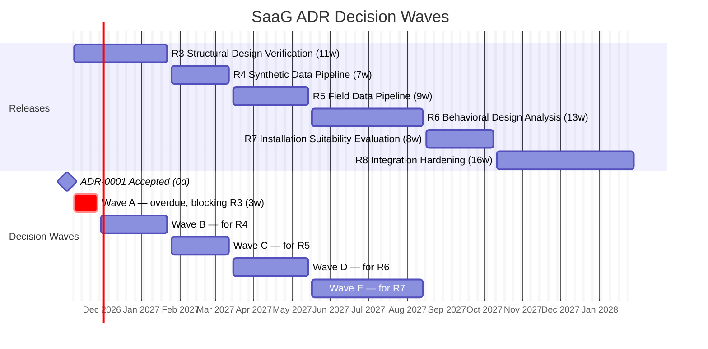

# Architecture Decision Record Roadmap (ADR Roadmap): System as a Graph (SaaG)

**Definition:** An Architecture Decision Record (ADR) is a short, versioned Markdown document that captures one architecturally significant decision: the problem it answers, the options weighed, the option chosen, and its consequences. SaaG ADRs follow the MADR format with SaaG traceability fields (see [ADR-0001](adr/0001-record-architecture-decisions.md) and the [template](adr/template.md)).

**Purpose:** This roadmap plans every ADR the CSCI needs, for both functional and non-functional requirements. For each one it states the decision question, the options to weigh, what it traces to, which deferred design points it resolves, and when it must be accepted. It is also the register of every design point the SRS and SDD defer "to the critical design phase" (§6.1); there is no separate CDR register. It also serves as the ADR index: the **Status** column is the single place that shows where each decision stands.

---

## 1. Scope and Relationship to Other Documents

| Document | Relationship to ADRs |
|---|---|
| [SRS](../requirements/SRS.md) | ADRs trace to SRS requirement IDs. The SRS has no separate non-functional chapter, so §3 below derives the quality-attribute baseline the non-functional ADRs trace to. |
| [SDD](SDD.md) | The SDD states *what* the design is. ADRs record *why*. When an ADR is accepted, the affected SDD section is updated and links back to the ADR. |
| Deferred design points | Every design point the SRS or SDD defers "to the critical design phase" is resolved by an ADR and listed in §6.1. Accepting the ADR replaces that wording in the source document with a link to the ADR. The separate CDR register (`CDR.md`) was retired on 2026-11-19 ([ADR-0001](adr/0001-record-architecture-decisions.md) step 6). |
| [SDP §5](../planning/SDP.md) | SDP §5's technology choices are treated as **candidate options**, not settled decisions. Where the implemented code (`mdg/`, `dve/`) differs from SDP §5, a *Reconcile* ADR weighs both. This resolves [BACKLOG](../planning/BACKLOG.md) finding L2. |
| [BACKLOG](../planning/BACKLOG.md) | ADR scheduling follows the BACKLOG §2 decision lane: each decision is accepted at least one release before the release that consumes it. ADR-0001 delivers story S0.2-02 (decision-log workflow). |
| [UXD](UXD.md), [STD](../test/STD.md) | UI and test-strategy decisions are recorded as ADRs (ADR-0015, ADR-0021). STD test cases cite the ADR that sets their acceptance threshold. |

**Out of scope for ADRs:** the *content* of the verification rule sets (DVE.18, 32–35, 39–45, 49). These are domain rules, not architecture. ADR-0016 decides where and how that content is kept, versioned and approved, and resolves those rule sets by reference to the approved rules catalog (§6.1, rows DP-01…DP-08).

---

## 2. Conventions

The full process is specified in [ADR-0001](adr/0001-record-architecture-decisions.md). In summary:

- **Location and naming:** `docs/design/adr/NNNN-kebab-case-title.md`. ADRs and this roadmap are written in English only.
- **Numbering:** numbers are gapless and assigned in order: a new ADR takes the next number (0022 onwards) and is added to this roadmap in the same pull request. An ADR dropped before acceptance is removed from the catalog; an accepted one is never removed, only superseded.
- **Identifiers:** ADRs and this roadmap use the canonical SRS.md IDs `MDG / SCG / FDM / ADM / SMM / DVE` ([BACKLOG Appendix A](../planning/BACKLOG.md)), never the Turkish abbreviations, which avoids the `TDM` homonym.
- **Status lifecycle:**

  | Status | Meaning |
  |---|---|
  | `Planned` | Listed in this roadmap; no file yet |
  | `Proposed` | ADR file open for review in a pull request |
  | `Accepted` | Approved by the CDR Board; immutable except for status and link updates |
  | `Rejected` | Reviewed and not adopted; the file is kept |
  | `Deprecated` | No longer applies, with no replacement |
  | `Superseded by ADR-NNNN` | Replaced by a later ADR |

- **Kind:** each planned ADR is one of three kinds:
  - **Ratify:** records a decision already implemented in `mdg/` or `dve/`, or already fixed in an approved document.
  - **Reconcile:** the implemented code and SDP §5 (or UXD) disagree. The ADR weighs both as options and picks one.
  - **Decide:** a fully open decision.

---

## 3. Quality-Attribute Baseline (Derived Non-Functional Requirements)

The SRS states non-functional needs inside functional requirements rather than in a separate chapter. The table below names them as quality attributes (QA) so that non-functional ADRs have a stable trace target. Concrete measurable targets are set by the ADRs themselves (mainly ADR-0020).

**Table 1. Quality Attributes**

| QA | Quality attribute | Derived from |
|---|---|---|
| QA-01 | Security: authentication, authorization, credential protection | DVE.3; MDG.8; SDP §5 |
| QA-02 | Concurrency and operation isolation | SMM.29–31; DVE.27; DVE.78 |
| QA-03 | Model integrity and non-destructiveness | SMM.36; DVE.17; DVE.29; DVE.51 |
| QA-04 | Traceability, provenance and auditability | MDG.1, 9, 18, 22; SCG.5–6; FDM.3; SMM.26, 35; DVE.24–25 |
| QA-05 | Input validation and error reporting | MDG.16, 19–22; SMM.3, 25, 37; FDM.5; ADM.5–6; DVE.8; SDD §1 decision 5 |
| QA-06 | Interoperability with automation clients and external sources | DVE.27, 77–78; SDD §2.3 EXT-IF-01…07 |
| QA-07 | Performance and capacity | FDM-INF.1; SMM.30; UXD §6 |
| QA-08 | Reliability of long-running operations | DVE.6–7, 14–15, 24; SDP Increment 8 |
| QA-09 | Observability and operability | SDP Increment 8 |
| QA-10 | Deployability and configuration | Offline target host without a container runtime, CPython 3.9 (ADR-0004); SDP §5 (on-premises) |
| QA-11 | Maintainability and testability | SDP §5 (Ports and Adapters, fake adapters); STD |
| QA-12 | Usability and accessibility | UXD §1, §6, §7 |

---

## 4. ADR Catalog

The catalog lists every ADR. **Decision** is the chosen option in one line for Proposed and Accepted ADRs, and the open question for Planned ones. **Resolves** lists the deferred design points the ADR settles (§6.1). **Wave** is the decision deadline (§5); a merged ADR with an open subsection shows that subsection's wave too. SRS and quality-attribute traces are in §6.2 and §6.3. All decisions assume the offline target host without a container runtime and with CPython 3.9 ([ADR-0004](adr/0004-deployment-and-repository-layout.md)), and "as built" refers to commit `1157784`.

**Table 2. ADR Catalog**

| Group | ID | Title | Decision | Kind | Resolves | Wave | Status |
|---|---|---|---|---|---|---|---|
| Foundation | [ADR-0001](adr/0001-record-architecture-decisions.md) | Record architecture decisions with MADR | MADR files in the repository, English only; ADRs and this roadmap are the only register of deferred design points | Ratify | — | — | Accepted |
| Foundation | [ADR-0002](adr/0002-canonical-component-identifiers.md) | Canonical component identifiers and vocabulary | SRS.md IDs (`MDG…DVE`) and terms everywhere, in documents and code | Ratify | — | A | Proposed |
| Foundation | [ADR-0003](adr/0003-ports-adapters-and-csc-integration.md) | Ports and Adapters, and internal CSC integration | Ports and Adapters per CSC with injected fakes; CSCs hand off persisted artifacts by reference through façade calls | Ratify | DP-24…DP-28 | A | Proposed |
| Foundation | [ADR-0004](adr/0004-deployment-and-repository-layout.md) | Deployment, layout, configuration and environments | Modular monolith installed offline from CPython 3.9 wheelhouses, one `dsm` process tree, host `.ini` overrides; retention and backup open (§5) | Ratify | — | A; §5 C | Proposed |
| Foundation | [ADR-0005](adr/0005-api-and-automation-contract.md) | Backend API and automation-client contract | Flask 2.3 + Flask-WTF with blueprints, `/api/v1/`, a hand-kept OpenAPI file and waitress; automation contract open (§3) | Ratify | DP-23 | A; §3 E | Proposed |
| Foundation | [ADR-0006](adr/0006-operation-execution-and-concurrency.md) | Operations: execution, concurrency and reliability | Spawned child process per operation, records in SQLite, optimistic revisions, per-class limits; retries open (§4) | Ratify | DP-16 | A; §4 B | Proposed |
| Foundation | [ADR-0007](adr/0007-records-store.md) | Records store: operations, findings, provenance and audit | SQLite (≥ 3.24, bundled fallback) for inventory, operations, findings, artifact lineage and an append-only audit log | Decide | DP-29b, DP-29g, DP-30b, DP-30g | A | Proposed |
| MDG and SMM | [ADR-0008](adr/0008-model-data-acquisition.md) | MDG acquisition: data sources, topology and source files | PyMySQL CMDB, `git` CLI over HTTPS, REST packages; topology from the ansible repository; static parsing with a constrained opt-in build | Ratify | DP-09, DP-10, DP-17, DP-18, DP-19, DP-20 | A | Proposed |
| MDG and SMM | [ADR-0009](adr/0009-model-data-file-and-error-records.md) | Model Data file and common error records | Versioned, schema-validated JSON file per run with hash and placeholders; one shared error-record type | Ratify | DP-29a, DP-30a | A | Proposed |
| MDG and SMM | [ADR-0010](adr/0010-system-model-graph-schema.md) | System Model graph schema | Framework-aligned typed property graph with SRS extensions and derived `DEPENDS_ON`, ported to pure Python 3.9 | Decide | DP-30d, DP-30f | A | Proposed |
| MDG and SMM | [ADR-0011](adr/0011-graph-store-and-model-instances.md) | Graph store and model instances | Native graph server (Neo4j Community 5 or FalkorDB, by spike) behind `IGraphStore`; one instance per baseline, working or candidate model | Decide | DP-29d, DP-29f | A | Proposed |
| Analysis data | [ADR-0012](adr/0012-analytical-evaluation-data.md) | Analytical Evaluation Data: format and binding | Manifest plus gzip JSON Lines data sets keyed by entity key, schema-validated; bound through a separate SQLite overlay, never written into the graph | Decide | DP-12, DP-29e, DP-30e | B (format), C (binding) | Proposed |
| Analysis data | [ADR-0013](adr/0013-simulation-and-synthetic-data.md) | Simulation semantics and synthetic data | Simulation is analytical propagation over the derived dependency view under scenario conditions; synthetic data is seeded per-window aggregates in the AED format | Decide | DP-11 | B | Proposed |
| Analysis data | [ADR-0014](adr/0014-field-records.md) | Field records: ingestion and storage | Recorder export files uploaded over HTTPS, parsed behind a port; raw and normalized files retained with hashes, catalogued in SQLite | Decide | DP-21, DP-29c, DP-30c | C | Proposed |
| DVE | [ADR-0015](adr/0015-operations-panel.md) | Operations Panel: frontend, graph view and browser support | Flask-served vanilla-JS page with vendored AntV G6 5.1.1 and server-side view scoping; Firefox 90 and WCAG 2.1 AA | Ratify | — | A | Proposed |
| DVE | [ADR-0016](adr/0016-verification-rules.md) | Verification rules: engine and catalog | Hybrid rule model (data records plus Python checks); versioned YAML catalog in `dve`, approved by pull request | Decide | DP-01…DP-08 | A | Proposed |
| DVE | [ADR-0017](adr/0017-propagation-and-drift.md) | Behavioral propagation and drift detection | Weighted reverse traversal of `DEPENDS_ON` with explicit paths; drift by entity key with a reviewed alias table | Decide | — | D | Proposed |
| DVE | [ADR-0018](adr/0018-installation-evaluation-and-reports.md) | Installation evaluation: scoring and reports | Weighted pass ratio per heading and overall, threshold class, blocking override; HTML, JSON and CSV reports rendered by `dve` | Decide | DP-13, DP-14 | E | Proposed |
| Quality | [ADR-0019](adr/0019-security.md) | Security: authentication, sessions, authorization and secrets | LDAP search-and-bind; hardened signed cookie with epoch revocation; API tokens; host secret files and encrypted credentials; authorization open (§3) | Reconcile | DP-22 | A; §3 B | Proposed |
| Quality | [ADR-0020](adr/0020-performance-and-observability.md) | Performance, capacity and observability | Budgets per operation class on a stated reference model and host; disk sizing formula; structured log files and a health endpoint | Decide | DP-15 | C | Proposed |
| Quality | [ADR-0021](adr/0021-test-strategy-and-quality-gates.md) | Test strategy and quality gates | Per-package pytest with fakes, plus contract, rule, parity, browser and offline-install gates | Ratify | — | A | Proposed |

---

## 5. Decision Schedule

Each wave closes its ADRs at least one release before the release that consumes them, following the BACKLOG §2 decision lane. As of 2026-11-03, the decisions the lane scheduled for R0–R2 are overdue, and R3 (Structural Design Verification) starts on 2026-11-09. Wave A therefore collects them, with *Ratify* ADRs first because they record decisions already made. On 2026-11-19 the Wave A ADRs were revised against commit `1157784`, and then consolidated by theme and renumbered 0001–0021.

**Table 3. Decision Waves**

| Wave | Accept by | Window | Consuming release | ADRs |
|---|---|---|---|---|
| A | 2026-11-27 | First three weeks of R3 (overdue items from the R0–R2 lane) | R3 and work already in progress | 0002–0011, 0015, 0016, 0019, 0021 |
| B | 2027-01-22 | During R3 | R4 — Synthetic Data Pipeline | 0012 (format), 0013; 0006 §4, 0019 §3 |
| C | 2027-03-12 | During R4 | R5 — Field Data Pipeline | 0012 (binding), 0014, 0020; 0004 §5 |
| D | 2027-05-14 | During R5 | R6 — Behavioral Design Analysis | 0017 |
| E | 2027-08-13 | During R6 | R7 — Installation Suitability Evaluation | 0018; 0005 §3 |
| F | 2027-10-08 | During R7 | R8 — Integration Hardening & Capacity Verification | — |

**Figure 1. ADR Decision Waves**

---

## 6. Coverage Matrices

### 6.1 Deferred Design Points → ADR

This table is the single register of every design point that the SRS and SDD defer "to the critical design phase" instead of inventing a value. It replaces the retired CDR register (`CDR.md`); row keys DP-01…DP-30 keep the old CDR item numbers so that earlier references can still be followed. A point has no status of its own: it is **resolved** when the ADR in *Resolved by* is `Accepted` (for DP-01…DP-08, when the rule family is approved in the ADR-0016 catalog), and **deferred** when that ADR is re-planned to a later wave with a recorded reason (§7). The storage-technology and entity-schema points cover the seven SDD §2.4 data stores, so they are split per store (DP-29a…g, DP-30a…g).

**Table 4. Deferred Design Points → ADR**

| Key | Deferred design point | Source | Resolved by | STD acceptance pending |
|---|---|---|---|---|
| DP-01 | Topic QoS conformance rules (Durability, Reliability, Lifespan, Transport Priority) | SRS DVE.32–35 | ADR-0016 (`qos.yaml`) | TC-DVE-09 |
| DP-02 | Communication services subject to external-to-middleware consistency verification | SRS DVE.39 | ADR-0016 (`communication.yaml`) | TC-DVE-11 |
| DP-03 | Load-balancing rules for software-unit distribution across processor/console units | SRS DVE.40 | ADR-0016 (`load_balancing.yaml`) | TC-DVE-12 |
| DP-04 | Processor core allocation conformance rules | SRS DVE.41–43 | ADR-0016 (`cpu_allocation.yaml`) | TC-DVE-12 |
| DP-05 | Operating system settings conformance rules | SRS DVE.44 | ADR-0016 (`os_settings.yaml`) | TC-DVE-12 |
| DP-06 | Runtime environment memory allocation conformance rules | SRS DVE.45 | ADR-0016 (`memory.yaml`) | TC-DVE-12 |
| DP-07 | Architectural rules for design-pattern-violation detection | SRS DVE.49 | ADR-0016 (`architecture.yaml`) | TC-DVE-13 |
| DP-08 | Conforming / non-conforming classification rules and metrics | SRS DVE.18 | ADR-0016 (`classification.yaml`) | TC-DVE-06 |
| DP-09 | Automatic network topology acquisition source and method | SRS MDG.6 | ADR-0008 | — |
| DP-10 | Mandatory source-code-repository file list | SRS MDG.19 | ADR-0008 | — |
| DP-11 | System-wide simulation processes that SCG's synthetic data feeds | SRS SCG.2 | ADR-0013 | — |
| DP-12 | Analytical Evaluation Data format and content | SRS ADM.4 | ADR-0012 | TC-ADM-03 |
| DP-13 | Exportable report file format | SRS DVE.26 | ADR-0018 | TC-DVE-06 |
| DP-14 | Installation-suitability conformance scoring method | SRS DVE.76 | ADR-0018 | TC-DVE-17 |
| DP-15 | FDM storage hardware disk capacity | SRS FDM-INF.1 | ADR-0020 | — |
| DP-16 | Concurrent user/operation count for pipeline and analysis/simulation operations | SRS SMM.30 | ADR-0006 | TC-CSM-04 |
| DP-17 | EXT-IF-01 Configuration Management Database: communication method/protocol | SDD §2.3 | ADR-0008 | — |
| DP-18 | EXT-IF-02 Source Code Repository: communication method/protocol | SDD §2.3 | ADR-0008 | — |
| DP-19 | EXT-IF-03 Software Units Package Repository: communication method/protocol | SDD §2.3 | ADR-0008 | — |
| DP-20 | EXT-IF-04 Network Topology Data Source: communication method/protocol (distinct from DP-09's automatic-vs-manual choice) | SDD §2.3 | ADR-0008 | — |
| DP-21 | EXT-IF-05 System Field Data Recording Mechanism: communication method/protocol | SDD §2.3 | ADR-0014 | — |
| DP-22 | EXT-IF-06 LDAP Directory Service: communication method/protocol | SDD §2.3 | ADR-0019 | — |
| DP-23 | EXT-IF-07 Build Automation Tools / CLI: communication method/protocol and machine-processable result format | SDD §2.3; SRS DVE.78 | ADR-0005 | — |
| DP-24 | INT-IF-01 MDG → SMM handoff: communication method/protocol | SDD §2.3 | ADR-0003 | — |
| DP-25 | INT-IF-02 SCG → ADM handoff: communication method/protocol | SDD §2.3 | ADR-0003 | — |
| DP-26 | INT-IF-03 FDM → ADM handoff: communication method/protocol | SDD §2.3 | ADR-0003 | — |
| DP-27 | INT-IF-04 ADM → SMM handoff: communication method/protocol | SDD §2.3 | ADR-0003 | — |
| DP-28 | INT-IF-05 SMM → DVE access: communication method/protocol | SDD §2.3 | ADR-0003 | — |
| DP-29a | Physical storage technology: Model Data file | SDD §2.4 | ADR-0009 | — |
| DP-29b | Physical storage technology: Software Unit Version Inventory | SDD §2.4 | ADR-0007 | — |
| DP-29c | Physical storage technology: Field Records Database | SDD §2.4 | ADR-0014 | — |
| DP-29d | Physical storage technology: System Model | SDD §2.4 | ADR-0011 | — |
| DP-29e | Physical storage technology: Analytical Evaluation Data | SDD §2.4 | ADR-0012 | — |
| DP-29f | Physical storage technology: Working Model | SDD §2.4 | ADR-0011 | — |
| DP-29g | Physical storage technology: Findings, Operations & Reports | SDD §2.4 | ADR-0007 | — |
| DP-30a | Entity schema and attributes: Model Data file | SDD §2.4 | ADR-0009 | — |
| DP-30b | Entity schema and attributes: Software Unit Version Inventory | SDD §2.4 | ADR-0007 | — |
| DP-30c | Entity schema and attributes: Field Records Database | SDD §2.4 | ADR-0014 | — |
| DP-30d | Entity schema and attributes: System Model | SDD §2.4 | ADR-0010 | — |
| DP-30e | Entity schema and attributes: Analytical Evaluation Data | SDD §2.4 | ADR-0012 | — |
| DP-30f | Entity schema and attributes: Working Model | SDD §2.4 | ADR-0010 (same schema as the System Model, per ADR-0011) | — |
| DP-30g | Entity schema and attributes: Findings, Operations & Reports | SDD §2.4 | ADR-0007 | — |

**Impact if left unresolved:**

- DP-01…DP-08 block SDD §3.6.2 (Design Verifier and Findings & Reporting Manager) from being fully specified.
- STD test cases listed in the last column state only the mechanically verifiable behavior until their point is resolved, and cannot state a concrete pass/fail threshold.
- DP-17…DP-28 block finalizing SDD §2.3 and integration testing across the 12 interfaces.
- DP-29 and DP-30 block finalizing the SDD §2.4 physical schema and performance/capacity testing.

### 6.2 SRS Requirements → ADR

Every SRS requirement block is governed by at least one ADR.

**Table 5. SRS → ADR**

| SRS requirements | Governing ADRs |
|---|---|
| MDG.1 | 0007, 0009 |
| MDG.2–8 | 0008, 0019 |
| MDG.9–13 | 0007, 0008 |
| MDG.14–15 | 0009, 0011 |
| MDG.16 | 0009 |
| MDG.17–20 | 0008, 0009 |
| MDG.21–23 | 0003, 0009 |
| SCG.1–4 | 0012, 0013 |
| SCG.5–7 | 0003, 0007, 0012 |
| FDM.1–5 | 0004, 0014 |
| FDM-INF.1 | 0020 |
| ADM.1–6 | 0003, 0009, 0012 |
| SMM.1–5 | 0009, 0010, 0011 |
| SMM.6–24 | 0010 |
| SMM.25–26 | 0007, 0009 |
| SMM.27–28 | 0003, 0011 |
| SMM.29–31 | 0006, 0011 |
| SMM.32–37 | 0012 |
| DVE.1–2 | 0005, 0015 |
| DVE.3–4 | 0019 |
| DVE.5–9 | 0006, 0015 |
| DVE.10–16 | 0006, 0012, 0015 |
| DVE.17 | 0011, 0015 |
| DVE.18 | 0016 |
| DVE.19–20 | 0015 |
| DVE.21–25 | 0007 |
| DVE.26 | 0018 |
| DVE.27 | 0005, 0006 |
| DVE.28–30 | 0011, 0016 |
| DVE.31–49 | 0016 |
| DVE.50–58 | 0010, 0011, 0013, 0017 |
| DVE.59–65, 69–70 | 0014, 0017 |
| DVE.66–68 | 0017 |
| DVE.71–77 | 0018 |
| DVE.78 | 0005, 0006 |

### 6.3 Quality Attributes → ADR

**Table 6. QA → ADR**

| QA | Governing ADRs |
|---|---|
| QA-01 Security | 0019 |
| QA-02 Concurrency and isolation | 0006, 0011 |
| QA-03 Model integrity | 0004, 0010, 0011, 0012 |
| QA-04 Traceability and provenance | 0007 |
| QA-05 Validation and error reporting | 0008, 0009 |
| QA-06 Interoperability | 0005, 0008 |
| QA-07 Performance and capacity | 0010, 0011, 0014, 0015, 0020 |
| QA-08 Reliability | 0006 |
| QA-09 Observability | 0020 |
| QA-10 Deployability and configuration | 0004 |
| QA-11 Maintainability and testability | 0003, 0011, 0016, 0021 |
| QA-12 Usability and accessibility | 0015 |

---

## 7. Maintaining This Roadmap

1. The pull request that adds or changes an ADR also updates its **Status** cell here.
2. When an ADR is accepted, the same pull request replaces the "to be determined during the critical design phase" wording for each point it resolves (§6.1) in the SRS or SDD with a link to the ADR. A point found during design that is not in §6.1 is added there, with the ADR that will resolve it, in the same pull request that opens that ADR.
3. Each release DoD includes a roadmap check: every ADR in the wave due at that release is `Accepted` or `Rejected`, or it is re-planned to a later wave with a reason.
4. A decision that emerges during implementation and is not listed here gets the next free number and is added to the matching table in §4.
