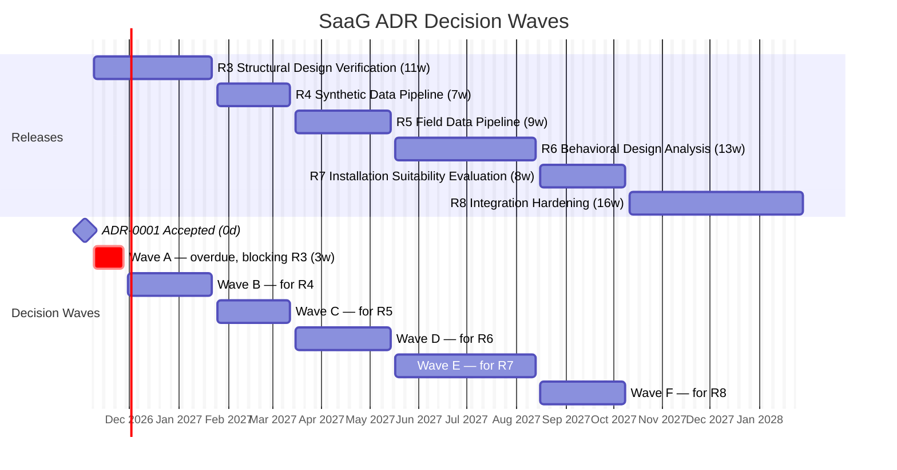

# Architecture Decision Record Roadmap (ADR Roadmap): System as a Graph (SaaG)

**Definition:** An Architecture Decision Record (ADR) is a short, versioned Markdown document that captures one architecturally significant decision: the problem it answers, the options weighed, the option chosen, and its consequences. SaaG ADRs follow the MADR format with SaaG traceability fields (see [ADR-0001](adr/0001-record-architecture-decisions.md) and the [template](adr/template.md)).

**Purpose:** This roadmap plans every ADR the CSCI needs, for both functional and non-functional requirements. For each one it states the decision question, the options to weigh, what it traces to, which CDR items it closes, and when it must be accepted. It also serves as the ADR index: the **Status** column is the single place that shows where each decision stands.

---

## 1. Scope and Relationship to Other Documents

| Document | Relationship to ADRs |
|---|---|
| [SRS](../requirements/SRS.md) | ADRs trace to SRS requirement IDs. The SRS has no separate non-functional chapter, so §3 below derives the quality-attribute baseline the non-functional ADRs trace to. |
| [SDD](SDD.md) | The SDD states *what* the design is. ADRs record *why*. When an ADR is accepted, the affected SDD section is updated and links back to the ADR. |
| [CDR](CDR.md) | Every CDR-01…30 open item is closed by an ADR (§6.1). Accepting the ADR sets the CDR item to `Resolved` and replaces the "to be determined during the critical design phase" wording in the source document. |
| [SDP §5](../planning/SDP.md) | SDP §5's technology choices are treated as **candidate options**, not settled decisions. Where the implemented code (`mdg/`, `dve/`) differs from SDP §5, a *Reconcile* ADR weighs both. This resolves [BACKLOG](../planning/BACKLOG.md) finding L2. |
| [BACKLOG](../planning/BACKLOG.md) | ADR scheduling follows the BACKLOG §2 decision lane: each decision is accepted at least one release before the release that consumes it. ADR-0001 delivers story S0.2-02 (decision-log workflow). |
| [UXD](UXD.md), [STD](../test/STD.md) | UI and test-strategy decisions are recorded as ADRs (ADR-0004, 0020, 0036, 0037). STD test cases cite the ADR that sets their acceptance threshold. |

**Out of scope for ADRs:** the *content* of the verification rule sets (CDR-01…08). These are domain rules, not architecture. ADR-0018 decides where and how that content is kept, versioned and approved, and closes CDR-01…08 by reference to the approved rules catalog.

---

## 2. Conventions

The full process is specified in [ADR-0001](adr/0001-record-architecture-decisions.md). In summary:

- **Location and naming:** `docs/design/adr/NNNN-kebab-case-title.md`, from [template.md](adr/template.md). ADRs are written in English only and are not translated.
- **Numbering:** this roadmap reserves the numbers. A number is never reused once its ADR is `Accepted`. While a draft is unaccepted this roadmap may compact the list and reissue its number, as it did on 2026-11-13 when three drafts merged into ADR-0003 and four more were merged or withdrawn into ADR-0004. A dropped ADR keeps its number with status `Withdrawn` unless the list is compacted. A new ADR not listed here takes the next free number and is added to this roadmap in the same pull request.
- **Identifiers:** the canonical SRS.md IDs `MDG / SCG / FDM / ADM / SMM / DVE` ([BACKLOG Appendix A](../planning/BACKLOG.md)). The per-document abbreviations retired by [ADR-0002](adr/0002-canonical-component-identifiers.md) (`MSG`, `TDM`, `CSM` and the Turkish set) are not used, which avoids the `TDM` homonym.
- **Status lifecycle:**

  | Status | Meaning |
  |---|---|
  | `Planned` | Listed in this roadmap; no file yet |
  | `Proposed` | ADR file open for review in a pull request |
  | `Accepted` | Approved by the CDR Board; immutable except for status and link updates |
  | `Rejected` | Reviewed and not adopted; the file is kept |
  | `Deprecated` | No longer applies, with no replacement |
  | `Superseded by ADR-NNNN` | Replaced by a later ADR |
  | `Withdrawn` | Removed from the roadmap before being proposed |

- **Kind:** each planned ADR is one of three kinds:
  - **Ratify:** records a decision already implemented in `mdg/` or `dve/`, or already fixed in an approved document.
  - **Reconcile:** the implemented code and SDP §5 (or UXD) disagree. The ADR weighs both as options and picks one.
  - **Decide:** a fully open decision.

---

## 3. Quality-Attribute Baseline (Derived Non-Functional Requirements)

The SRS states non-functional needs inside functional requirements rather than in a separate chapter. The table below names them as quality attributes (QA) so that non-functional ADRs have a stable trace target. Concrete measurable targets are set by the ADRs themselves (mainly ADR-0031).

**Table 1. Quality Attributes**

| QA | Quality attribute | Derived from |
|---|---|---|
| QA-01 | Security: authentication, authorization, credential protection | DVE.3; MDG.8; SDP §5 |
| QA-02 | Concurrency and operation isolation | SMM.29–31; DVE.27; DVE.78; CDR-16 |
| QA-03 | Model integrity and non-destructiveness | SMM.36; DVE.17; DVE.29; DVE.51 |
| QA-04 | Traceability, provenance and auditability | MDG.1, 9, 18, 22; SCG.5–6; FDM.3; SMM.26, 35; DVE.24–25 |
| QA-05 | Input validation and error reporting | MDG.16, 19–22; SMM.3, 25, 37; FDM.5; ADM.5–6; DVE.8; SDD §1 decision 5 |
| QA-06 | Interoperability with automation clients and external sources | DVE.27, 77–78; SDD §2.3 EXT-IF-01…07 |
| QA-07 | Performance and capacity | FDM-INF.1; UXD §6; CDR-15; CDR-16 |
| QA-08 | Reliability of long-running operations | DVE.6–7, 14–15, 24; SDP Increment 8 |
| QA-09 | Observability and operability | SDP Increment 8 |
| QA-10 | Deployability and configuration | SDP §5 (on-premises, Docker Compose) |
| QA-11 | Maintainability and testability | SDP §5 (Ports and Adapters, fake adapters); STD |
| QA-12 | Usability and accessibility | UXD §1, §6, §7 |

---

## 4. ADR Catalog

Column key: **Wave** is the decision deadline (see §5). **Closes** lists the CDR items the ADR resolves. "as built" refers to the current `mdg/` and `dve/` code; "SDP" refers to SDP §5 Table 6.

### 4.1 Foundation and Cross-Cutting Decisions

**Table 2. Foundation ADRs**

| ID | Title | Decision question | Options to weigh | Kind | Traces | Closes | Wave | Status |
|---|---|---|---|---|---|---|---|---|
| [ADR-0001](adr/0001-record-architecture-decisions.md) | Record architecture decisions with MADR | How are design decisions recorded, reviewed and linked to the CDR? | MADR in repo; Nygard in repo; CDR register only; wiki | Ratify | BACKLOG S0.2-02, L2 | — | — | Accepted |
| [ADR-0002](adr/0002-canonical-component-identifiers.md) | Canonical component identifiers and domain vocabulary | Which IDs and terms are used across all documents and code? | SRS.md IDs (`MDG…DVE`) and terms ("Model Data", "System Model"); keep per-document names | Ratify | BACKLOG T1, T2, Appendix A | — | A | Proposed |
| [ADR-0003](adr/0003-code-architecture-per-csc.md) | Decompose the CSCI into one package per CSC with façade handoffs | How is the CSCI decomposed into code, and how do CSCs hand data to each other? | One package per CSC + Ports and Adapters + in-process façade handoffs over persisted artifacts (as built); service per CSC; layered packages with file-drop; SDP §4 layout | Reconcile | QA-10, QA-11; MDG.23; SCG.7; FDM.4; ADM.2–4; SMM.2, 27–28, 33; DVE.27; BACKLOG T3; SDP §4, §5 | CDR-24, 25, 26, 27, 28 | A | Proposed |
| [ADR-0004](adr/0004-operations-panel-runtime-stack.md) | Operations Panel runtime stack: web framework, task execution, persistence and front end | Which framework serves the API, how do long-running operations run and report, where are records persisted, and how is the Operations Panel built? | Flask 2.3 + Flask-WTF (as built) vs FastAPI (SDP §5); multiprocessing with an in-memory task log (as built) vs Celery + Redis vs Procrastinate (SDP §5); files + memory (as built) vs PostgreSQL (SDP §5); Jinja + hand-written JS + vendored G6 (as built) vs Vite React SPA vs Next.js + Refine (SDP §5, UXD) | Reconcile | DVE.1–27, 78; MDG.8, 14–15; SMM.26, 30; QA-02, 04, 06, 07, 08, 11, 12 | — | A | Proposed |

### 4.2 Functional Decisions (by CSC)

**Table 3. Functional ADRs**

| ID | Title | Decision question | Options to weigh | Kind | Traces | Closes | Wave | Status |
|---|---|---|---|---|---|---|---|---|
| [ADR-0005](adr/0005-external-data-source-adapters.md) | External data-source adapters and connection configuration | Which protocol and client does each external source use, and how is per-source configuration modelled? | CMDB via PyMySQL (as built) vs generic SQLAlchemy (SDP); Git over HTTPS with token; package repository REST API | Reconcile | MDG.2–4, 8, 10–13; QA-06 | CDR-17, 18, 19 | A | Proposed |
| [ADR-0006](adr/0006-network-topology-acquisition.md) | Network topology acquisition | Where does topology data come from automatically, in what format, and how does manual entry coexist with it? | Topology file in the system repository; database/CMDB query; network-management export; manual entry only | Decide | MDG.5–7 | CDR-09, 20 | A | Proposed |
| [ADR-0007](adr/0007-source-repository-acquisition.md) | Source-repository acquisition and mandatory file set | Which files are mandatory per software unit, and is model data extracted by parsing or by running the build? | Static parsing (as built); optional host `gmake regenerate_code` step (as built, off by default); always build; isolated container build | Ratify | MDG.17–21; QA-05 | CDR-10 | A | Proposed |
| [ADR-0008](adr/0008-model-data-file-format.md) | Model Data file format and versioning | What is the Model Data file's format, schema version and storage location? | JSON on the filesystem keyed by project/platform/version/run (as built); stored in the relational store; graph-native import format | Ratify | MDG.1, 14–15, 23; SMM.2–3, 26 | CDR-29 (part), CDR-30 (part) | A | Proposed |
| [ADR-0009](adr/0009-system-model-graph-schema.md) | System Model graph schema | How are the node and relationship types, identity keys, attributes and project/platform/version scoping modelled? | Labeled property graph with typed nodes/edges; generic node + type attribute; per-version graphs vs version properties | Decide | SMM.4–24; QA-03 | CDR-30 (part) | A | Proposed |
| [ADR-0010](adr/0010-graph-storage-technology.md) | Graph storage technology | Which engine stores and queries the System Model? | FalkorDB (SDP); Neo4j; in-process NetworkX with serialization; PostgreSQL + Apache AGE | Decide | SMM.1, 4, 27–29; DVE.28–49; QA-02, QA-07 | CDR-29 (part) | A | Proposed |
| [ADR-0011](adr/0011-model-instances.md) | Model instances: baseline, working and candidate-evaluation models | How are working models (what-if edits) and candidate-evaluation models isolated from the baseline System Model? | Full copy per instance; copy-on-write delta overlay; separate named graph per instance | Decide | SMM.29–31; DVE.17, 29, 51; MDG.15; QA-02, QA-03 | CDR-29 (part) | A | Proposed |
| ADR-0012 | Analytical data binding and layer separation | How is Analytical Evaluation Data attached to nodes and relationships while staying separable, with its provenance kept? | Overlay properties in the graph; separate overlay store joined by entity key; time-series store referenced by entity key | Decide | SMM.32–37; DVE.16; QA-03, QA-04 | CDR-29 (part), CDR-30 (part) | C | Planned |
| ADR-0013 | Simulation semantics and synthetic data generation | What does "simulation" mean in SaaG, and how is synthetic data generated reproducibly? | Analytical propagation over the graph; discrete-event simulation; statistical trace synthesis; seeded generators | Decide | SCG.1–4; DVE.53–58 | CDR-11 | B | Planned |
| ADR-0014 | Analytical Evaluation Data format | What are the content, schema and versioning of Analytical Evaluation Data and of synthetic data handed to ADM? | Columnar file (e.g. Parquet); JSON Lines; database tables; time-series records | Decide | ADM.1, 3–4, 6; SCG.4–7; QA-04 | CDR-12, CDR-30 (part) | B | Planned |
| ADR-0015 | Field record upload and ingestion | How are field records uploaded and validated, and are raw uploads retained? | Browser upload; drop folder; API push from the recording mechanism; discard raw after parsing (SDP) vs retain | Decide | FDM.2–3, 5; ADM.2, 5; QA-05 | CDR-21 | C | Planned |
| ADR-0016 | Field-record and telemetry storage | Where are System Field Records and telemetry stored and queried? | VictoriaMetrics (SDP); PostgreSQL / TimescaleDB; files catalogued in the relational store | Decide | FDM.1, 4; DVE.59–65, 69–70; QA-07 | CDR-29 (part), CDR-30 (part) | C | Planned |
| [ADR-0017](adr/0017-verification-rule-engine.md) | Verification rule engine and rule model | How are verification rules represented and executed against the System Model? | Rules as data (declarative, graph queries); rules as Python plug-ins; hybrid; fields: ID, heading, severity, weight, acceptance criterion, blocking | Decide | DVE.18, 28–49, 76; QA-11 | — | A | Proposed |
| [ADR-0018](adr/0018-verification-rule-set-catalog.md) | Verification rule-set catalog and governance | Where is rule content kept, who approves it, and how is it versioned and tested? | Versioned rules catalog in repo approved by the CDR Board; rules in database editable at runtime; per-project rule profiles | Decide | DVE.18, 32–49, 76 | CDR-01…08 | A | Proposed |
| [ADR-0019](adr/0019-findings-and-operation-records.md) | Findings and operation record model | What are the structure of a finding, the severity scale, cause-and-effect links and operation identifiers? | Flat findings with severity enum; findings graph with causal edges; operation/finding schema in relational store | Decide | DVE.18, 21–25; QA-04 | CDR-30 (part) | A | Proposed |
| [ADR-0020](adr/0020-graph-visualization.md) | Graph visualization and large-model rendering | Which library renders the node-relationship graph, and how are large models kept responsive? | React Flow (SDP, UXD); Cytoscape.js; Sigma.js / WebGL; level-of-detail and server-side filtering | Decide | DVE.17, 19–20; QA-07, QA-12 | — | A | Proposed |
| ADR-0021 | Behavioral propagation and drift-detection algorithms | How are effect propagation and architectural drift computed? | Graph traversal with propagation weights; dependency-matrix analysis; entity matching by name/ID/fingerprint for drift | Decide | DVE.53–58, 66–68 | — | D | Planned |
| ADR-0022 | Installation suitability scoring and blocking decision | How are rule results scored, classified and turned into an install / block decision? | Weighted sum with class thresholds; per-heading minimums; blocking override (DVE.77) | Decide | DVE.71–77 | CDR-14 | E | Planned |
| ADR-0023 | Automation-client contract | What do the API, CLI, result schema and exit codes look like for CI pipelines? | REST + CLI wrapper (SDP); CLI-only; result as JSON schema; exit codes per decision | Decide | DVE.27, 77–78; QA-06 | CDR-23 | E | Planned |
| ADR-0024 | Report generation and export formats | Which report formats are produced, and how? | PDF via WeasyPrint/ReportLab + JSON (SDP); HTML; CSV for findings | Decide | DVE.26 | CDR-13 | E | Planned |

### 4.3 Non-Functional Decisions (by Quality Attribute)

**Table 4. Non-Functional ADRs**

| ID | Title | Decision question | Options to weigh | Kind | Traces | Closes | Wave | Status |
|---|---|---|---|---|---|---|---|---|
| [ADR-0025](adr/0025-authentication-and-sessions.md) | Authentication and session management | How do users and automation clients authenticate, and how are sessions held? | LDAP bind (SDP; as built: mock); Flask signed-cookie session (as built) vs stateless JWT (SDP) vs server-side session; service accounts or API tokens for CLI | Reconcile | DVE.3, 27; QA-01 | CDR-22 | A | Proposed |
| ADR-0026 | Authorization model | How are "authorizations" defined and enforced per operation? | Roles mapped from LDAP groups; per-project permissions; single role | Decide | DVE.3; QA-01 | — | B | Planned |
| [ADR-0027](adr/0027-secrets-and-credentials.md) | Secrets and data-source credential protection | How are data-source credentials and application secrets stored and protected? | Per-session in-memory (as built); `.env` (SDP); encrypted at rest in the relational store; external vault | Reconcile | MDG.8; DVE.3; QA-01 | — | A | Proposed |
| [ADR-0028](adr/0028-concurrency-control.md) | Concurrency control and operation limits | How is model consistency kept under concurrent sessions and operations, and what are the concurrency limits? | Read-only shared baseline + isolated instances; optimistic versioning; locks; worker-pool size and queue limits | Decide | SMM.29–30; DVE.27, 78; QA-02 | CDR-16 | A | Proposed |
| [ADR-0029](adr/0029-validation-and-error-records.md) | Common validation and error-record pattern | How does every acquisition path validate input and record errors consistently? | Shared error-record type and status set (as built, SDD §1 decision 5); per-CSC error models | Ratify | MDG.16, 19–22; SMM.3, 25, 37; FDM.5; ADM.5–6; DVE.8, 24; QA-05 | — | A | Proposed |
| [ADR-0030](adr/0030-traceability-and-provenance.md) | Traceability, provenance and audit trail | How are inputs, outputs, users and times recorded so every result is reproducible? | Immutable operation records with input hashes; event log; provenance fields per store keyed by project/platform/version | Decide | MDG.1, 9, 18; SCG.5–6; FDM.3; SMM.26, 35; DVE.25; QA-04 | — | A | Proposed |
| ADR-0031 | Performance and capacity budgets | What are the target model sizes, response times, throughput and storage sizing? | Budgets per operation class; UXD §6 UI budget; FDM disk sizing from record volume × retention | Decide | FDM-INF.1; QA-07 | CDR-15 | C | Planned |
| ADR-0032 | Reliability of long-running operations | How are retries, idempotency, interruption recording and data-source health handled? | Task retries with idempotency keys; checkpoint/resume; fail-fast with recorded stage; periodic source health checks | Decide | DVE.6–7, 14–15, 24; QA-08 | — | B | Planned |
| ADR-0033 | Observability | What logs, metrics and health checks are produced, and where are they collected? | Structured logs + Prometheus-style metrics; VictoriaMetrics (shared with ADR-0016); log files only | Decide | QA-09; SDP Increment 8 | — | F | Planned |
| ADR-0034 | Deployment, configuration and environments | How is the CSCI deployed and configured across development, test and production? | Docker Compose on-premises (SDP); `.ini` files (as built) vs environment variables (SDP); dev mock stack (`dev/compose.yaml`) | Reconcile | QA-10 | — | B | Planned |
| ADR-0035 | Data retention, backup and recovery | How long are models, records, findings and reports retained, and how are they backed up and restored? | Retention per store; scheduled backups; restore drills | Decide | FDM.1–2; QA-03, QA-10 | — | C | Planned |
| ADR-0036 | Test strategy and quality gates | Which test levels and CI gates apply, and how are adapters and rules tested? | pytest with fake adapters (as built); adapter contract tests; rule regression fixtures; Playwright E2E (SDP) | Ratify | QA-11; STD | — | B | Planned |
| ADR-0037 | Browser support and accessibility baseline | Which browsers and accessibility level must the Operations Panel support? | Firefox 90+ floor and WCAG AA (UXD); evergreen-only | Ratify | QA-12; UXD §6–7 | — | B | Planned |

---

## 5. Decision Schedule

Each wave closes its ADRs at least one release before the release that consumes them, following the BACKLOG §2 decision lane. As of 2026-11-03, the decisions the lane scheduled for R0–R2 are overdue, and R3 (Structural Design Verification) starts on 2026-11-09. Wave A therefore collects them, with *Ratify* ADRs first because they record decisions already made.

**Table 5. Decision Waves**

| Wave | Accept by | Window | Consuming release | ADRs |
|---|---|---|---|---|
| A | 2026-11-27 | First three weeks of R3 (overdue items from the R0–R2 lane) | R3 and work already in progress | 0002–0011, 0017–0020, 0025, 0027–0030 |
| B | 2027-01-22 | During R3 | R4 — Synthetic Data Pipeline | 0013, 0014, 0026, 0032, 0034, 0036, 0037 |
| C | 2027-03-12 | During R4 | R5 — Field Data Pipeline | 0012, 0015, 0016, 0031, 0035 |
| D | 2027-05-14 | During R5 | R6 — Behavioral Design Analysis | 0021 |
| E | 2027-08-13 | During R6 | R7 — Installation Suitability Evaluation | 0022, 0023, 0024 |
| F | 2027-10-08 | During R7 | R8 — Integration Hardening & Capacity Verification | 0033 |

**Figure 1. ADR Decision Waves**

---

## 6. Coverage Matrices

### 6.1 CDR Open Items → ADR

All 30 CDR items are closed by an ADR, except the relational-store part of CDR-29: no relational store is decided, and [ADR-0004](adr/0004-operations-panel-runtime-stack.md) records what a future store must satisfy instead. CDR-29 (storage technology per store) and CDR-30 (schemas per store) cover all seven SDD §2.4 data stores, so several ADRs each close part of them. Each of the two items is `Resolved` when its last contributing ADR is accepted. Splitting CDR-29 and CDR-30 into one sub-item per store in CDR.md is recommended.

**Table 6. CDR → ADR**

| CDR | Item (short) | Closed by |
|---|---|---|
| CDR-01 | Topic QoS conformance rules | ADR-0018 |
| CDR-02 | External-to-middleware communication services in scope | ADR-0018 |
| CDR-03 | Load-balancing rules | ADR-0018 |
| CDR-04 | Processor core allocation rules | ADR-0018 |
| CDR-05 | Operating system settings rules | ADR-0018 |
| CDR-06 | Runtime memory allocation rules | ADR-0018 |
| CDR-07 | Architectural rules for design-pattern violations | ADR-0018 |
| CDR-08 | Conforming / non-conforming classification rules | ADR-0018 |
| CDR-09 | Automatic network topology acquisition | ADR-0006 |
| CDR-10 | Mandatory source-repository file list | ADR-0007 |
| CDR-11 | Simulation process definition | ADR-0013 |
| CDR-12 | Analytical Evaluation Data format | ADR-0014 |
| CDR-13 | Report export format | ADR-0024 |
| CDR-14 | Installation suitability scoring method | ADR-0022 |
| CDR-15 | FDM storage disk capacity | ADR-0031 |
| CDR-16 | Concurrent user/operation count | ADR-0028 |
| CDR-17 | EXT-IF-01 Configuration Management Database protocol | ADR-0005 |
| CDR-18 | EXT-IF-02 Source Code Repository protocol | ADR-0005 |
| CDR-19 | EXT-IF-03 Package Repository protocol | ADR-0005 |
| CDR-20 | EXT-IF-04 Network Topology Data Source protocol | ADR-0006 |
| CDR-21 | EXT-IF-05 Field Data Recording Mechanism protocol | ADR-0015 |
| CDR-22 | EXT-IF-06 LDAP Directory Service protocol | ADR-0025 |
| CDR-23 | EXT-IF-07 Build Automation / CLI protocol and result format | ADR-0023 |
| CDR-24 | INT-IF-01 MDG → SMM handoff | ADR-0003 |
| CDR-25 | INT-IF-02 SCG → ADM handoff | ADR-0003 |
| CDR-26 | INT-IF-03 FDM → ADM handoff | ADR-0003 |
| CDR-27 | INT-IF-04 ADM → SMM handoff | ADR-0003 |
| CDR-28 | INT-IF-05 SMM → DVE access | ADR-0003 |
| CDR-29 | Physical storage technology per data store | ADR-0008, 0010, 0011, 0012, 0016 |
| CDR-30 | Entity schemas per data store | ADR-0008, 0009, 0012, 0014, 0016, 0019 |

### 6.2 SRS Requirements → ADR

Every SRS requirement block is governed by at least one ADR.

**Table 7. SRS → ADR**

| SRS requirements | Governing ADRs |
|---|---|
| MDG.1 | 0008, 0030 |
| MDG.2–8 | 0005, 0006, 0027 |
| MDG.9–13 | 0005, 0030 |
| MDG.14–15 | 0008, 0011 |
| MDG.16 | 0029 |
| MDG.17–20 | 0007, 0029 |
| MDG.21–23 | 0003, 0008, 0029 |
| SCG.1–4 | 0013, 0014 |
| SCG.5–7 | 0003, 0014, 0030 |
| FDM.1–5 | 0015, 0016, 0035 |
| FDM-INF.1 | 0031 |
| ADM.1–6 | 0003, 0014, 0029 |
| SMM.1–5 | 0008, 0009, 0010 |
| SMM.6–24 | 0009 |
| SMM.25–26 | 0029, 0030 |
| SMM.27–28 | 0003, 0010 |
| SMM.29–31 | 0011, 0028 |
| SMM.32–37 | 0012 |
| DVE.1–2 | 0004 |
| DVE.3–4 | 0025, 0026 |
| DVE.5–9 | 0004, 0032 |
| DVE.10–16 | 0004, 0012 |
| DVE.17 | 0011, 0020 |
| DVE.18 | 0017, 0018 |
| DVE.19–20 | 0020 |
| DVE.21–25 | 0019, 0030 |
| DVE.26 | 0024 |
| DVE.27 | 0004, 0023, 0028 |
| DVE.28–30 | 0011, 0017 |
| DVE.31–49 | 0017, 0018 |
| DVE.50–58 | 0013, 0021 |
| DVE.59–65, 69–70 | 0016, 0021 |
| DVE.66–68 | 0021 |
| DVE.71–77 | 0022 |
| DVE.78 | 0023, 0028 |

### 6.3 Quality Attributes → ADR

**Table 8. QA → ADR**

| QA | Governing ADRs |
|---|---|
| QA-01 Security | 0025, 0026, 0027 |
| QA-02 Concurrency and isolation | 0004, 0011, 0028 |
| QA-03 Model integrity | 0009, 0011, 0012, 0035 |
| QA-04 Traceability and provenance | 0019, 0030 |
| QA-05 Validation and error reporting | 0007, 0029 |
| QA-06 Interoperability | 0004, 0005, 0023 |
| QA-07 Performance and capacity | 0010, 0016, 0020, 0031 |
| QA-08 Reliability | 0004, 0032 |
| QA-09 Observability | 0033 |
| QA-10 Deployability and configuration | 0003, 0034, 0035 |
| QA-11 Maintainability and testability | 0003, 0017, 0036 |
| QA-12 Usability and accessibility | 0004, 0020, 0037 |

---

## 7. Maintaining This Roadmap

1. The pull request that adds or changes an ADR also updates its **Status** cell here.
2. When an ADR is accepted, the same pull request sets the CDR items it closes to `Resolved` with a link to the ADR. It also updates the affected SRS/SDD wording.
3. Each release DoD includes a roadmap check: every ADR in the wave due at that release is `Accepted`, `Rejected` or `Withdrawn`, or it is re-planned to a later wave with a reason.
4. A decision that emerges during implementation and is not listed here gets the next free number and is added to the matching table in §4.
