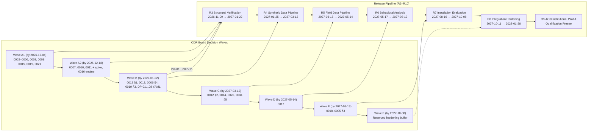

# Architecture Decision Record Roadmap (ADR Roadmap): System as a Graph (SaaG)

**Definition:** An Architecture Decision Record (ADR) is a short, versioned Markdown document that captures one architecturally significant decision: the problem it answers, the options weighed, the option chosen, and its consequences. SaaG ADRs follow the MADR format with SaaG traceability fields (see [ADR-0001](adr/0001-record-architecture-decisions.md) and the [template](adr/template.md)).

**Purpose:** This roadmap governs every ADR the CSCI needs, across both functional and non-functional requirements. For each ADR it states the chosen option (or open decision question if `Planned`), its classification (`Kind`), which deferred design points it resolves, and the decision wave by which it must be accepted; weighed options and trade-offs live in the individual MADR files. It is also the sole register of every design point the SRS and SDD defer "to the critical design phase" (§6.1); there is no separate CDR register. Finally, it serves as the ADR index: the **Status** column is the single place that shows where each decision stands.

---

## 1. Scope and Relationship to Other Documents

| Document | Relationship to ADRs |
|---|---|
| [SRS](../requirements/SRS.md) | ADRs trace to SRS requirement IDs. The SRS has no separate non-functional chapter, so §3 below derives the quality-attribute baseline the non-functional ADRs trace to. |
| [SDD](SDD.md) | The SDD states *what* the design is. ADRs record *why*. When an ADR (or its deferred subsection) is accepted, the affected SDD section is updated and links back to the ADR. |
| Deferred design points | Every design point the SRS or SDD defers "to the critical design phase" is resolved by an ADR (or a named subsection, spike, or rule family within one) and listed in §6.1. Accepting that decision item replaces the deferred wording in the source document with a link to the ADR. The separate CDR register (`CDR.md`) was retired on 2026-11-19 ([ADR-0001](adr/0001-record-architecture-decisions.md) step 6). |
| [SDP §5](../planning/SDP.md) | Prior SDP §5 technology choices were treated as **candidate options**, not settled decisions, resolving [BACKLOG](../planning/BACKLOG.md) finding L2. SDP §5 has been aligned in draft with the `Proposed` catalog on this branch, while each ADR becomes normative upon `Accepted` status ([ADR-0001](adr/0001-record-architecture-decisions.md) step 7). |
| [BACKLOG](../planning/BACKLOG.md) | ADR scheduling follows the BACKLOG §2 decision lane: each decision is accepted at least one release before the release that consumes it. ADR-0001 delivers story S0.2-02 (decision-log workflow). |
| [UXD](UXD.md), [STD](../test/STD.md) | UI and test-strategy decisions are recorded as ADRs (ADR-0015, ADR-0021). STD test cases cite the ADR that sets their acceptance threshold. |

**Out of scope for ADRs:** the *content* of the verification rule sets (DVE.18, 32–35, 39–45, 49). These are domain rules, not architecture. ADR-0016 decides the engine and rule catalog workflow (Wave A2), and resolves those rule sets by reference as each YAML family reaches `approved` status in the catalog (§6.1, rows DP-01…DP-08, gated at Wave B).

---

## 2. Conventions

The full process is specified in [ADR-0001](adr/0001-record-architecture-decisions.md). In summary:

- **Location and naming:** `docs/design/adr/NNNN-kebab-case-title.md`. ADRs and this roadmap are written in English only.
- **Numbering:** numbers are gapless and assigned in order: a new ADR takes the next number (0022 onwards) and is added to this roadmap in the same pull request. An ADR dropped before acceptance is removed from the catalog; an accepted one is never removed, only superseded.
- **Identifiers:** ADRs and this roadmap use the canonical SRS.md IDs `MDG / SCG / FDM / ADM / SMM / DVE` ([BACKLOG Appendix A](../planning/BACKLOG.md)), never the Turkish abbreviations, which avoids the `TDM` homonym. The sole verbatim exception in §6.1 is `TC-CSM-04`, which cites the current [STD](../test/STD.md) test-case ID until ADR-0002's rename (`MSG→MDG`, `TDM→FDM`, `CSM→SMM`) lands on the SDD and STD.
- **Status lifecycle:**

  | Status | Meaning |
  |---|---|
  | `Planned` | Listed in this roadmap; no file yet |
  | `Proposed` | ADR file open for review in a pull request |
  | `Accepted` | Approved by the CDR Board; closed sections are immutable except for status and link updates |
  | `Accepted (<clause> Proposed)` | Closed sections approved by the CDR Board; a named deferred subsection (e.g., `§3 Proposed`) or confirmation spike (`spike pending`) remains open until its scheduled wave |
  | `Rejected` | Reviewed and not adopted; the file is kept |
  | `Deprecated` | No longer applies, with no replacement |
  | `Superseded by ADR-NNNN` | Replaced by a later ADR |

- **Open subsections and confirmation spikes:** Because the catalog consolidates related decisions by theme (0001–0021), five ADRs carry an explicitly marked open subsection (`(open, decide by Wave X)`) and ADR-0011 carries an R3 engine-confirmation spike. Closed sections become immutable once `Accepted`. An open subsection or spike is the **only** part of an accepted ADR that may be completed in place via a CDR-Board-approved pull request in its scheduled wave, recorded with an `Amended YYYY-MM-DD` note under `More Information`. Changing any already-closed section requires a new superseding ADR.
- **Kind:** each ADR is classified into one of three kinds:
  - **Ratify:** adopts the approach already implemented in `mdg/` or `dve/` (commit `1157784`) or fixed in an approved document—including where the as-built implementation is chosen over an earlier SDP §5 or UXD assumption—and defines bounded growth rules around it.
  - **Reconcile:** synthesizes a hybrid design where neither the implemented code nor SDP §5 / UXD can be adopted as-is (ADR-0019).
  - **Decide:** settles an unbuilt architectural capability.

---

## 3. Quality-Attribute Baseline (Derived Non-Functional Requirements)

The SRS states non-functional needs inside functional requirements rather than in a separate chapter. The table below names them as quality attributes (QA) so that non-functional ADRs have a stable trace target. Concrete measurable targets are set by the ADRs themselves (mainly ADR-0020).

**Table 1. Quality Attributes**

| QA | Quality attribute | Derived from |
|---|---|---|
| QA-01 | Security: authentication, authorization, credential protection | DVE.3; MDG.8; SDP §5 |
| QA-02 | Concurrency and operation isolation | SMM.29–31; DVE.27; DVE.78 |
| QA-03 | Model integrity and non-destructiveness | SMM.36; DVE.17; DVE.29; DVE.51 |
| QA-04 | Traceability, provenance and auditability | MDG.1, 9, 18, 22; SCG.5–6; FDM.3; SMM.26, 35; DVE.24–25 |
| QA-05 | Input validation and error reporting | MDG.16, 19–22; SMM.3, 25, 37; FDM.5; ADM.5–6; DVE.8; SDD §1 decision 5 |
| QA-06 | Interoperability with automation clients and external sources | DVE.27, 77–78; SDD §2.3 EXT-IF-01…07 |
| QA-07 | Performance and capacity | FDM-INF.1; SMM.30; UXD §6 |
| QA-08 | Reliability of long-running operations | DVE.6–7, 14–15, 24; SDP Increment 8 |
| QA-09 | Observability and operability | SDP Increment 8 |
| QA-10 | Deployability and configuration | Offline target host without a container runtime, CPython 3.9 (ADR-0004); SDP §5 (on-premises) |
| QA-11 | Maintainability and testability | SDP §5 (Ports and Adapters, fake adapters); STD |
| QA-12 | Usability and accessibility | UXD §1, §6, §7 |

---

## 4. ADR Catalog

The catalog lists every ADR. **Decision** states the chosen option in one line for `Proposed` and `Accepted` ADRs, and the open question for `Planned` ones. **Resolves** lists the deferred design points the ADR settles (§6.1), noting the specific subsection, spike, or catalog family where closure is staged. **Wave** is the decision deadline (§5); a consolidated ADR with an open subsection, confirmation spike, or catalog-approval gate shows each wave explicitly. SRS and quality-attribute traces are in §6.2 and §6.3. All decisions assume the offline target host without a container runtime and with CPython 3.9 ([ADR-0004](adr/0004-deployment-and-repository-layout.md)), and "as built" refers to commits `1157784` and `f820ccb`.

**Table 2. ADR Catalog**

| Group | ID | Title | Decision | Kind | Resolves | Wave | Status |
|---|---|---|---|---|---|---|---|
| Foundation | [ADR-0001](adr/0001-record-architecture-decisions.md) | Record architecture decisions with MADR | MADR files in the repository, English only; ADRs and this roadmap are the only register of deferred design points | Ratify | — | — | Accepted |
| Foundation | [ADR-0002](adr/0002-canonical-component-identifiers.md) | Canonical component identifiers and vocabulary | SRS.md IDs (`MDG…DVE`) and terms everywhere, in documents and code | Ratify | — | A1 | Proposed |
| Foundation | [ADR-0003](adr/0003-ports-adapters-and-csc-integration.md) | Ports and Adapters, and internal CSC integration | Ports and Adapters per CSC with injected fakes; CSCs hand off persisted artifacts by reference through façade calls | Ratify | DP-24…DP-28 | A1 | Proposed |
| Foundation | [ADR-0004](adr/0004-deployment-and-repository-layout.md) | Deployment, layout, configuration and environments | Modular monolith installed offline from CPython 3.9 wheelhouses, one `dsm` process tree, host `.ini` overrides; retention and backup open (§5) | Ratify | — | A1; §5 C | Proposed |
| Foundation | [ADR-0005](adr/0005-api-and-automation-contract.md) | Backend API and automation-client contract | Flask 2.3 + Flask-WTF with blueprints, `/api/v1/`, a hand-kept OpenAPI file and waitress; automation contract open (§3) | Ratify | DP-23 (by §3) | A1; §3 E | Proposed |
| Foundation | [ADR-0006](adr/0006-operation-execution-and-concurrency.md) | Operations: execution, concurrency and reliability | Spawned child process per operation, records in SQLite, optimistic revisions, per-class limits; retries open (§4) | Ratify | DP-16 | A1; §4 B | Proposed |
| Foundation | [ADR-0007](adr/0007-records-store.md) | Records store: operations, findings, provenance and audit | SQLite (≥ 3.24, bundled fallback) for inventory, operations, findings, artifact lineage and an append-only audit log | Decide | DP-29b, DP-29g, DP-30b, DP-30g | A2 | Proposed |
| MDG and SMM | [ADR-0008](adr/0008-model-data-acquisition.md) | MDG acquisition: data sources, topology and source files | PyMySQL CMDB, `git` CLI over HTTPS, REST packages; topology from the ansible repository; static parsing with a constrained opt-in build | Ratify | DP-09, DP-10, DP-17, DP-18, DP-19, DP-20 | A1 | Proposed |
| MDG and SMM | [ADR-0009](adr/0009-model-data-file-and-error-records.md) | Model Data file and common error records | Versioned, schema-validated JSON file per run with hash and placeholders; one shared error-record type | Ratify | DP-29a, DP-30a | A1 | Proposed |
| MDG and SMM | [ADR-0010](adr/0010-system-model-graph-schema.md) | System Model graph schema | Framework-aligned (`saag @ 0bbe06af`) typed property graph with SRS extensions and derived `DEPENDS_ON`, ported to pure Python 3.9 | Decide | DP-30d, DP-30f | A2 | Proposed |
| MDG and SMM | [ADR-0011](adr/0011-graph-store-and-model-instances.md) | Graph store and model instances | Native graph server (Neo4j Community 5 default, or FalkorDB, confirmed by R3 spike) behind `IGraphStore`; isolated instances with atomic edits and Undo | Decide | DP-29d, DP-29f (with spike) | A2 (with R3 spike) | Proposed |
| Analysis data | [ADR-0012](adr/0012-analytical-evaluation-data.md) | Analytical Evaluation Data: format and binding | Manifest plus gzip JSON Lines streams keyed by entity/edge key; bound via per-dataset read-only SQLite `overlay.db` + `dsm.db` metadata, never mutating the graph | Decide | DP-12 (§1); DP-29e, DP-30e (§2) | §1 B; §2 C | Proposed |
| Analysis data | [ADR-0013](adr/0013-simulation-and-synthetic-data.md) | Simulation semantics and synthetic data | Dual-snapshot ($G_{\text{pre}}, G_{\text{post}}$) analytical propagation over `ModelReader`; seeded per-window aggregates plus `SCG.4`-constrained `field_samples` | Decide | DP-11 | B | Proposed |
| Analysis data | [ADR-0014](adr/0014-field-records.md) | Field records: ingestion and storage | Recorder export files uploaded over HTTPS, parsed behind a port; raw and normalized files retained with hashes, catalogued in SQLite | Decide | DP-21, DP-29c, DP-30c | C | Proposed |
| DVE | [ADR-0015](adr/0015-operations-panel.md) | Operations Panel: frontend, graph view and browser support | Flask-served vanilla-JS page with vendored AntV G6 5.1.1, server-side view scoping and `smm_instance_layout`; Firefox 90+ (`91 ESR`) and WCAG 2.1 AA | Ratify | — | A1 | Proposed |
| DVE | [ADR-0016](adr/0016-verification-rules.md) | Verification rules: engine and catalog | Hybrid rule model (`YAML` records + `@check(model, params, aed)` + `DVE.22` links); Git-versioned catalog in `dve`, approved by pull request | Decide | DP-01…DP-08 (catalog YAML) | A2; catalog B | Proposed |
| DVE | [ADR-0017](adr/0017-propagation-and-drift.md) | Behavioral propagation and drift detection | Dual-graph ($G_{\text{pre}}, G_{\text{post}}$) reverse traversal of `DEPENDS_ON` + `RUNS_ON` with explicit paths; drift over `observed_topology` + `smm_aed_alias` | Decide | — | D | Proposed |
| DVE | [ADR-0018](adr/0018-installation-evaluation-and-reports.md) | Installation evaluation: scoring and reports | Weighted pass ratio per heading and overall, mandatory `score_class`, `conformance`, and `critical`/blocking override; HTML, JSON and CSV reports | Decide | DP-13, DP-14 | E | Proposed |
| Quality | [ADR-0019](adr/0019-security.md) | Security: authentication, sessions, authorization and secrets | LDAP search-and-bind; hardened signed cookie with login reset & epoch revocation; API tokens; host keyring files & AES-256-GCM credentials; authorization open (§3) | Reconcile | DP-22 | A1; §3 B | Proposed |
| Quality | [ADR-0020](adr/0020-performance-and-observability.md) | Performance, capacity and observability | Budgets across all 10 operation types on a 12-core/32 GB host; ≥ 4.0 TB NVMe/SSD baseline + sizing formula; structured JSON logs & tiered health/metrics | Decide | DP-15 | C | Proposed |
| Quality | [ADR-0021](adr/0021-test-strategy-and-quality-gates.md) | Test strategy and quality gates | Per-package pytest with unified fakes, plus contract, SQLite/WAL, rule, `0bbe06af` parity, Firefox 91 ESR/Playwright and offline-install gates | Ratify | — | A1 | Proposed |

---

## 5. Decision Schedule

Each wave closes its ADRs at least one release before the release that consumes them, following the [BACKLOG §2](../planning/BACKLOG.md#2-decision-lane-adr-acceptance-pulled-1-release-ahead) decision lane. As of 2026-11-03, the decisions the lane scheduled for R0–R2 were overdue while R3 (Structural Design Verification) started on 2026-11-09. On 2026-11-19 the ADRs were revised against commit `1157784`, consolidated by theme, and renumbered 0001–0021.

To sequence CDR Board review realistically inside R3, the overdue R0–R2 backlog is split into two sub-waves:
- **Wave A1** closes the ten `Ratify` and `Reconcile` ADRs first, locking the as-built runtime, API, task-runner, acquisition, UI, security, and testing baseline.
- **Wave A2** closes the four unbuilt R3 `Decide` ADRs—including confirming the native graph-server engine from the R3 offline-install spike (ADR-0011) and locking the verification rule engine (ADR-0016) so R3 implementation runs against `provisional` YAML rules while domain owners review and approve the `DP-01…DP-08` YAML rule families by **Wave B** (R3 close).

**Table 3. Decision Waves**

| Wave | Accept by | Window | Consuming release | Decisions due |
|---|---|---|---|---|
| A1 | 2026-12-04 | Weeks 1–4 of R3 (overdue as-built & security baseline) | R3 and work already in progress | 0002, 0003, 0004 (§1–4), 0005 (§1–2), 0006 (§1–3), 0008, 0009, 0015, 0019 (§1–2, §4–5), 0021 |
| A2 | 2026-12-18 | Weeks 5–6 of R3 (overdue R3 storage, schema & rule engine) | R3 — Structural Design Verification | 0007, 0010, 0011 (including R3 engine spike), 0016 (engine & catalog workflow) |
| B | 2027-01-22 | Remainder of R3 (closes at R3 DoD) | R3 DoD (rule catalog) & R4 — Synthetic Data Pipeline | 0012 §1 (format), 0013; 0006 §4, 0019 §3; 0016 catalog approval (`DP-01…DP-08`) |
| C | 2027-03-12 | During R4 | R5 — Field Data Pipeline | 0012 §2 (binding), 0014, 0020; 0004 §5 |
| D | 2027-05-14 | During R5 | R6 — Behavioral Design Analysis | 0017 |
| E | 2027-08-13 | During R6 | R7 — Installation Suitability Evaluation | 0018; 0005 §3 |
| F | 2027-10-08 | During R7 | R8 — Integration Hardening & Capacity Verification (followed by R9–R10 pilot & qualification) | Reserved buffer for R7 soak/tuning findings (none currently planned) |

**Figure 1. Decision Waves Feeding Consuming Releases**

---

## 6. Coverage Matrices

### 6.1 Deferred Design Points → ADR

This table is the single register of every design point that the SRS and SDD defer "to the critical design phase" instead of inventing a value. It replaces the retired CDR register (`CDR.md`); row keys DP-01…DP-30 keep the old CDR item numbers so that earlier references can still be followed. The storage-technology and entity-schema points cover the seven SDD §2.4 data stores, so they are split per store (DP-29a…g, DP-30a…g).

**Resolution rule:** A point has no separate status column of its own. It is **resolved** only when the specific decision unit named in *Resolved by* is approved:
- for whole-ADR entries, when that ADR reaches `Accepted` (or `Accepted (<other clause> Proposed)` where the point belongs to an already-closed section);
- for subsection-scoped entries (`ADR-0005 §3`, `ADR-0012 §1`, `ADR-0012 §2`), when that specific subsection is approved in its scheduled wave;
- for `DP-29d` and `DP-29f`, when `ADR-0011` is `Accepted` **and** the R3 spike confirms the production graph-server engine;
- for `DP-01…DP-08`, when `ADR-0016` is `Accepted` **and** the named YAML rule family has `status: approved` rules covering every requirement in its range (Wave B).

A point is **deferred** only if its governing wave item is explicitly re-planned to a later wave with a recorded reason (§7).

**Table 4. Deferred Design Points → ADR**

| Key | Deferred design point | Source | Resolved by | STD acceptance pending |
|---|---|---|---|---|
| DP-01 | Topic QoS conformance rules (Durability, Reliability, Lifespan, Transport Priority) | SRS DVE.32–35 | ADR-0016 (`qos.yaml` approved, Wave B) | TC-DVE-09 |
| DP-02 | Communication services subject to external-to-middleware consistency verification | SRS DVE.39 | ADR-0016 (`communication.yaml` approved, Wave B) | TC-DVE-11 |
| DP-03 | Load-balancing rules for software-unit distribution across processor/console units | SRS DVE.40 | ADR-0016 (`load_balancing.yaml` approved, Wave B) | TC-DVE-12 |
| DP-04 | Processor core allocation conformance rules | SRS DVE.41–43 | ADR-0016 (`cpu_allocation.yaml` approved, Wave B) | TC-DVE-12 |
| DP-05 | Operating system settings conformance rules | SRS DVE.44 | ADR-0016 (`os_settings.yaml` approved, Wave B) | TC-DVE-12 |
| DP-06 | Runtime environment memory allocation conformance rules | SRS DVE.45 | ADR-0016 (`memory.yaml` approved, Wave B) | TC-DVE-12 |
| DP-07 | Architectural rules for design-pattern-violation detection | SRS DVE.49 | ADR-0016 (`architecture.yaml` approved, Wave B) | TC-DVE-13 |
| DP-08 | Conforming / non-conforming classification rules and metrics | SRS DVE.18 | ADR-0016 (`classification.yaml` approved, Wave B) | TC-DVE-06 |
| DP-09 | Automatic network topology acquisition source and method | SRS MDG.6 | ADR-0008 (Wave A1) | — |
| DP-10 | Mandatory source-code-repository file list | SRS MDG.19 | ADR-0008 (Wave A1) | — |
| DP-11 | System-wide simulation processes that SCG's synthetic data feeds | SRS SCG.2 | ADR-0013 (Wave B) | — |
| DP-12 | Analytical Evaluation Data format and content | SRS ADM.4 | ADR-0012 §1 (Wave B) | TC-ADM-03 |
| DP-13 | Exportable report file format | SRS DVE.26 | ADR-0018 (Wave E) | TC-DVE-06 |
| DP-14 | Installation-suitability conformance scoring method | SRS DVE.76 | ADR-0018 (Wave E) | TC-DVE-17 |
| DP-15 | FDM storage hardware disk capacity | SRS FDM-INF.1 | ADR-0020 (Wave C) | — |
| DP-16 | Concurrent user/operation count for pipeline and analysis/simulation operations | SRS SMM.30 | ADR-0006 §2 (Wave A1) | TC-CSM-04¹ |
| DP-17 | EXT-IF-01 Configuration Management Database: communication method/protocol | SDD §2.3 | ADR-0008 (Wave A1) | — |
| DP-18 | EXT-IF-02 Source Code Repository: communication method/protocol | SDD §2.3 | ADR-0008 (Wave A1) | — |
| DP-19 | EXT-IF-03 Software Units Package Repository: communication method/protocol | SDD §2.3 | ADR-0008 (Wave A1) | — |
| DP-20 | EXT-IF-04 Network Topology Data Source: communication method/protocol (distinct from DP-09's automatic-vs-manual choice) | SDD §2.3 | ADR-0008 (Wave A1) | — |
| DP-21 | EXT-IF-05 System Field Data Recording Mechanism: communication method/protocol | SDD §2.3 | ADR-0014 (Wave C) | — |
| DP-22 | EXT-IF-06 LDAP Directory Service: communication method/protocol | SDD §2.3 | ADR-0019 §1 (Wave A1) | — |
| DP-23 | EXT-IF-07 Build Automation Tools / CLI: communication method/protocol and machine-processable result format | SDD §2.3; SRS DVE.78 | ADR-0005 §3 (Wave E) | — |
| DP-24 | INT-IF-01 MDG → SMM handoff: communication method/protocol | SDD §2.3 | ADR-0003 (Wave A1) | — |
| DP-25 | INT-IF-02 SCG → ADM handoff: communication method/protocol | SDD §2.3 | ADR-0003 (Wave A1) | — |
| DP-26 | INT-IF-03 FDM → ADM handoff: communication method/protocol | SDD §2.3 | ADR-0003 (Wave A1) | — |
| DP-27 | INT-IF-04 ADM → SMM handoff: communication method/protocol | SDD §2.3 | ADR-0003 (Wave A1) | — |
| DP-28 | INT-IF-05 SMM → DVE access: communication method/protocol | SDD §2.3 | ADR-0003 (Wave A1) | — |
| DP-29a | Physical storage technology: Model Data file | SDD §2.4 | ADR-0009 (Wave A1) | — |
| DP-29b | Physical storage technology: Software Unit Version Inventory | SDD §2.4 | ADR-0007 (Wave A2) | — |
| DP-29c | Physical storage technology: Field Records Database | SDD §2.4 | ADR-0014 (Wave C) | — |
| DP-29d | Physical storage technology: System Model | SDD §2.4 | ADR-0011 + R3 engine spike (Wave A2) | — |
| DP-29e | Physical storage technology: Analytical Evaluation Data | SDD §2.4 | ADR-0012 §2 (Wave C) | — |
| DP-29f | Physical storage technology: Working Model | SDD §2.4 | ADR-0011 + R3 engine spike (Wave A2) | — |
| DP-29g | Physical storage technology: Findings, Operations & Reports | SDD §2.4 | ADR-0007 (Wave A2) | — |
| DP-30a | Entity schema and attributes: Model Data file | SDD §2.4 | ADR-0009 (Wave A1) | — |
| DP-30b | Entity schema and attributes: Software Unit Version Inventory | SDD §2.4 | ADR-0007 (Wave A2) | — |
| DP-30c | Entity schema and attributes: Field Records Database | SDD §2.4 | ADR-0014 (Wave C) | — |
| DP-30d | Entity schema and attributes: System Model | SDD §2.4 | ADR-0010 (Wave A2) | — |
| DP-30e | Entity schema and attributes: Analytical Evaluation Data | SDD §2.4 | ADR-0012 §2 (Wave C) | — |
| DP-30f | Entity schema and attributes: Working Model | SDD §2.4 | ADR-0010 (same schema as System Model, per ADR-0011; Wave A2) | — |
| DP-30g | Entity schema and attributes: Findings, Operations & Reports | SDD §2.4 | ADR-0007 (Wave A2) | — |

¹ `TC-CSM-04` is the current identifier in [STD](../test/STD.md); it becomes `TC-SMM-04` when ADR-0002's rename is applied to SDD and STD.

**Impact if left unresolved:**

- DP-01…DP-08 block SDD §3.6.2 (Design Verifier and Findings & Reporting Manager) and R3's qualification DoD from moving beyond `provisional` rules.
- STD test cases listed in the last column state only the mechanically verifiable behavior until their point is resolved, and cannot state a concrete pass/fail threshold.
- DP-17…DP-28 block finalizing SDD §2.3 and integration testing across the 12 interfaces.
- DP-29 and DP-30 block finalizing the SDD §2.4 physical schema and performance/capacity testing.

### 6.2 SRS Requirements → ADR

Every one of the 157 SRS requirements (`MDG.1–23`, `SCG.1–7`, `FDM.1–5`, `FDM-INF.1`, `ADM.1–6`, `SMM.1–37`, `DVE.1–78`) appears in exactly one row below and is mapped to its **primary governing ADRs**. Every `(SRS ID, ADR)` pair in Table 5 is verified against that ADR's `Traces` header. Cross-cutting and secondary traces (for example, ADR-0002 governing canonical IDs across all 157 requirements, ADR-0003 port boundaries, ADR-0007 audit/provenance hooks, or ADR-0020 performance budgets) are listed in each ADR's own `Traces` header.

**Table 5. SRS → Primary Governing ADRs**

| SRS requirements | Primary governing ADRs |
|---|---|
| MDG.1 | 0007, 0009 |
| MDG.2–7 | 0008 |
| MDG.8 | 0008, 0019 |
| MDG.9 | 0007, 0008 |
| MDG.10–13 | 0008 |
| MDG.14 | 0007, 0009 |
| MDG.15 | 0007, 0009, 0011 |
| MDG.16 | 0008, 0009 |
| MDG.17 | 0008 |
| MDG.18–21 | 0008, 0009 |
| MDG.22 | 0007, 0009 |
| MDG.23 | 0003, 0009 |
| SCG.1–3 | 0013 |
| SCG.4 | 0012, 0013 |
| SCG.5–6 | 0007, 0012, 0013 |
| SCG.7 | 0003, 0012, 0013 |
| FDM.1–2 | 0004, 0014 |
| FDM.3–5 | 0014 |
| FDM-INF.1 | 0020 |
| ADM.1 | 0007, 0012 |
| ADM.2–4 | 0003, 0012 |
| ADM.5–6 | 0009, 0012 |
| SMM.1, 4 | 0010, 0011 |
| SMM.2–3 | 0009 |
| SMM.5 | 0007, 0010 |
| SMM.6–24 | 0010 |
| SMM.25 | 0009, 0010 |
| SMM.26 | 0007, 0009, 0011 |
| SMM.27–28 | 0003, 0011 |
| SMM.29–31 | 0006, 0011 |
| SMM.32–37 | 0012 |
| DVE.1 | 0005, 0015 |
| DVE.2 | 0003, 0005 |
| DVE.3 | 0019 |
| DVE.4 | 0015 |
| DVE.5, 8 | 0009, 0015 |
| DVE.6–7, 9 | 0006, 0015 |
| DVE.10, 12 | 0014, 0015 |
| DVE.11, 13 | 0013, 0015 |
| DVE.14 | 0006, 0013, 0015 |
| DVE.15 | 0006, 0012, 0013, 0015 |
| DVE.16 | 0007, 0012, 0015 |
| DVE.17 | 0006, 0011, 0013, 0015 |
| DVE.18 | 0016, 0018 |
| DVE.19–20 | 0010, 0015 |
| DVE.21–22 | 0007, 0015, 0016 |
| DVE.23–25 | 0007, 0015 |
| DVE.26 | 0007, 0018 |
| DVE.27 | 0005, 0006, 0015, 0019 |
| DVE.28–49 | 0010, 0011, 0016 |
| DVE.50–58 | 0011, 0013, 0017 |
| DVE.59–65, 69 | 0012, 0014, 0016, 0017 |
| DVE.66–68, 70 | 0012, 0016, 0017 |
| DVE.71 | 0011, 0018 |
| DVE.72–77 | 0011, 0016, 0018 |
| DVE.78 | 0005, 0006, 0011, 0018 |

### 6.3 Quality Attributes → ADR

**Primary ADRs** own the architectural mechanism and targets for each quality attribute; **Also traced in** lists every additional ADR whose `Traces` header is constrained by or contributes to that quality attribute, keeping 1-to-1 parity with ADR headers.

**Table 6. QA → ADR**

| QA | Primary ADRs | Also traced in |
|---|---|---|
| QA-01 Security | 0019 | 0007, 0008 |
| QA-02 Concurrency and isolation | 0006, 0011 | — |
| QA-03 Model integrity | 0004, 0010, 0011, 0012 | 0009, 0016, 0017 |
| QA-04 Traceability and provenance | 0007 | 0009, 0011, 0012, 0013, 0014, 0016, 0018 |
| QA-05 Validation and error reporting | 0008, 0009 | 0014 |
| QA-06 Interoperability | 0005, 0008 | 0018 |
| QA-07 Performance and capacity | 0010, 0011, 0014, 0015, 0020 | 0006, 0017 |
| QA-08 Reliability | 0006 | 0007, 0020 |
| QA-09 Observability | 0020 | — |
| QA-10 Deployability and configuration | 0004 | 0007, 0011, 0015, 0019 |
| QA-11 Maintainability and testability | 0003, 0011, 0016, 0021 | 0004, 0005 |
| QA-12 Usability and accessibility | 0015 | — |

---

## 7. Maintaining This Roadmap

1. The pull request that adds or changes an ADR (or completes an open subsection or spike) updates its **Status** cell in §4 and keeps header `Traces`, `Resolves`, and `Decide by` synchronized with §5 and §6.
2. When a decision unit in §6.1 is approved—an entire ADR, a deferred subsection (`§N`), the ADR-0011 R3 engine spike, or an ADR-0016 YAML rule family—the approving pull request replaces the "to be determined during the critical design phase" wording in the SRS or SDD **only for the `DP-*` items closed by that unit** with a link to the ADR (or catalog file). Accepting a parent ADR never replaces deferred wording for a subsection, spike, or rule family that is still open. A newly discovered deferred point is added to §6.1 in the same pull request that opens or updates its governing ADR.
3. Each release DoD includes a roadmap check: every ADR, subsection, spike, or rule-catalog gate scheduled in §5 for the wave due at that release is `Accepted` (or `approved` for YAML rule families) or `Rejected`, or it is re-planned to a later wave with a recorded reason.
4. A decision that emerges during implementation and is not listed here gets the next free number (`0022` onwards) and is added to §4, §5, and §6 in the same pull request.
