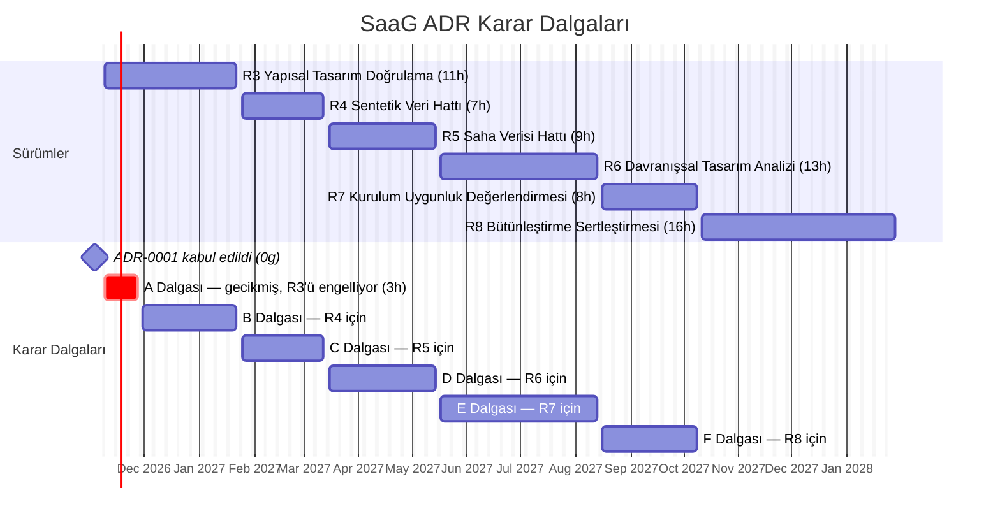

# Mimari Karar Kaydı Yol Haritası (ADR Yol Haritası): System as a Graph (SaaG)

> Bu doküman [ADR-ROADMAP.md](ADR-ROADMAP.md) dosyasının Türkçe çevirisidir. Bağlayıcı metin İngilizce olandır.

**Tanım:** Mimari Karar Kaydı (Architecture Decision Record, ADR), mimari açıdan önemli tek bir kararı kayıt altına alan, sürümlenen kısa bir Markdown dokümanıdır. Kararın yanıtladığı problemi, değerlendirilen seçenekleri, seçilen seçeneği ve sonuçlarını içerir. SaaG ADR'leri, SaaG izlenebilirlik alanlarıyla genişletilmiş MADR biçimini izler ([ADR-0001](adr/0001-record-architecture-decisions.tr.md) ve [şablon](adr/template.tr.md)).

**Amaç:** Bu yol haritası, CSCI'ın işlevsel ve işlevsel olmayan isterleri için ihtiyaç duyduğu tüm ADR'leri planlar. Her ADR için karar sorusunu, değerlendirilecek seçenekleri, izlendiği isterleri, kapattığı CDR maddelerini ve kabul edilmesi gereken tarihi belirtir. Aynı zamanda ADR dizini işlevi görür: her kararın güncel durumu yalnızca **Durum** sütununda tutulur.

---

## 1. Kapsam ve Diğer Dokümanlarla Bağlantı

| Doküman | ADR'lerle ilişkisi |
|---|---|
| [SRS](../requirements/SRS.tr.md) | ADR'ler SRS ister kimliklerine izlenir. SRS'te ayrı bir işlevsel olmayan isterler bölümü bulunmadığından, işlevsel olmayan ADR'lerin izlendiği kalite özniteliği temeli aşağıda §3'te türetilmiştir. |
| [SDD](SDD.md) | SDD tasarımın *ne* olduğunu, ADR'ler ise *neden* öyle olduğunu kaydeder. Bir ADR kabul edildiğinde ilgili SDD bölümü güncellenir ve ADR'ye bağlantı verir. |
| [CDR](CDR.md) | CDR-01…30 açık maddelerinin her biri bir ADR ile kapatılır (§6.1). ADR'nin kabulü, CDR maddesini `Resolved` durumuna getirir ve kaynak dokümandaki "kritik tasarım aşamasında belirlenecek" ifadesini kararla değiştirir. |
| [SDP §5](../planning/SDP.tr.md) | SDP §5'teki teknoloji seçimleri kesinleşmiş karar değil, **aday seçenek** olarak ele alınır. Gerçekleştirilmiş kod (`mdg/`, `dve/`) SDP §5'ten farklıysa, bir *Uzlaştırma* ADR'si iki seçeneği birlikte değerlendirir. Bu yaklaşım [BACKLOG](../planning/BACKLOG.md) bulgusu L2'yi çözer. |
| [BACKLOG](../planning/BACKLOG.md) | ADR takvimi BACKLOG §2 karar şeridini izler: her karar, onu kullanan sürümden en az bir sürüm önce kabul edilir. ADR-0001, S0.2-02 hikâyesini (karar kaydı iş akışı) karşılar. |
| [UXD](UXD.md), [STD](../test/STD.md) | Arayüz ve test stratejisi kararları ADR olarak kaydedilir (ADR-0009, 0025, 0041, 0042). STD test durumları, kabul eşiklerini belirleyen ADR'ye atıf yapar. |

**ADR kapsamı dışında kalanlar:** doğrulama kural setlerinin *içeriği* (CDR-01…08). Bunlar mimari değil, alan kurallarıdır. ADR-0023 bu içeriğin nerede tutulacağına, nasıl sürümleneceğine ve kimin onaylayacağına karar verir; CDR-01…08'i onaylanmış kural kataloğuna atıfla kapatır.

---

## 2. Kurallar

Sürecin tamamı [ADR-0001](adr/0001-record-architecture-decisions.tr.md)'de tanımlanmıştır. Özetle:

- **Konum ve adlandırma:** `docs/design/adr/NNNN-kebab-case-baslik.md`, Türkçe çevirisi `NNNN-kebab-case-baslik.tr.md`. Bağlayıcı dil İngilizcedir. Türkçe dosya aynı pull request içinde güncellenir.
- **Numaralandırma:** numaraları bu yol haritası ayırır. Bir numara asla yeniden kullanılmaz. Vazgeçilen bir ADR numarasını `Withdrawn` durumuyla korur. Burada listelenmeyen yeni bir ADR bir sonraki boş numarayı alır ve aynı pull request içinde bu yol haritasına eklenir.
- **Kimlikler:** her iki dilde de SRS.md'deki kanonik kimlikler `MDG / SCG / FDM / ADM / SMM / DVE` kullanılır ([BACKLOG Ek A](../planning/BACKLOG.md)). Türkçe metinde bileşenlerin Türkçe adları kullanılır, ancak Türkçe kısaltmalar kullanılmaz; böylece `TDM` eşadlılığından kaçınılır.
- **Durum yaşam döngüsü:**

  | Durum | Anlamı |
  |---|---|
  | `Planned` | Bu yol haritasında listelenmiş; henüz dosyası yok |
  | `Proposed` | ADR dosyası bir pull request'te incelemede |
  | `Accepted` | CDR Kurulu tarafından onaylandı; durum ve bağlantı güncellemeleri dışında değiştirilemez |
  | `Rejected` | İncelendi ve benimsenmedi; dosya korunur |
  | `Deprecated` | Artık geçerli değil; yerine geçen karar yok |
  | `Superseded by ADR-NNNN` | Sonraki bir ADR ile değiştirildi |
  | `Withdrawn` | Önerilmeden önce yol haritasından çıkarıldı |

  Durum değerleri, iki dilde de tutarlı olması için İngilizce yazılır.

- **Tür:** planlanan her ADR üç türden biridir:
  - **Onaylama (Ratify):** `mdg/` veya `dve/` içinde zaten gerçekleştirilmiş ya da onaylı bir dokümanda zaten belirlenmiş bir kararı kayda geçirir.
  - **Uzlaştırma (Reconcile):** gerçekleştirilmiş kod ile SDP §5 (veya UXD) çelişir. ADR iki seçeneği birlikte değerlendirir ve birini seçer.
  - **Karar (Decide):** tamamen açık bir karar.

---

## 3. Kalite Özniteliği Temeli (Türetilmiş İşlevsel Olmayan İsterler)

SRS, işlevsel olmayan ihtiyaçları ayrı bir bölümde değil, işlevsel isterlerin içinde ifade eder. Aşağıdaki tablo bunları kalite özniteliği (QA) olarak adlandırır; böylece işlevsel olmayan ADR'lerin izleneceği kararlı hedefler oluşur. Somut ve ölçülebilir hedefleri ADR'lerin kendisi belirler (başta ADR-0036).

**Tablo 1. Kalite Öznitelikleri**

| QA | Kalite özniteliği | Türetildiği kaynak |
|---|---|---|
| QA-01 | Güvenlik: kimlik doğrulama, yetkilendirme, kimlik bilgisi koruması | DVE.3; MDG.8; SDP §5 |
| QA-02 | Eşzamanlılık ve işlem yalıtımı | SMM.29–31; DVE.27; DVE.78; CDR-16 |
| QA-03 | Model bütünlüğü ve tahribatsızlık | SMM.36; DVE.17; DVE.29; DVE.51 |
| QA-04 | İzlenebilirlik, köken bilgisi ve denetlenebilirlik | MDG.1, 9, 18, 22; SCG.5–6; FDM.3; SMM.26, 35; DVE.24–25 |
| QA-05 | Girdi doğrulama ve hata raporlama | MDG.16, 19–22; SMM.3, 25, 37; FDM.5; ADM.5–6; DVE.8; SDD §1 karar 5 |
| QA-06 | Otomasyon istemcileri ve dış kaynaklarla birlikte çalışabilirlik | DVE.27, 77–78; SDD §2.3 EXT-IF-01…07 |
| QA-07 | Performans ve kapasite | FDM-INF.1; UXD §6; CDR-15; CDR-16 |
| QA-08 | Uzun süren işlemlerin güvenilirliği | DVE.6–7, 14–15, 24; SDP Artım 8 |
| QA-09 | Gözlemlenebilirlik ve işletilebilirlik | SDP Artım 8 |
| QA-10 | Kurulabilirlik ve yapılandırma | SDP §5 (şirket içi kurulum, Docker Compose) |
| QA-11 | Sürdürülebilirlik ve test edilebilirlik | SDP §5 (Portlar ve Adaptörler, sahte adaptörler); STD |
| QA-12 | Kullanılabilirlik ve erişilebilirlik | UXD §1, §6, §7 |

---

## 4. ADR Kataloğu

Sütun açıklaması: **Dalga** karar son tarihidir (bkz. §5). **Kapatır** sütunu ADR'nin çözdüğü CDR maddelerini listeler. "mevcut" ifadesi `mdg/` ve `dve/` içindeki güncel kodu, "SDP" ifadesi SDP §5 Tablo 6'yı belirtir.

### 4.1 Temel ve Kesişen Kararlar

**Tablo 2. Temel ADR'ler**

| Kimlik | Başlık | Karar sorusu | Değerlendirilecek seçenekler | Tür | İzlenen | Kapatır | Dalga | Durum |
|---|---|---|---|---|---|---|---|---|
| [ADR-0001](adr/0001-record-architecture-decisions.tr.md) | Mimari kararların MADR ile kaydedilmesi | Tasarım kararları nasıl kaydedilir, incelenir ve CDR'ye bağlanır? | Depoda MADR; depoda Nygard; yalnızca CDR kaydı; wiki | Onaylama | BACKLOG S0.2-02, L2 | — | — | Accepted |
| [ADR-0002](adr/0002-canonical-component-identifiers.tr.md) | Kanonik bileşen kimlikleri ve alan terminolojisi | Tüm doküman ve kodlarda hangi kimlikler ve terimler kullanılır? | SRS.md kimlikleri (`MDG…DVE`) ve terimleri ("Model Verisi", "Sistem Modeli"); doküman başına ayrı adlar | Onaylama | BACKLOG T1, T2, Ek A | — | A | Proposed |
| [ADR-0003](adr/0003-ports-and-adapters-per-csc.tr.md) | CSC başına Portlar ve Adaptörler | CSC'ler alan mantığını dış sistemlerden nasıl yalıtır ve geliştirme ile testte sahte adaptörlere nasıl olanak tanır? | DI ile seçilen sahte adaptörlü Portlar ve Adaptörler (mevcut, SDP); katmanlı mimari; doğrudan entegrasyon | Onaylama | QA-11; SDP §5 | — | A | Proposed |
| [ADR-0004](adr/0004-deployable-units-and-repository-layout.tr.md) | Kurulum birimleri ve depo yerleşimi | CSCI tek bir kurulum birimi mi, yoksa CSC başına bir servis mi; her CSC'nin dizini nedir? | CSC başına bir paketle modüler monolit (mevcut: `mdg/`, `dve/`); CSC başına servis; SDP §4 yerleşimi | Uzlaştırma | BACKLOG T3; SDP §4; QA-10 | — | A | Proposed |
| [ADR-0005](adr/0005-backend-web-framework.tr.md) | Arka uç web çatısı ve API biçimi | Operasyon Paneli API'sine ve otomasyon API'sine hangi çatı hizmet verir? | Flask 2.3 (mevcut); FastAPI (SDP); REST/JSON ve alternatifleri | Uzlaştırma | DVE.1–2, 27; QA-06 | — | A | Proposed |
| [ADR-0006](adr/0006-background-operation-execution.tr.md) | Arka plan işlem yürütme ve durum iletimi | Uzun süren işlemler nasıl kuyruğa alınır, yürütülür, izlenir ve arayüz ile CLI istemcilerine raporlanır? | Celery + Redis (mevcut); PostgreSQL üzerinde Procrastinate (SDP); durum iletimi için SSE veya yoklama | Uzlaştırma | DVE.6, 9, 14–15, 27, 78; SMM.30; QA-02, QA-08 | — | A | Proposed |
| [ADR-0007](adr/0007-internal-csc-integration-style.tr.md) | CSC'ler arası iç entegrasyon biçimi | CSC'ler birbirine veriyi nasıl aktarır (INT-IF-01…05)? | Süreç içi port çağrıları; dosya ile aktarım; mesaj kuyruğu; iç HTTP | Karar | MDG.23; SCG.7; FDM.4; ADM.2–4; SMM.2, 27–28, 33 | CDR-24, 25, 26, 27, 28 | A | Proposed |
| [ADR-0008](adr/0008-relational-store.tr.md) | Üst veri, işlem ve bulgular için ilişkisel depo | Yapılandırma, işlem, bulgu ve rapor kayıtları nerede saklanır? | PostgreSQL (SDP); MySQL (geliştirme CMDB'siyle uyumlu); yalnızca Redis (üretim günlüğü için mevcut) | Uzlaştırma | DVE.21–26; MDG.8, 14; QA-04 | CDR-29 (kısmi) | A | Proposed |
| [ADR-0009](adr/0009-frontend-application-architecture.tr.md) | Ön yüz uygulama mimarisi | Operasyon Paneli nasıl geliştirilir? | Sunucu tarafında işlenen şablonlar + sade JS (mevcut); Next.js + Refine + shadcn/ui (SDP, UXD) | Uzlaştırma | DVE.1, 4–27; QA-12 | — | A | Proposed |

### 4.2 İşlevsel Kararlar (CSC'ye göre)

**Tablo 3. İşlevsel ADR'ler**

| Kimlik | Başlık | Karar sorusu | Değerlendirilecek seçenekler | Tür | İzlenen | Kapatır | Dalga | Durum |
|---|---|---|---|---|---|---|---|---|
| [ADR-0010](adr/0010-external-data-source-adapters.tr.md) | Dış veri kaynağı adaptörleri ve bağlantı yapılandırması | Her dış kaynak hangi protokol ve istemciyi kullanır; kaynak başına yapılandırma nasıl modellenir? | PyMySQL ile CMDB (mevcut) veya genel SQLAlchemy (SDP); token ile HTTPS üzerinden Git; paket deposu REST API'si | Uzlaştırma | MDG.2–4, 8, 10–13; QA-06 | CDR-17, 18, 19 | A | Proposed |
| [ADR-0011](adr/0011-network-topology-acquisition.tr.md) | Ağ topolojisi verisinin alınması | Topoloji verisi otomatik olarak nereden ve hangi biçimde gelir; elle giriş bununla nasıl bir arada bulunur? | Sistem deposunda topoloji dosyası; veri tabanı/CMDB sorgusu; ağ yönetim sistemi dışa aktarımı; yalnızca elle giriş | Karar | MDG.5–7 | CDR-09, 20 | A | Proposed |
| [ADR-0012](adr/0012-source-repository-acquisition.tr.md) | Kaynak kod deposundan veri alımı ve zorunlu dosya seti | Yazılım birimi başına hangi dosyalar zorunludur; model verisi ayrıştırmayla mı yoksa derleme çalıştırılarak mı çıkarılır? | Statik ayrıştırma (mevcut); ana makinede isteğe bağlı `gmake regenerate_code` adımı (mevcut, varsayılan kapalı); her zaman derleme; yalıtılmış konteynerde derleme | Onaylama | MDG.17–21; QA-05 | CDR-10 | A | Proposed |
| [ADR-0013](adr/0013-model-data-file-format.tr.md) | Model Verisi dosya biçimi ve sürümleme | Model Verisi dosyasının biçimi, şema sürümü ve saklama yeri nedir? | Proje/platform/sürüm/çalıştırma anahtarlı dosya sisteminde JSON (mevcut); ilişkisel depoda saklama; çizge veri tabanına özgü içe aktarma biçimi | Onaylama | MDG.1, 14–15, 23; SMM.2–3, 26 | CDR-29 (kısmi), CDR-30 (kısmi) | A | Proposed |
| [ADR-0014](adr/0014-system-model-graph-schema.tr.md) | Sistem Modeli çizge şeması | Düğüm ve ilişki tipleri, kimlik anahtarları, öznitelikler ve proje/platform/sürüm kapsamı nasıl modellenir? | Tipli düğüm/kenarlı etiketli özellik çizgesi; tip özniteliği taşıyan genel düğüm; sürüm başına çizge veya sürüm özelliği | Karar | SMM.4–24; QA-03 | CDR-30 (kısmi) | A | Proposed |
| [ADR-0015](adr/0015-graph-storage-technology.tr.md) | Çizge depolama teknolojisi | Sistem Modeli hangi motorda saklanır ve sorgulanır? | FalkorDB (SDP); Neo4j; serileştirmeli süreç içi NetworkX; PostgreSQL + Apache AGE | Karar | SMM.1, 4, 27–29; DVE.28–49; QA-02, QA-07 | CDR-29 (kısmi) | A | Proposed |
| [ADR-0016](adr/0016-model-instances.tr.md) | Model örnekleri: temel, çalışma ve aday değerlendirme modelleri | Çalışma modelleri (kurgusal düzenlemeler) ve aday değerlendirme modelleri temel Sistem Modelinden nasıl yalıtılır? | Her örnek için tam kopya; yazarken kopyalanan fark katmanı; örnek başına ayrı adlandırılmış çizge | Karar | SMM.29–31; DVE.17, 29, 51; MDG.15; QA-02, QA-03 | CDR-29 (kısmi) | A | Proposed |
| ADR-0017 | Analitik veri bağlama ve katman ayrımı | Analitik Değerlendirme Verisi, ayrılabilir kalarak ve köken bilgisi korunarak düğüm ve ilişkilere nasıl bağlanır? | Çizgede katman özellikleri; varlık anahtarıyla birleştirilen ayrı katman deposu; varlık anahtarıyla başvurulan zaman serisi deposu | Karar | SMM.32–37; DVE.16; QA-03, QA-04 | CDR-29 (kısmi), CDR-30 (kısmi) | C | Planned |
| ADR-0018 | Simülasyon anlamı ve sentetik veri üretimi | SaaG'de "simülasyon" ne anlama gelir; sentetik veri tekrarlanabilir biçimde nasıl üretilir? | Çizge üzerinde analitik yayılım; ayrık olay simülasyonu; istatistiksel iz sentezi; tohumlanmış üreteçler | Karar | SCG.1–4; DVE.53–58 | CDR-11 | B | Planned |
| ADR-0019 | Analitik Değerlendirme Verisi biçimi | Analitik Değerlendirme Verisinin ve ADM'ye aktarılan sentetik verinin içeriği, şeması ve sürümlemesi nedir? | Sütunlu dosya (ör. Parquet); JSON Lines; veri tabanı tabloları; zaman serisi kayıtları | Karar | ADM.1, 3–4, 6; SCG.4–7; QA-04 | CDR-12, CDR-30 (kısmi) | B | Planned |
| ADR-0020 | Saha kaydı yükleme ve alımı | Saha kayıtları nasıl yüklenir ve doğrulanır; ham yüklemeler saklanır mı? | Tarayıcıdan yükleme; bırakma klasörü; kayıt mekanizmasından API ile gönderim; ayrıştırma sonrası ham veriyi silme (SDP) veya saklama | Karar | FDM.2–3, 5; ADM.2, 5; QA-05 | CDR-21 | C | Planned |
| ADR-0021 | Saha kaydı ve telemetri depolama | Sistem Saha Kayıtları ve telemetri nerede saklanır ve sorgulanır? | VictoriaMetrics (SDP); PostgreSQL / TimescaleDB; ilişkisel depoda kataloglanan dosyalar | Karar | FDM.1, 4; DVE.59–65, 69–70; QA-07 | CDR-29 (kısmi), CDR-30 (kısmi) | C | Planned |
| [ADR-0022](adr/0022-verification-rule-engine.tr.md) | Doğrulama kural motoru ve kural modeli | Doğrulama kuralları nasıl temsil edilir ve Sistem Modeli üzerinde nasıl yürütülür? | Veri olarak kurallar (bildirimsel, çizge sorguları); Python eklentisi olarak kurallar; karma; alanlar: kimlik, başlık, önem, ağırlık, kabul kriteri, engelleme | Karar | DVE.18, 28–49, 76; QA-11 | — | A | Proposed |
| [ADR-0023](adr/0023-verification-rule-set-catalog.tr.md) | Doğrulama kural seti kataloğu ve yönetişimi | Kural içeriği nerede tutulur, kim onaylar, nasıl sürümlenir ve test edilir? | Depoda CDR Kurulu onaylı sürümlü kural kataloğu; çalışma zamanında düzenlenebilen veri tabanındaki kurallar; proje başına kural profilleri | Karar | DVE.18, 32–49, 76 | CDR-01…08 | A | Proposed |
| [ADR-0024](adr/0024-findings-and-operation-records.tr.md) | Bulgu ve işlem kaydı modeli | Bulgunun yapısı, önem ölçeği, neden-sonuç bağlantıları ve işlem kimlikleri nedir? | Önem sıralamalı düz bulgular; nedensel kenarlı bulgu çizgesi; ilişkisel depoda işlem/bulgu şeması | Karar | DVE.18, 21–25; QA-04 | CDR-30 (kısmi) | A | Proposed |
| [ADR-0025](adr/0025-graph-visualization.tr.md) | Çizge görselleştirme ve büyük model çizimi | Düğüm-ilişki çizgesini hangi kütüphane çizer; büyük modellerde akıcılık nasıl korunur? | React Flow (SDP, UXD); Cytoscape.js; Sigma.js / WebGL; ayrıntı düzeyi ve sunucu tarafı filtreleme | Karar | DVE.17, 19–20; QA-07, QA-12 | — | A | Proposed |
| ADR-0026 | Davranışsal yayılım ve mimari sapma tespiti algoritmaları | Etki yayılımı ve mimari sapma nasıl hesaplanır? | Yayılım ağırlıklı çizge dolaşımı; bağımlılık matrisi analizi; sapma için ad/kimlik/parmak izi ile varlık eşleştirme | Karar | DVE.53–58, 66–68 | — | D | Planned |
| ADR-0027 | Kurulum uygunluk puanlaması ve engelleme kararı | Kural sonuçları nasıl puanlanır, sınıflandırılır ve kurulum / engelleme kararına dönüştürülür? | Sınıf eşikli ağırlıklı toplam; başlık başına asgari değerler; engelleme önceliği (DVE.77) | Karar | DVE.71–77 | CDR-14 | E | Planned |
| ADR-0028 | Otomasyon istemcisi sözleşmesi | CI hatları için API, CLI, sonuç şeması ve çıkış kodları nasıl olur? | REST + CLI sarmalayıcı (SDP); yalnızca CLI; JSON şeması olarak sonuç; karar başına çıkış kodu | Karar | DVE.27, 77–78; QA-06 | CDR-23 | E | Planned |
| ADR-0029 | Rapor üretimi ve dışa aktarma biçimleri | Hangi rapor biçimleri, nasıl üretilir? | WeasyPrint/ReportLab ile PDF + JSON (SDP); HTML; bulgular için CSV | Karar | DVE.26 | CDR-13 | E | Planned |

### 4.3 İşlevsel Olmayan Kararlar (Kalite Özniteliğine Göre)

**Tablo 4. İşlevsel Olmayan ADR'ler**

| Kimlik | Başlık | Karar sorusu | Değerlendirilecek seçenekler | Tür | İzlenen | Kapatır | Dalga | Durum |
|---|---|---|---|---|---|---|---|---|
| [ADR-0030](adr/0030-authentication-and-sessions.tr.md) | Kimlik doğrulama ve oturum yönetimi | Kullanıcılar ve otomasyon istemcileri kimliklerini nasıl doğrular; oturumlar nasıl tutulur? | LDAP bağlanma (SDP; mevcut: taklit); Flask imzalı çerez oturumu (mevcut), durumsuz JWT (SDP) veya sunucu tarafı oturum; CLI için servis hesapları veya API token'ları | Uzlaştırma | DVE.3, 27; QA-01 | CDR-22 | A | Proposed |
| ADR-0031 | Yetkilendirme modeli | "Yetkiler" nasıl tanımlanır ve işlem bazında nasıl uygulanır? | LDAP gruplarından eşlenen roller; proje başına yetkiler; tek rol | Karar | DVE.3; QA-01 | — | B | Planned |
| [ADR-0032](adr/0032-secrets-and-credentials.tr.md) | Gizli bilgiler ve veri kaynağı kimlik bilgilerinin korunması | Veri kaynağı kimlik bilgileri ve uygulama gizli bilgileri nasıl saklanır ve korunur? | Oturum başına bellekte (mevcut); `.env` (SDP); ilişkisel depoda şifreli saklama; harici kasa | Uzlaştırma | MDG.8; DVE.3; QA-01 | — | A | Proposed |
| [ADR-0033](adr/0033-concurrency-control.tr.md) | Eşzamanlılık denetimi ve işlem sınırları | Eşzamanlı oturum ve işlemler altında model tutarlılığı nasıl korunur; eşzamanlılık sınırları nelerdir? | Salt okunur paylaşılan temel model + yalıtılmış örnekler; iyimser sürümleme; kilitler; işçi havuzu boyutu ve kuyruk sınırları | Karar | SMM.29–30; DVE.27, 78; QA-02 | CDR-16 | A | Proposed |
| [ADR-0034](adr/0034-validation-and-error-records.tr.md) | Ortak doğrulama ve hata kaydı örüntüsü | Her veri alım yolu girdiyi nasıl doğrular ve hataları tutarlı biçimde nasıl kaydeder? | Paylaşılan hata kaydı tipi ve durum kümesi (mevcut, SDD §1 karar 5); CSC başına ayrı hata modelleri | Onaylama | MDG.16, 19–22; SMM.3, 25, 37; FDM.5; ADM.5–6; DVE.8, 24; QA-05 | — | A | Proposed |
| [ADR-0035](adr/0035-traceability-and-provenance.tr.md) | İzlenebilirlik, köken bilgisi ve denetim izi | Her sonucun tekrarlanabilir olması için girdiler, çıktılar, kullanıcılar ve zamanlar nasıl kaydedilir? | Girdi özetli değiştirilemez işlem kayıtları; olay günlüğü; proje/platform/sürüm anahtarlı depo başına köken alanları | Karar | MDG.1, 9, 18; SCG.5–6; FDM.3; SMM.26, 35; DVE.25; QA-04 | — | A | Proposed |
| ADR-0036 | Performans ve kapasite bütçeleri | Hedef model boyutları, yanıt süreleri, iş hacmi ve depolama boyutlandırması nelerdir? | İşlem sınıfı başına bütçeler; UXD §6 arayüz bütçesi; kayıt hacmi × saklama süresinden FDM disk boyutlandırması | Karar | FDM-INF.1; QA-07 | CDR-15 | C | Planned |
| ADR-0037 | Uzun süren işlemlerin güvenilirliği | Yeniden denemeler, eşgüçlülük, kesinti kaydı ve veri kaynağı sağlığı nasıl ele alınır? | Eşgüçlülük anahtarlı görev yeniden denemeleri; kontrol noktası/devam; kaydedilen aşamayla hızlı başarısızlık; periyodik kaynak sağlık denetimi | Karar | DVE.6–7, 14–15, 24; QA-08 | — | B | Planned |
| ADR-0038 | Gözlemlenebilirlik | Hangi günlükler, metrikler ve sağlık denetimleri üretilir ve nerede toplanır? | Yapılandırılmış günlükler + Prometheus tarzı metrikler; VictoriaMetrics (ADR-0021 ile ortak); yalnızca günlük dosyaları | Karar | QA-09; SDP Artım 8 | — | F | Planned |
| ADR-0039 | Kurulum, yapılandırma ve ortamlar | CSCI geliştirme, test ve üretim ortamlarında nasıl kurulur ve yapılandırılır? | Şirket içinde Docker Compose (SDP); `.ini` dosyaları (mevcut) veya ortam değişkenleri (SDP); geliştirme taklit yığını (`dev/compose.yaml`) | Uzlaştırma | QA-10 | — | B | Planned |
| ADR-0040 | Veri saklama, yedekleme ve geri yükleme | Modeller, kayıtlar, bulgular ve raporlar ne kadar süre saklanır; nasıl yedeklenir ve geri yüklenir? | Depo başına saklama süresi; zamanlanmış yedekler; geri yükleme tatbikatları | Karar | FDM.1–2; QA-03, QA-10 | — | C | Planned |
| ADR-0041 | Test stratejisi ve kalite kapıları | Hangi test seviyeleri ve CI kapıları uygulanır; adaptörler ve kurallar nasıl test edilir? | Sahte adaptörlü pytest (mevcut); adaptör sözleşme testleri; kural regresyon fikstürleri; Playwright uçtan uca (SDP) | Onaylama | QA-11; STD | — | B | Planned |
| ADR-0042 | Tarayıcı desteği ve erişilebilirlik temeli | Operasyon Paneli hangi tarayıcıları ve hangi erişilebilirlik düzeyini desteklemelidir? | Firefox 90+ alt sınırı ve WCAG AA (UXD); yalnızca güncel tarayıcılar | Onaylama | QA-12; UXD §6–7 | — | B | Planned |

---

## 5. Karar Takvimi

Her dalga, BACKLOG §2 karar şeridini izleyerek ADR'lerini onları kullanan sürümden en az bir sürüm önce kapatır. 2026-11-03 itibarıyla karar şeridinin R0–R2 için planladığı kararların süresi geçmiştir; R3 (Yapısal Tasarım Doğrulama) 2026-11-09'da başlar. Bu nedenle bu kararlar A Dalgasında toplanmıştır. Zaten verilmiş kararları kayda geçirdikleri için *Onaylama* ADR'leri önce ele alınır.

**Tablo 5. Karar Dalgaları**

| Dalga | Kabul son tarihi | Zaman aralığı | Kullanan sürüm | ADR'ler |
|---|---|---|---|---|
| A | 2026-11-27 | R3'ün ilk üç haftası (R0–R2 şeridinden gecikmiş maddeler) | R3 ve sürmekte olan iş | 0002–0016, 0022–0025, 0030, 0032–0035 |
| B | 2027-01-22 | R3 süresince | R4 — Sentetik Veri Hattı | 0018, 0019, 0031, 0037, 0039, 0041, 0042 |
| C | 2027-03-12 | R4 süresince | R5 — Saha Verisi Hattı | 0017, 0020, 0021, 0036, 0040 |
| D | 2027-05-14 | R5 süresince | R6 — Davranışsal Tasarım Analizi | 0026 |
| E | 2027-08-13 | R6 süresince | R7 — Kurulum Uygunluk Değerlendirmesi | 0027, 0028, 0029 |
| F | 2027-10-08 | R7 süresince | R8 — Bütünleştirme Sertleştirmesi ve Kapasite Doğrulama | 0038 |

**Şekil 1. ADR Karar Dalgaları**

---

## 6. Kapsama Matrisleri

### 6.1 CDR Açık Maddeleri → ADR

30 CDR maddesinin tamamı bir ADR ile kapatılır. CDR-29 (depo başına depolama teknolojisi) ve CDR-30 (depo başına şemalar) SDD §2.4'teki yedi veri deposunun tamamını kapsadığından, birden fazla ADR bu maddelerin birer kısmını kapatır. Bu iki maddenin her biri, katkıda bulunan son ADR kabul edildiğinde `Resolved` olur. CDR.md'de CDR-29 ve CDR-30'un depo başına alt maddelere bölünmesi önerilir.

**Tablo 6. CDR → ADR**

| CDR | Madde (kısa) | Kapatan |
|---|---|---|
| CDR-01 | Topic QoS uygunluk kuralları | ADR-0023 |
| CDR-02 | Kapsamdaki arakatman dışı haberleşme servisleri | ADR-0023 |
| CDR-03 | Yük dengeleme kuralları | ADR-0023 |
| CDR-04 | İşlemci çekirdek tahsisi kuralları | ADR-0023 |
| CDR-05 | İşletim sistemi ayarları kuralları | ADR-0023 |
| CDR-06 | Çalışma zamanı bellek tahsisi kuralları | ADR-0023 |
| CDR-07 | Tasarım örüntüsü ihlalleri için mimari kurallar | ADR-0023 |
| CDR-08 | Uygun / uygun değil sınıflandırma kuralları | ADR-0023 |
| CDR-09 | Otomatik ağ topolojisi verisi alımı | ADR-0011 |
| CDR-10 | Kaynak kod deposundan zorunlu dosya listesi | ADR-0012 |
| CDR-11 | Simülasyon süreçlerinin tanımı | ADR-0018 |
| CDR-12 | Analitik Değerlendirme Verisi biçimi | ADR-0019 |
| CDR-13 | Rapor dışa aktarma biçimi | ADR-0029 |
| CDR-14 | Kurulum uygunluk puanlama yöntemi | ADR-0027 |
| CDR-15 | FDM depolama disk kapasitesi | ADR-0036 |
| CDR-16 | Eşzamanlı kullanıcı/işlem sayısı | ADR-0033 |
| CDR-17 | EXT-IF-01 Konfigürasyon Yönetim Veri Tabanı protokolü | ADR-0010 |
| CDR-18 | EXT-IF-02 Kaynak Kod Deposu protokolü | ADR-0010 |
| CDR-19 | EXT-IF-03 Paket Deposu protokolü | ADR-0010 |
| CDR-20 | EXT-IF-04 Ağ Topolojisi Veri Kaynağı protokolü | ADR-0011 |
| CDR-21 | EXT-IF-05 Saha Verisi Kayıt Mekanizması protokolü | ADR-0020 |
| CDR-22 | EXT-IF-06 LDAP Dizin Servisi protokolü | ADR-0030 |
| CDR-23 | EXT-IF-07 Derleme Otomasyonu / CLI protokolü ve sonuç biçimi | ADR-0028 |
| CDR-24 | INT-IF-01 MDG → SMM aktarımı | ADR-0007 |
| CDR-25 | INT-IF-02 SCG → ADM aktarımı | ADR-0007 |
| CDR-26 | INT-IF-03 FDM → ADM aktarımı | ADR-0007 |
| CDR-27 | INT-IF-04 ADM → SMM aktarımı | ADR-0007 |
| CDR-28 | INT-IF-05 SMM → DVE erişimi | ADR-0007 |
| CDR-29 | Veri deposu başına fiziksel depolama teknolojisi | ADR-0008, 0013, 0015, 0016, 0017, 0021 |
| CDR-30 | Veri deposu başına varlık şemaları | ADR-0013, 0014, 0017, 0019, 0021, 0024 |

### 6.2 SRS İsterleri → ADR

Her SRS ister bloğu en az bir ADR tarafından yönetilir.

**Tablo 7. SRS → ADR**

| SRS isterleri | Yöneten ADR'ler |
|---|---|
| MDG.1 | 0013, 0035 |
| MDG.2–8 | 0010, 0011, 0032 |
| MDG.9–13 | 0010, 0035 |
| MDG.14–15 | 0013, 0016 |
| MDG.16 | 0034 |
| MDG.17–20 | 0012, 0034 |
| MDG.21–23 | 0007, 0013, 0034 |
| SCG.1–4 | 0018, 0019 |
| SCG.5–7 | 0007, 0019, 0035 |
| FDM.1–5 | 0020, 0021, 0040 |
| FDM-INF.1 | 0036 |
| ADM.1–6 | 0007, 0019, 0034 |
| SMM.1–5 | 0013, 0014, 0015 |
| SMM.6–24 | 0014 |
| SMM.25–26 | 0034, 0035 |
| SMM.27–28 | 0007, 0015 |
| SMM.29–31 | 0016, 0033 |
| SMM.32–37 | 0017 |
| DVE.1–2 | 0005, 0009 |
| DVE.3–4 | 0030, 0031 |
| DVE.5–9 | 0006, 0009, 0037 |
| DVE.10–16 | 0006, 0009, 0017 |
| DVE.17 | 0016, 0025 |
| DVE.18 | 0022, 0023 |
| DVE.19–20 | 0025 |
| DVE.21–25 | 0024, 0035 |
| DVE.26 | 0029 |
| DVE.27 | 0006, 0028, 0033 |
| DVE.28–30 | 0016, 0022 |
| DVE.31–49 | 0022, 0023 |
| DVE.50–58 | 0018, 0026 |
| DVE.59–65, 69–70 | 0021, 0026 |
| DVE.66–68 | 0026 |
| DVE.71–77 | 0027 |
| DVE.78 | 0028, 0033 |

### 6.3 Kalite Öznitelikleri → ADR

**Tablo 8. QA → ADR**

| QA | Yöneten ADR'ler |
|---|---|
| QA-01 Güvenlik | 0030, 0031, 0032 |
| QA-02 Eşzamanlılık ve yalıtım | 0006, 0016, 0033 |
| QA-03 Model bütünlüğü | 0014, 0016, 0017, 0040 |
| QA-04 İzlenebilirlik ve köken bilgisi | 0024, 0035 |
| QA-05 Doğrulama ve hata raporlama | 0012, 0034 |
| QA-06 Birlikte çalışabilirlik | 0005, 0010, 0028 |
| QA-07 Performans ve kapasite | 0015, 0021, 0025, 0036 |
| QA-08 Güvenilirlik | 0006, 0037 |
| QA-09 Gözlemlenebilirlik | 0038 |
| QA-10 Kurulabilirlik ve yapılandırma | 0004, 0039, 0040 |
| QA-11 Sürdürülebilirlik ve test edilebilirlik | 0003, 0022, 0041 |
| QA-12 Kullanılabilirlik ve erişilebilirlik | 0009, 0025, 0042 |

---

## 7. Yol Haritasının Bakımı

1. Bir ADR'yi ekleyen veya değiştiren pull request, buradaki **Durum** hücresini de günceller. İngilizce yol haritası da aynı pull request'te güncellenir.
2. Bir ADR kabul edildiğinde aynı pull request, kapattığı CDR maddelerini ADR bağlantısıyla `Resolved` durumuna getirir. Etkilenen SRS/SDD ifadelerini de günceller.
3. Her sürümün tamamlanma kriterleri (DoD) bir yol haritası denetimi içerir: o sürümde süresi dolan dalgadaki her ADR `Accepted`, `Rejected` veya `Withdrawn` durumundadır ya da gerekçesiyle sonraki bir dalgaya yeniden planlanmıştır.
4. Gerçekleştirme sırasında ortaya çıkan ve burada listelenmeyen bir karar, bir sonraki boş numarayı alır ve §4'teki uygun tabloya eklenir.
