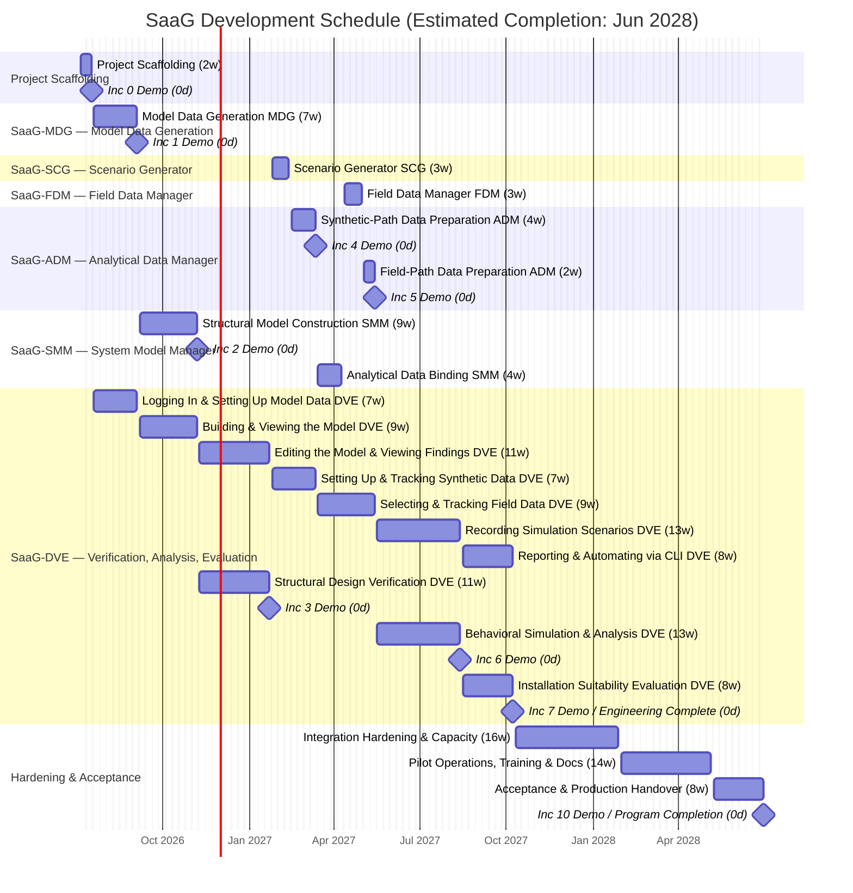

# Software Development Plan (SDP): System as a Graph (SaaG)

**Definition:** This Software Development Plan (SDP) is the plan for performing the software development of the System as a Graph (SaaG) Computer Software Configuration Item (CSCI). It decomposes the work defined in the SRS into a Work Breakdown Structure (WBS) of functional deliverables, and sequences those deliverables into a series of incremental builds. Every WBS deliverable and every increment is traceable to the CSU-scoped requirements in the SRS.

**Purpose:** The WBS (§1) establishes the full scope of development work, organized by Computer Software Component (CSC) and Computer Software Unit (CSU). The Incremental Development Plan (§2) sequences that work into a strictly serial series of builds — one increment at a time, in dependency-safe order. Each increment is scoped to one or more CSCs/CSUs plus, where relevant, the corresponding slice of DVE (Operations and Visualization), SaaG's front-door UI capability, so that every increment produces an end-to-end, demonstrable capability.

---

## 1. Work Breakdown Structure

**Table 1. WBS Deliverable Distribution**

| No | Component | Abbreviation | CSUs | Deliverables |
|---|---|---|---|---|
| 1 | Model Data Generator | SaaG-MDG | 1 | 1 |
| 2 | Scenario Generator | SaaG-SCG | 1 | 1 |
| 3 | Field Data Manager | SaaG-FDM | 1 | 1 |
| 4 | Analytical Data Manager | SaaG-ADM | 1 | 2 |
| 5 | System Model Manager | SaaG-SMM | 1 | 2 |
| 6 | Design Verification Engine | SaaG-DVE | 1 | 10 |
| **TOTAL** | | | **6** | **17** |

Each leaf bullet below cites the exact SRS requirement ID range it realizes.

- **SaaG**
  - **SaaG-MDG**
    - **MDG: Model Data Generator** (MDG.1–23)
  - **SaaG-SCG**
    - **SCG: Scenario Generator** (SCG.1–7)
  - **SaaG-FDM**
    - **FDM: Field Data Manager** (FDM.1–5)
  - **SaaG-ADM**
    - **ADM: Analytical Data Manager**
      - Synthetic-Path Data Preparation (ADM.1, 3, 4, 6)
      - Field-Path Data Preparation (ADM.2, 5)
  - **SaaG-SMM**
    - **SMM: System Model Manager**
      - Structural Model Construction (SMM.1–31)
      - Analytical Data Binding (SMM.32–37)
  - **SaaG-DVE**
    - **DVE: Design Verification Engine**
      - Operations and Visualization (DVE.1–27)
        - Logging In & Setting Up Model Data (DVE.1–8)
        - Building & Viewing the Model (DVE.9, 19–20)
        - Editing the Model & Viewing Findings (DVE.17–18, 21–24)
        - Setting Up & Tracking Synthetic Data (DVE.11, 13–15)
        - Selecting & Tracking Field Data (DVE.10, 12, 16)
        - Recording Simulation Scenarios (DVE.25)
        - Reporting & Automating via CLI (DVE.26–27)
      - Structural Design Verification (DVE.28–49)
      - Behavioral Simulation and Analysis (DVE.50–70)
      - Installation Suitability Evaluation (DVE.71–78)

---

## 2. Incremental Development Plan

Increment 0 establishes the repository scaffolding, shared infrastructure, and documentation skeleton. The seven functional increments that follow, plus three closing increments (Increments 8–10) that bring the program to institutional acceptance, are built one at a time, in dependency-safe order. The closing increments (8–10) deliver no new CSUs; they cover full-stack hardening, pilot operations, and acceptance. Each increment delivers one or more CSCs' remaining CSUs plus the matching slice of DVE (Operations and Visualization). Each increment also states the design, development, test, and packaging work needed to deliver it, plus its demo scenario. The SDD, UXD, ADRs, and STD are updated within every increment to cover that increment's CSUs.

**Definition of Done (applies to every increment):** an increment is Done when (1) every deliverable in its CSU/Deliverable table is implemented and satisfies its SRS requirement(s); (2) every ADR cited in its Design paragraph is Accepted, or re-planned to a later wave with a recorded reason (see [ADR Roadmap §6.1](../design/ADR-ROADMAP.md#61-deferred-design-points--adr)); (3) everything in its Test paragraph passes; (4) every service in its Packaging paragraph builds and deploys cleanly; (5) its Demo scenario runs end-to-end.

**Table 2. Increment Overview**

| # | Increment | CSUs delivered | CSCs complete |
|---|---|---|---|
| 0 | Project Scaffolding | — | — |
| 1 | Model Data Generation | MDG | SaaG-MDG |
| 2 | System Model Construction | SMM (structural slice) | — |
| 3 | Structural Design Verification | DVE (verification slice) | — |
| 4 | Synthetic Data Pipeline | SCG, ADM (synthetic slice) | SaaG-SCG |
| 5 | Field Data Pipeline | SMM (binding slice), FDM, ADM (field slice) | SaaG-FDM, SaaG-ADM, SaaG-SMM |
| 6 | Behavioral Design Analysis | DVE (analysis slice) | — |
| 7 | Installation Suitability Evaluation | DVE (evaluation & ops complete) | SaaG-DVE |
| 8 | Integration Hardening & Capacity Verification | — | — |
| 9 | Pilot Operations, Training & Documentation | — | — |
| 10 | Acceptance & Production Handover | — | — (CSCI accepted) |

### Increment 0: Project Scaffolding

| CSU | Deliverable |
|---|---|
| — | Repository scaffolding, shared cross-CSC infrastructure, and documentation skeleton |

**Design:** No SRS requirements are implemented. Establishes the repository structure (§4), hexagonal directory conventions, and shared cross-CSC primitives every later increment depends on.

**Development:** Scaffold the repository per §4, stand up the base Docker Compose stack with placeholder services, initialize shared packages, and populate the `docs/` skeleton.

**Test:** Verify the repository builds and lints cleanly, placeholder services start healthy, and CI runs successfully against the empty scaffolding.

**Packaging:** Stand up the base Docker Compose stack and CI pipeline — no application services yet.

**Demo:** A clean checkout builds, lints, and brings up the full Docker Compose stack with no application logic, and every planned document has a placeholder under `docs/`.

**Definition of Done:**
- [x] Repository scaffolded per §4 (per-CSC hexagonal layout, `web/`, `cli/`, `shared/`)
- [x] Base Docker Compose stack and CI pipeline stood up
- [x] `docs/` skeleton populated for every planned document
- [x] Scaffolding builds, lints, and deploys cleanly
- [x] Demo run end-to-end

### Increment 1: Model Data Generation

| CSU | Deliverable |
|---|---|
| MDG *(complete)* | Model Data Generation (MDG.1–23) |
| DVE *(ongoing)* | Logging In & Setting Up Model Data (DVE.1–8) |

**Completes:** SaaG-MDG

**Design:** MDG (SRS MDG.1–23) and the login/MDG-control screen (DVE.1–8) are fully designed. Still open: the exact protocol for each external connection and for LDAP, the topology method, and the required file list (ADR-0003, ADR-0008, ADR-0019).

**Development:** Build the MDG backend — connect to, validate, and assemble data from the four external sources — plus login/session handling. On the frontend: login, project/platform/version selection, source configuration, and an MDG production/status screen.

**Test:** Verify MDG's five jobs (source connections, config pull, version tracking, file transfer, validation/assembly) and the login/production screens, then run an end-to-end MDG-file production.

**Packaging:** Stand up MDG and web services with a metadata database, a settings template for the four sources plus LDAP, and stand-in external systems for demoing.

**Demo:** An operator authenticates via LDAP, selects a project/platform/system version, configures and connects to all four external data sources, triggers Model Data production end-to-end, and observes accessibility status and any errors, producing a valid, verified Model Data file.

**Definition of Done:**
- [ ] MDG (MDG.1–23) and login/MDG-control (DVE.1–8) built and working
- [ ] ADR-0003 (INT-IF-01), ADR-0008, ADR-0019 accepted or re-planned
- [ ] MDG and login/workflow tests pass
- [ ] MDG/web services deploy together
- [ ] Demo run end-to-end

### Increment 2: System Model Construction

| CSU | Deliverable |
|---|---|
| SMM *(ongoing)* | Structural Model Construction (SMM.1–31) |
| DVE *(ongoing)* | Building & Viewing the Model (DVE.9, 19–20) |

**Design:** System Model Manager (SRS SMM.1–31) and the model-build/browsing screen (DVE.9, 19–20) are fully designed. Biggest gap: the model's storage technology and schema aren't decided (ADR-0010, ADR-0011); concurrency limits and the DVE read protocol are also open (ADR-0006, ADR-0003).

**Development:** Build the Model Manager backend — turn Model Data into a graph, keep it safe under concurrent access, support isolated evaluation copies — on a graph database. On the frontend: model browsing (search/filter/zoom/pan/attributes).

**Test:** Verify the model builds correctly, represents all node/relationship types, stays consistent under concurrent access, and browsing works — end-to-end, completing Increment 1's workflow test.

**Packaging:** Add the `smm` distribution and its wheelhouse, install the graph server chosen by the ADR-0011 spike offline, and enable per-class operation limits (ADR-0006).

**Demo:** An operator builds the System Model Manager from the Increment 1 Model Data file, browses and visually navigates the resulting node-relationship structure (search/filter, zoom/pan, attribute display), while the model is served for concurrent multi-session access.

**Definition of Done:**
- [ ] System Model Manager (SMM.1–31) and browsing screen (DVE.9, 19–20) built and working
- [ ] ADR-0003 (INT-IF-05), ADR-0010, ADR-0011, ADR-0006 accepted or re-planned
- [ ] Model Manager and browsing tests pass, completing Increment 1's
- [ ] Model Manager service and graph database deploy together
- [ ] Demo run end-to-end

### Increment 3: Structural Design Verification

| CSU | Deliverable |
|---|---|
| DVE *(ongoing)* | Structural Design Verification (DVE.28–49) |
| DVE *(ongoing)* | Editing the Model & Viewing Findings (DVE.17–18, 21–24) |

**Design:** Structural Design Verification (SRS DVE.28–49) and the model-editor/findings screen (DVE.17–18, 21–24) are laid out, but most of the actual pass/fail rules are undecided — the biggest design gap in this plan (rule families in the ADR-0016 catalog).

**Development:** Build the Design Verifier's six checking engines against provisional rules until the ADR-0016 rule families are approved. On the frontend: the working-model editor (safe sandbox) and findings display/classification.

**Test:** Verify all six engines catch their fault conditions, editor changes never touch the real model, and findings display correctly — though some checks can only verify mechanics, not thresholds, until the rules close. End-to-end: edit and verify.

**Packaging:** Stand up the Design Verifier service — no new storage; it reads the model and writes findings to Increment 1's database.

**Demo:** An operator edits a working-model sandbox derived from the System Model Manager (add/remove nodes/relationships, update attributes) and runs design verification against it — QoS conformance, publisher/consumer matching, resource/load-balancing checks, circular-dependency and architectural-rule detection — with findings presented, classified, and filterable.

**Definition of Done:**
- [ ] Structural Design Verification (DVE.28–49) and editor/findings screen (DVE.17–18, 21–24) built and working
- [ ] ADR-0016 rule families for DVE.18, 32–35, 39–45 and 49 — the biggest open item in this plan — approved or re-planned
- [ ] Verifier and editor/findings tests pass (to the extent rules allow)
- [ ] Design Verifier service deploys and runs
- [ ] Demo run end-to-end

### Increment 4: Synthetic Data Pipeline

| CSU | Deliverable |
|---|---|
| SCG *(complete)* | Scenario Generator (SCG.1–7) |
| ADM *(ongoing)* | Synthetic-Path Data Preparation (ADM.1, 3, 4, 6) |
| DVE *(ongoing)* | Setting Up & Tracking Synthetic Data (DVE.11, 13–15) |

**Completes:** SaaG-SCG

**Design:** Scenario Generator (SRS SCG.1–7) and the synthetic-data setup screen (DVE.11, 13–15) are fully designed. Still open: what the synthetic data should simulate, the Analytical Evaluation Data format, and the SCG→ADM handoff (ADR-0013, ADR-0012, ADR-0003).

**Development:** Build the Scenario Generator (capture inputs, produce and record traceable synthetic data) and the synthetic-intake half of Analytical Data Manager. On the frontend: scenario input and production/status screens.

**Test:** Verify scenario inputs are captured, synthetic data matches the real system's structure, and the synthetic intake/assembly works — end-to-end, generating synthetic data and preparing analytical data.

**Packaging:** Stand up the Scenario Generator and Analytical Data Manager services — no new storage; data streams straight through.

**Demo:** An operator defines scenario scope/type/interval/density/data types, triggers synthetic data production, and observes the produced data recorded and traceable to its inputs. The synthetic data is then prepared into Analytical Evaluation Data (AED), with production status tracked and any format/missing-field errors reported — completing SaaG-SCG.

**Definition of Done:**
- [ ] Scenario Generator (SCG.1–7) and setup screen (DVE.11, 13–15) built and working
- [ ] ADR-0013, ADR-0012, ADR-0003 (INT-IF-02) accepted or re-planned
- [ ] Scenario Generator and synthetic-path tests pass
- [ ] Both services deploy together
- [ ] Demo run end-to-end

### Increment 5: Field Data Pipeline

| CSU | Deliverable |
|---|---|
| SMM *(complete)* | Analytical Data Binding (SMM.32–37) |
| FDM *(complete)* | Field Data Manager (FDM.1–5) |
| ADM *(complete)* | Field-Path Data Preparation (ADM.2, 5) |
| DVE *(ongoing)* | Selecting & Tracking Field Data (DVE.10, 12, 16) |

**Completes:** SaaG-FDM, SaaG-ADM, SaaG-SMM

**Design:** Analytical Data Binding (SRS SMM.32–37) and Field Data Manager (FDM.1–5) are fully designed, as are the field-record source-selection and binding-status screens (DVE.10, 12, 16). Still open: field-record storage capacity, the FDM external interface protocol, the FDM→ADM and ADM→SMM handoffs, and the carried-over AED format decision (ADR-0020, ADR-0014, ADR-0003, ADR-0012).

**Development:** Build the Field Data Manager (upload/catalog/search), the field-intake half of Analytical Data Manager, and the Data Binder (attach behavioral data without altering the model). On the frontend: field-record source-selection, upload/catalog, and binding-status screens.

**Test:** Verify records upload/catalog correctly, the field intake/assembly completes (never mixing with synthetic data), and binding matches data to the model without changing it — end-to-end, including a check that Increment 2's model is untouched.

**Packaging:** Add the `fdm` distribution and the field-record storage chosen by ADR-0014; raw-upload retention follows ADR-0014.

**Demo:** The synthetic-sourced AED from Increment 4 is bound onto the System Model Manager without altering its nodes/relationships, with binding status and provenance visible to the operator. The operator then selects System Field Records as the Analytical Evaluation Data source, uploads System Field Records (listing/searching/selecting them by project, platform, version, source, or upload time), and the resulting field-sourced AED is bound onto the model via the same source-agnostic binder — completing SaaG-FDM, SaaG-ADM (both the synthetic and field paths now work end-to-end), and SaaG-SMM.

**Definition of Done:**
- [ ] Analytical Data Binding (SMM.32–37), FDM (FDM.1–5), and field-selection/binding-status screens (DVE.10, 12, 16) built and working
- [ ] ADR-0020, ADR-0014, ADR-0003 (INT-IF-03, INT-IF-04), ADR-0012 accepted or re-planned
- [ ] Field-records, binder, and field-path tests pass, completing Increment 4's
- [ ] New services and telemetry database deploy together
- [ ] Demo run end-to-end

### Increment 6: Behavioral Design Analysis

| CSU | Deliverable |
|---|---|
| DVE *(ongoing)* | Behavioral Simulation and Analysis (DVE.50–70) |
| DVE *(ongoing)* | Recording Simulation Scenarios (DVE.25) |

**Design:** Behavioral Simulation and Analysis (SRS DVE.50–70) and the simulation-recording screen (DVE.25) are fully designed. No item names it directly, but it depends on two carried-over decisions: the DVE read protocol and the model's storage/schema (ADR-0003, ADR-0010, ADR-0011).

**Development:** Build the Design Analyzer's three engines (synthetic-data simulation, field-data analysis, drift detection). On the frontend: simulation-scenario recording and high-volume field-trace charts.

**Test:** Verify all three engines produce correct results for their data sources and fault scenarios, and simulation metadata is recorded — end-to-end analysis-and-record run.

**Packaging:** Stand up the Design Analyzer service — no new storage; it reads Increment 2 and 5's databases.

**Demo:** An operator runs static analysis using synthetic-sourced AED (message/traffic flow, node/relationship-inactivity effects, load-density and fault-propagation analysis, resource-usage summaries) and using field-record-sourced AED (operational/health status, resource usage, error/timeout information, communication latency/loss, model-vs-runtime drift detection), with simulation scenario metadata (DVE.25) recorded against the results.

**Definition of Done:**
- [ ] Behavioral Simulation and Analysis (DVE.50–70) and recording screen (DVE.25) built and working
- [ ] Carried-over ADR-0003 (INT-IF-05), ADR-0010, ADR-0011 accepted or re-planned
- [ ] Design Analyzer tests pass
- [ ] Design Analyzer service deploys and runs
- [ ] Demo run end-to-end

### Increment 7: Installation Suitability Evaluation

| CSU | Deliverable |
|---|---|
| DVE *(complete)* | Installation Suitability Evaluation (DVE.71–78) |
| DVE *(complete)* | Reporting & Automating via CLI (DVE.26–27) |

**Completes:** SaaG-DVE

**Design:** Installation Suitability Evaluation (SRS DVE.71–78) and the reporting/CLI screen (DVE.26–27) are fully designed. Still open: the scoring method, report file format, and CLI protocol/result format (ADR-0018, ADR-0005) — all should close before this final increment ships.

**Development:** Build the Design Evaluator (score candidates, force non-conforming on critical findings, run evaluations concurrently) and the CLI. Add PDF/JSON report generation and the report screen.

**Test:** Verify scoring, the forced non-conforming rule, concurrent evaluation, and CLI request/status — end-to-end CLI evaluation through decision and report, closing out every component.

**Packaging:** Add the evaluation part of `dve`, the `dsm` CLI subcommands (ADR-0005) and report generation (ADR-0018), so every CSC is installed together on the target host.

**Demo:** An automation client (e.g., Jenkins) submits an installation-suitability evaluation via CLI for one or more candidate software units; the system scores each unit against its evaluation headings and control rules, returns a blocking/non-blocking decision and machine-processable results concurrently and independently per unit, and a comprehensive summary/detailed report covering all verification, analysis, and evaluation results is generated — completing SaaG-DVE and all six CSCs.

**Definition of Done:**
- [ ] Installation Suitability Evaluation (DVE.71–78) and reporting/CLI screen (DVE.26–27) built and working
- [ ] ADR-0018, ADR-0005 accepted or re-planned
- [ ] Evaluator and CLI tests pass, completing the reporting test from Increments 3/6/7
- [ ] Full service stack deploys together
- [ ] Demo run end-to-end — all six components complete

### Increment 8: Integration Hardening & Capacity Verification

| CSU | Deliverable |
|---|---|
| — | Full-stack integration hardening, performance/capacity, and security verification |

**Design:** No new SRS requirement is realized; every STD test definition is executed against the full stack. Hardening targets are defined by prior ADRs: the concurrent user/operation count (ADR-0006) and the field-record storage capacity (ADR-0020).

**Development:** Complete the end-to-end (acceptance) regression suite; harden the background-job queue, retry, and recovery behavior; run a security audit of the LDAP, session, API-token and authorization model (ADR-0019); add the production host configuration and service unit with runtime observability (logs/metrics, ADR-0020, ADR-0004).

**Test:** All STD test packages pass on the full stack; concurrent load/volume tests meet the ADR-0020 and ADR-0006 targets; a 72-hour soak run completes without unplanned deviation.

**Packaging:** Release candidate: all CSCs installed offline from the release tarball on a production-like host (ADR-0004).

**Demo:** All capabilities from the seven increments run on one stack, under concurrent multi-session load, for 72 hours without interruption, continuing to produce verification, analysis, and evaluation results.

**Definition of Done:**
- [ ] All STD test packages pass on the full stack
- [ ] Performance/capacity targets (ADR-0006, ADR-0020) met
- [ ] Security audit (LDAP, sessions, API tokens, authorization) closed
- [ ] 72-hour soak completed without interruption
- [ ] Residual defect list approved for handover to Increment 9

### Increment 9: Pilot Operations, Training & Documentation

| CSU | Deliverable |
|---|---|
| — | Institutional pilot operation, operator training, and documentation completion |

**Design:** No new requirement design. Pilot scenarios are defined as re-runs of the increment demo scenarios against institutional data; the user manual and operations runbooks are completed.

**Development:** Burn down usability items raised from pilot feedback; validate report output (the ADR-0018 format) on real data; produce training materials.

**Test:** Pilot operators run full workflows without team support; every feedback-driven change triggers and passes full regression.

**Packaging:** The pilot environment is installed as a separate offline host install; the release-candidate publication is validated in the pilot environment.

**Demo:** Pilot operators carry out the end-to-end flows — from Model Data production to CLI-driven installation suitability evaluation — without team support.

**Definition of Done:**
- [ ] Pilot scenarios completed unassisted
- [ ] Usability feedback list closed or deferred with recorded reason
- [ ] User manual and runbooks published
- [ ] Release-candidate publication validated in the pilot environment

### Increment 10: Acceptance & Production Handover

| CSU | Deliverable |
|---|---|
| — | CSCI acceptance, deferred-design-point closure, and production handover |

**Design:** No new requirement design. Every deferred design point in [ADR Roadmap §6.1](../design/ADR-ROADMAP.md#61-deferred-design-points--adr) is resolved by an Accepted ADR or explicitly deferred past acceptance (with reason); the SRS, SDD, UXD, and STD document set is frozen as the baseline.

**Development:** Final defect burn-down; prepare the pilot-to-production data migration and rollback plan; complete the tier-one support handover package.

**Test:** Acceptance run covering all six CSCs — a full re-performance of every increment demo — plus a complete Definition-of-Done review.

**Packaging:** Production deployment applied; rollback plan verified by drill.

**Demo:** Acceptance run: MDG → SMM → DVE verification → SCG/ADM → FDM → analysis → evaluation/CLI runs end to end; all six CSCs are accepted and the CSCI is accepted.

**Definition of Done:**
- [ ] All six CSCs accepted; CSCI accepted
- [ ] Every deferred design point in ADR Roadmap §6.1 resolved or explicitly deferred
- [ ] Document set frozen (baseline freeze)
- [ ] Production handover and rollback plan executed
- [ ] Closeout report published

---

## 3. Development Schedule

**Estimated completion: 2028-06-30.** Per §2, Increment 0, the seven functional increments, and the three closing increments are built strictly serially in dependency-safe order, starting **2026-07-06** and completing on **2028-06-30** — **104 business weeks** in total. Sized to scope and weight, the functional increments are 7–13 week demoable, end-to-end slices with backend and Operations Panel UI work running concurrently; the closing increments run 8–16 weeks. One week = 5 business days (weekends excluded).

**Table 3. Increment Schedule Summary**

| Increment | Start | End | Duration |
|---|---|---|---|
| 0 — Project Scaffolding | 2026-07-06 | 2026-07-17 | 2w |
| 1 — Model Data Generation | 2026-07-20 | 2026-09-04 | 7w |
| 2 — System Model Construction | 2026-09-07 | 2026-11-06 | 9w |
| 3 — Structural Design Verification | 2026-11-09 | 2027-01-22 | 11w |
| 4 — Synthetic Data Pipeline | 2027-01-25 | 2027-03-12 | 7w |
| 5 — Field Data Pipeline | 2027-03-15 | 2027-05-14 | 9w |
| 6 — Behavioral Design Analysis | 2027-05-17 | 2027-08-13 | 13w |
| 7 — Installation Suitability Evaluation | 2027-08-16 | 2027-10-08 | 8w |
| 8 — Integration Hardening & Capacity Verification | 2027-10-11 | 2028-01-28 | 16w |
| 9 — Pilot Operations, Training & Documentation | 2028-01-31 | 2028-05-05 | 14w |
| 10 — Acceptance & Production Handover | 2028-05-08 | 2028-06-30 | 8w |

**Figure 1. SaaG Development Schedule**



---

## 4. Project Structure

The repository layout is decided in [ADR-0004](../design/adr/0004-deployment-and-repository-layout.md), and the package-internal layout in [ADR-0003](../design/adr/0003-ports-adapters-and-csc-integration.md). Every top-level CSC directory is one Python distribution named by its canonical CSC ID ([ADR-0002](../design/adr/0002-canonical-component-identifiers.md)), with its own offline wheelhouse ([ADR-0004](../design/adr/0004-deployment-and-repository-layout.md)). The Operations Panel front end lives inside `dve` ([ADR-0015](../design/adr/0015-operations-panel.md)). `mdg/`, `dve/` and `dev/` exist; the other directories are created when their increment starts.

```text
system-as-a-graph/
├── README.md
├── docs/
│   ├── requirements/      SRS.md, SRS.tr.md
│   ├── planning/          SDP.md, SDP.tr.md, BACKLOG.md
│   ├── design/            SDD.md, UXD.md, ADR-ROADMAP.md, adr/
│   └── test/              STD.md
│
├── common/                # shared kernel: error records, provenance types (ADR-0009, ADR-0007)
├── mdg/                   # CSC-1: Model Data Generator (built)
├── scg/                   # CSC-2: Scenario Generator
├── fdm/                   # CSC-3: Field Data Manager
├── adm/                   # CSC-4: Analytical Data Manager
├── smm/                   # CSC-5: System Model Manager
├── dve/                   # CSC-6: Design Verification Engine, API, task runner and Operations Panel (built)
│   ├── setup.py
│   ├── wheelhouse/        # pinned CPython 3.9 wheels for offline install
│   ├── src/dve/
│   │   ├── domain/  ports/  services/  adapters/
│   │   ├── rules/         # verification rule catalog (ADR-0016)
│   │   ├── templates/  static/   # Operations Panel (ADR-0015)
│   │   └── __init__.py    # façade and runtime wiring
│   └── tests/             # adapters/ domain/ services/ fakes/ …
│
├── dev/                   # development-only mock data sources (Docker Compose: MySQL, Gitea)
└── deploy/                # install scripts, host configuration templates, service unit (ADR-0004)
```

Every CSC distribution has the same shape as `dve/` above: `setup.py`, `wheelhouse/`, `src/<csc>/` and `tests/`.

**Table 4. Project Directory Mapping**

| Directory | Scope |
|---|---|
| `mdg/` | SaaG-MDG CSC; contains `MDG` |
| `scg/` | SaaG-SCG CSC; contains `SCG` |
| `fdm/` | SaaG-FDM CSC; contains `FDM` |
| `adm/` | SaaG-ADM CSC; contains `ADM` |
| `smm/` | SaaG-SMM CSC; contains `SMM` |
| `dve/` | SaaG-DVE CSC; contains `DVE`, including the API, the task runner, the Operations Panel and the `dsm` command |
| `common/` | Cross-CSC error records and provenance types; no business logic |
| `dev/` | Development-only mock external systems |
| `deploy/` | Offline installation and host configuration |

**Table 5. Standard Hexagonal Directory Meaning** (ADR-0003)

| Directory | Meaning |
|---|---|
| `domain/` | Immutable value objects and entities, domain errors; standard library only |
| `ports/` | Abstract interfaces `I<Name>` and their exceptions |
| `services/` | Use cases, one class per use case, depending on ports only |
| `adapters/<area>/` | Implementations `<Technology><Port>`, such as MySQL, Git, SQLite, graph-server or LDAP adapters |
| `__init__.py` | The CSC's public façade: factory functions that wire adapters to services |
| `tests/` | The CSC's test suite, with `tests/fakes/` for fake adapters (ADR-0021) |

---

## 5. Technology Stack

The technology choices below implement the WBS deliverables (§1) and are traceable to the same SRS requirement IDs used throughout this document.

**Table 6. Technology Stack Summary**

Each row is decided by the ADR named in its last column; the ADR is normative where the two differ ([ADR-0001](../design/adr/0001-record-architecture-decisions.md) step 7). "Built" marks what exists at commit `1157784`.

| Area | Technology | Usage | ADR |
|---|---|---|---|
| **Runtime & Deployment** | | | |
| Runtime | CPython 3.9, x86_64, glibc ≥ 2.17 (CentOS 7+) — built | All CSCs | [0004](../design/adr/0004-deployment-and-repository-layout.md) |
| Deployment | Offline install of pinned wheels from per-package wheelhouses into a virtual environment, run by the host service manager; no container runtime on the target — built | On-premises target host | [0004](../design/adr/0004-deployment-and-repository-layout.md) |
| Configuration | Packaged `.ini` defaults plus host `.ini` overrides under `/etc/dsm` — packaged part built | All CSCs | [0004](../design/adr/0004-deployment-and-repository-layout.md) |
| Development stack | Docker Compose with MySQL 9.7.2 and Gitea 1.27.3 mocks (OpenLDAP to be added), developer machines only — built | Adapter development and contract tests | [0004](../design/adr/0004-deployment-and-repository-layout.md), [0021](../design/adr/0021-test-strategy-and-quality-gates.md) |
| **Backend & API** | | | |
| Web framework | Flask 2.3 + Flask-WTF (CSRF) — built; waitress as production WSGI server | Operations Panel API and automation API (DVE.1–2, 27) | [0005](../design/adr/0005-api-and-automation-contract.md) |
| API style | REST/JSON; `/api/v1/` with a hand-kept OpenAPI file for automation clients | DVE.27, 77–78 | [0005](../design/adr/0005-api-and-automation-contract.md) |
| CLI | `dsm` console script (built), extended with click subcommands | Automation-client interface (DVE.27) | ADR-0005 |
| Background execution | One spawned child process per operation behind `ITaskRunner`, per-class limits — built (single limit) | DVE.6, 9, 14–15, 27, 78; SMM.30 | [0006](../design/adr/0006-operation-execution-and-concurrency.md) |
| Status delivery | REST polling with a log cursor — built | UI and CLI (DVE.6, 15, 27) | [0006](../design/adr/0006-operation-execution-and-concurrency.md) |
| **Data Storage** | | | |
| Model Data | Versioned JSON file per run on the filesystem — built (unversioned) | MDG.23; SMM.2–3 | [0009](../design/adr/0009-model-data-file-and-error-records.md) |
| Records store | SQLite through `sqlite3` (bundled `pysqlite3` where the system library is older than 3.24) | Inventory, operations, findings, reports, registries, sessions (MDG.8, 14–15; DVE.21–26) | [0007](../design/adr/0007-records-store.md) |
| Graph storage | Native graph server behind `IGraphStore`: Neo4j Community 5 or FalkorDB, chosen by an offline-install spike | System Model instances (SMM.1, 4, 27–31) | [0011](../design/adr/0011-graph-store-and-model-instances.md) |
| Graph schema and derivation | Framework-aligned schema and `DEPENDS_ON` rules ported to pure Python in `smm` | SMM.4–24; DVE.53–58 | [0010](../design/adr/0010-system-model-graph-schema.md) |
| Field-record and telemetry storage | Open | FDM.1, DVE.59–65 | ADR-0014 |
| **Frontend & UI** | | | |
| Operations Panel | Flask-served page, vanilla JavaScript, no build step, vendored libraries, self-hosted fonts — built | DVE.1, 4–27 | [0015](../design/adr/0015-operations-panel.md) |
| Graph visualization | AntV G6 5.1.1 (vendored) — built; server-side view scoping to come | DVE.17, 19–20 | [0015](../design/adr/0015-operations-panel.md) |
| Charts | Vendored ECharts when needed | DVE.58, 70 | [0015](../design/adr/0015-operations-panel.md) |
| Browser floor | Firefox 90+, WCAG 2.1 AA — built | QA-12 | [0015](../design/adr/0015-operations-panel.md) |
| **Security & Authentication** | | | |
| Authentication | LDAP search-and-bind via `ldap3` (mock built) | DVE.3 | [0019](../design/adr/0019-security.md) |
| Sessions and tokens | Flask signed cookie with CSRF — built; server-side epoch revocation and hashed API tokens to come | DVE.3, 27 | [0019](../design/adr/0019-security.md) |
| Secrets | Host files outside the package, mode 0600; saved data-source credentials AES-256-GCM-encrypted in SQLite | MDG.8; QA-01 | [0019](../design/adr/0019-security.md) |
| **External Integrations** | | | |
| Integration architecture | Ports and Adapters, fakes selected by injection — built | All external systems | [0003](../design/adr/0003-ports-adapters-and-csc-integration.md) |
| Configuration management DB | PyMySQL, read-only parameterised SQL — built | MDG.2, 8, 10–13 | [0008](../design/adr/0008-model-data-acquisition.md) |
| Source code repository | `git` CLI over HTTPS, shallow clone by tag, environment-based credential helper — built | MDG.3, 17–20 | [0008](../design/adr/0008-model-data-acquisition.md) |
| Network topology | Ansible repository over Git, YAML inventory and variables (parser mocked) | MDG.5–7 | [0008](../design/adr/0008-model-data-acquisition.md) |
| Package repository | HTTPS REST via the standard library | MDG.4 | [0008](../design/adr/0008-model-data-acquisition.md) |
| **Reporting & Data Handling** | | | |
| Report generation | Open: HTML and JSON first; PDF only with an offline-installable renderer | DVE.26, 78 | ADR-0018 |
| Raw upload retention | Open | FDM.2 | ADR-0014 |
| **Testing** | | | |
| Testing | pytest per package with fakes — built; contract, rule, parity, Playwright (Firefox 90 ESR) and offline-install gates | QA-11 | [0021](../design/adr/0021-test-strategy-and-quality-gates.md) |

