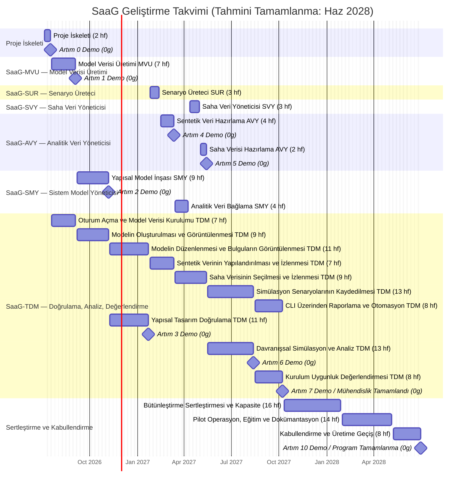

# Yazılım Geliştirme Planı (SDP): System as a Graph (SaaG)

**Tanım:** Bu Yazılım Geliştirme Planı (SDP), System as a Graph (SaaG) Yazılım Kırılım Öğesinin (CSCI) yazılım geliştirme çalışmasının nasıl yürütüleceğini planlar. SRS'te tanımlanan işi, işlevsel teslimatlardan oluşan bir İş Kırılım Yapısına (WBS) ayrıştırır ve bu teslimatları bir dizi artımlı yapıya (increment) sıralar. Her WBS teslimatı ve her artım, SRS'in CSU kapsamlı isterlerine izlenebilir durumdadır.

**Amaç:** İş Kırılım Yapısı (§1), Yazılım Komponenti (CSC) ve Yazılım Birimi (CSU) bazında organize edilmiş şekilde geliştirme çalışmasının tam kapsamını ortaya koyar. Artımlı Geliştirme Planı (§2), bu çalışmayı — bağımlılık açısından güvenli bir sırayla, tek seferde bir artım olacak şekilde — tamamen ardışık bir yapı dizisine sıralar. Her artım; bir veya daha fazla CSC'nin/CSU'nun yanı sıra, ilgili olduğu ölçüde TDM'nin (Operasyonlar ve Görselleştirme, SaaG'ın ön yüz kullanıcı arayüzü bileşeni) karşılık gelen dilimini de kapsayacak şekilde belirlenmiştir; böylece her artım uçtan uca, gösterilebilir bir yetenek üretir.

---

## 1. İş Kırılım Yapısı (WBS)

**Tablo 1. WBS Teslimat Dağılımı**

| No | Bileşen | Kısaltma | CSU Sayısı | Teslimat Sayısı |
|---|---|---|---|---|
| 1 | Model Veri Üreteci | SaaG-MVU | 1 | 1 |
| 2 | Senaryo Üreteci | SaaG-SUR | 1 | 1 |
| 3 | Saha Veri Yöneticisi | SaaG-SVY | 1 | 1 |
| 4 | Analitik Veri Yöneticisi | SaaG-AVY | 1 | 2 |
| 5 | Sistem Model Yöneticisi | SaaG-SMY | 1 | 2 |
| 6 | Tasarım Doğrulama Motoru | SaaG-TDM | 1 | 10 |
| **TOPLAM** | | | **6** | **17** |

Each leaf bullet below cites the exact SRS requirement ID range it realizes.

- **SaaG**
  - **SaaG-MVU**
    - **MVU: Model Veri Üreteci** (MVU.1–23)
  - **SaaG-SUR**
    - **SUR: Senaryo Üreteci** (SUR.1–7)
  - **SaaG-SVY**
    - **SVY: Saha Veri Yöneticisi** (SVY.1–5)
  - **SaaG-AVY**
    - **AVY: Analitik Veri Yöneticisi**
      - Sentetik Veri Hazırlama (AVY.1, 3, 4, 6)
      - Saha Verisi Hazırlama (AVY.2, 5)
  - **SaaG-SMY**
    - **SMY: Sistem Model Yöneticisi**
      - Yapısal Model İnşası (SMY.1–31)
      - Analitik Veri Bağlama (SMY.32–37)
  - **SaaG-TDM**
    - **TDM: Tasarım Doğrulama Motoru**
      - Operasyonlar ve Görselleştirme (TDM.1–27)
        - Oturum Açma ve Model Verisi Kurulumu (TDM.1–8)
        - Modelin Oluşturulması ve Görüntülenmesi (TDM.9, 19–20)
        - Modelin Düzenlenmesi ve Bulguların Görüntülenmesi (TDM.17–18, 21–24)
        - Sentetik Verinin Yapılandırılması ve İzlenmesi (TDM.11, 13–15)
        - Saha Verisinin Seçilmesi ve İzlenmesi (TDM.10, 12, 16)
        - Simülasyon Senaryolarının Kaydedilmesi (TDM.25)
        - CLI Üzerinden Raporlama ve Otomasyon (TDM.26–27)
      - Yapısal Tasarım Doğrulama (TDM.28–49)
      - Davranışsal Simülasyon ve Analiz (TDM.50–70)
      - Kurulum Uygunluk Değerlendirmesi (TDM.71–78)

---

## 2. Artımlı Geliştirme Planı

Artım 0, depo iskeletini, paylaşılan altyapıyı ve dokümantasyon iskeletini kurar. Bunu izleyen yedi işlevsel artım ile kurumsal kabullendirmeyi sağlayan üç kapatma artımı (Artım 8–10), bağımlılık açısından güvenli bir sırayla, tek seferde bir tanesi olacak şekilde inşa edilir. Kapatma artımları (8–10) yeni CSU teslim etmez; tam yığın sertleştirme, pilot operasyon ve kabullendirme çalışmasını kapsar. Her artım, bir veya daha fazla CSC'nin kalan CSU'larını ve bunlara karşılık gelen TDM (Operasyonlar ve Görselleştirme) dilimini teslim eder. Her artım ayrıca, teslimatı için gereken tasarım, geliştirme, test ve paketleme çalışmasını ve demo senaryosunu belirtir. SDD, UXD, ADR'ler ve STD, her artımın kendi CSU'larını kapsayacak şekilde her artım içinde güncellenir.

**Tamamlanma Tanımı (DoD — her artım için geçerlidir):** Bir artım şu durumda Tamamlanmış sayılır: (1) CSU/Teslimat tablosundaki her teslimat gerçekleştirilmiş ve ilgili SRS isterini/isterlerini karşılıyor; (2) Tasarım paragrafında atıfta bulunulan her ADR `Accepted` durumda ya da gerekçesi kayıt altına alınarak sonraki bir dalgaya yeniden planlanmış (bkz. [ADR Yol Haritası §6.1](../design/ADR-ROADMAP.md#61-deferred-design-points--adr)); (3) Test paragrafındaki her şey geçiyor; (4) Paketleme paragrafındaki her servis temiz şekilde derleniyor ve dağıtılıyor; (5) Demo senaryosu uçtan uca çalışıyor.

**Tablo 2. Artım Genel Görünümü**

| # | Artım | Teslim Edilen CSU'lar | Tamamlanan CSC'ler |
|---|---|---|---|
| 0 | Proje İskeleti | — | — |
| 1 | Model Verisi Üretimi | MVU | SaaG-MVU |
| 2 | Yapısal Model İnşası | SMY (yapısal dilim) | — |
| 3 | Yapısal Tasarım Doğrulama | TDM (doğrulama dilimi) | — |
| 4 | Sentetik Veri Hattı | SUR, AVY (sentetik dilim) | SaaG-SUR |
| 5 | Saha Verisi Hattı | SMY (bağlama dilimi), SVY, AVY (saha dilimi) | SaaG-SVY, SaaG-AVY, SaaG-SMY |
| 6 | Davranışsal Tasarım Analizi | TDM (analiz dilimi) | — |
| 7 | Kurulum Uygunluk Değerlendirmesi | TDM (değerlendirme ve operasyonlar tamamlandı) | SaaG-TDM |
| 8 | Bütünleştirme Sertleştirmesi ve Kapasite Doğrulama | — | — |
| 9 | Pilot Operasyon, Eğitim ve Dokümantasyon | — | — |
| 10 | Kabullendirme ve Üretime Geçiş | — | — (CSCI kabulü) |

### Artım 0: Proje İskeleti

| CSU | Teslimat |
|---|---|
| — | Depo iskeleti, CSC'ler arası paylaşılan altyapı ve dokümantasyon iskeleti |

**Tasarım:** Herhangi bir SRS isteri gerçekleştirilmez. Depo yapısını (§4), altıgen dizin kurallarını ve sonraki her artımın bağımlı olduğu paylaşılan CSC'ler arası ilkel bileşenleri kurar.

**Geliştirme:** Depo, §4'e göre iskeletlendirilir; yer tutucu servislerle temel Docker Compose yığını ayağa kaldırılır; paylaşılan paketler başlatılır ve `docs/` iskeleti doldurulur.

**Test:** Deponun temiz şekilde derlendiği ve lint kontrolünden geçtiği, yer tutucu servislerin sağlıklı başladığı ve CI'ın boş iskelet üzerinde başarıyla çalıştığı doğrulanır.

**Paketleme:** Temel Docker Compose yığını ve CI hattı ayağa kaldırılır — henüz uygulama servisi yoktur.

**Demo:** Temiz bir checkout, herhangi bir uygulama mantığı olmadan derlenir, lint kontrolünden geçer ve tam Docker Compose yığınını ayağa kaldırır; planlanan her doküman için `docs/` altında bir yer tutucu bulunur.

**Tamamlanma Tanımı:**
- [x] Depo §4'e göre iskeletlendirildi (CSC başına altıgen yerleşim, `web/`, `cli/`, `shared/`)
- [x] Temel Docker Compose yığını ve CI hattı ayağa kaldırıldı
- [x] `docs/` iskeleti planlanan her doküman için dolduruldu
- [x] İskelet temiz şekilde derleniyor, lint kontrolünden geçiyor ve dağıtılıyor
- [x] Demo uçtan uca çalıştırıldı

### Artım 1: Model Verisi Üretimi

| CSU | Teslimat |
|---|---|
| MVU *(tamamlandı)* | Model Verisi Üretimi (MVU.1–23) |
| TDM *(devam ediyor)* | Oturum Açma ve Model Verisi Kurulumu (TDM.1–8) |

**Tamamlar:** SaaG-MVU

**Tasarım:** MVU (SRS MVU.1–23) ve oturum açma/MVU kontrol ekranı (TDM.1–8) tam olarak tasarlanmıştır. Hâlâ açık olan konular: her dış bağlantı ve LDAP için kesin protokol, topoloji alım yöntemi ve zorunlu dosya listesi (ADR-0003, ADR-0008, ADR-0019).

**Geliştirme:** MVU arka ucu inşa edilir — dört dış kaynaktan veriye bağlanma, doğrulama ve derleme — ayrıca oturum açma/oturum yönetimi eklenir. Ön yüzde: oturum açma, proje/platform/sürüm seçimi, kaynak yapılandırması ve bir MVU üretim/durum ekranı.

**Test:** MVU'nin beş işi (kaynak bağlantıları, konfigürasyon alımı, sürüm takibi, dosya aktarımı, doğrulama/derleme) ile oturum açma/üretim ekranları doğrulanır; ardından uçtan uca bir MVU dosyası üretimi çalıştırılır.

**Paketleme:** MVU ve web servisleri; bir metadata veritabanı, dört kaynak ile LDAP için bir ayar şablonu ve demo amaçlı yerine geçen (stand-in) dış sistemlerle birlikte ayağa kaldırılır.

**Demo:** Bir operatör LDAP üzerinden kimlik doğrular, bir proje/platform/sistem sürümü seçer, dört dış veri kaynağının tamamını yapılandırır ve bunlara bağlanır, Model Verisi üretimini uçtan uca tetikler ve erişilebilirlik durumunu ve olası hataları gözlemler; sonuçta geçerli ve doğrulanmış bir Model Verisi dosyası üretilir.

**Tamamlanma Tanımı:**
- [ ] MVU (MVU.1–23) ve oturum açma/MVU kontrolü (TDM.1–8) inşa edildi ve çalışıyor
- [ ] ADR-0003 (INT-IF-01), ADR-0008, ADR-0019 kabul edildi veya yeniden planlandı
- [ ] MVU ve oturum açma/iş akışı testleri geçiyor
- [ ] MVU/web servisleri birlikte dağıtılıyor
- [ ] Demo uçtan uca çalıştırıldı

### Artım 2: Yapısal Model İnşası

| CSU | Teslimat |
|---|---|
| SMY *(devam ediyor)* | Yapısal Model İnşası (SMY.1–31) |
| TDM *(devam ediyor)* | Modelin Oluşturulması ve Görüntülenmesi (TDM.9, 19–20) |

**Tasarım:** Sistem Model Yöneticisi (SRS SMY.1–31) ve model inşa/gezinme ekranı (TDM.9, 19–20) tam olarak tasarlanmıştır. En büyük açık: modelin depolama teknolojisi ve şeması henüz kararlaştırılmamıştır (ADR-0010, ADR-0011); eşzamanlılık sınırları ve TDM okuma protokolü de açıktır (ADR-0006, ADR-0003).

**Geliştirme:** Model Yöneticisi arka ucu bir graf veritabanı üzerinde inşa edilir — Model Verisini bir grafa dönüştürme, eşzamanlı erişim altında güvende tutma, izole değerlendirme kopyalarını destekleme. Ön yüzde: model gezinme (arama/süzme/yakınlaştırma/kaydırma/öznitelikler).

**Test:** Modelin doğru şekilde inşa edildiği, tüm düğüm/ilişki türlerini temsil ettiği, eşzamanlı erişim altında tutarlı kaldığı ve gezinmenin çalıştığı doğrulanır — Artım 1'in iş akışı testini tamamlayacak şekilde uçtan uca.

**Paketleme:** `smm` dağıtımı ve wheelhouse'u eklenir, ADR-0011 denemesiyle seçilen graf sunucusu çevrimdışı kurulur ve sınıf başına işlem sınırları etkinleştirilir (ADR-0006).

**Demo:** Bir operatör, Artım 1'deki Model Verisi dosyasından Sistem Model Yöneticisini inşa eder; ortaya çıkan düğüm-ilişki yapısında gezinir ve görsel olarak dolaşır (arama/süzme, yakınlaştırma/kaydırma, öznitelik gösterimi); bu sırada model, eşzamanlı çoklu oturum erişimine açık şekilde sunulur.

**Tamamlanma Tanımı:**
- [ ] Sistem Model Yöneticisi (SMY.1–31) ve gezinme ekranı (TDM.9, 19–20) inşa edildi ve çalışıyor
- [ ] ADR-0003 (INT-IF-05), ADR-0010, ADR-0011, ADR-0006 kabul edildi veya yeniden planlandı
- [ ] Model Yöneticisi ve gezinme testleri, Artım 1'inkini tamamlayacak şekilde geçiyor
- [ ] Model Yöneticisi servisi ve graf veritabanı birlikte dağıtılıyor
- [ ] Demo uçtan uca çalıştırıldı

### Artım 3: Yapısal Tasarım Doğrulama

| CSU | Teslimat |
|---|---|
| TDM *(devam ediyor)* | Yapısal Tasarım Doğrulama (TDM.28–49) |
| TDM *(devam ediyor)* | Modelin Düzenlenmesi ve Bulguların Görüntülenmesi (TDM.17–18, 21–24) |

**Tasarım:** Yapısal Tasarım Doğrulama (SRS TDM.28–49) ve model düzenleyici/bulgu ekranı (TDM.17–18, 21–24) taslak olarak ortaya konmuştur; ancak fiili geçti/kaldı kurallarının çoğu henüz kararlaştırılmamıştır — bu planın en büyük tasarım açığı (ADR-0016 kataloğundaki kural aileleri).

**Geliştirme:** Tasarım Doğrulayıcının altı kontrol motoru, ADR-0016 kural aileleri onaylanana kadar geçici kurallara göre inşa edilir. Ön yüzde: çalışma modeli düzenleyicisi (güvenli sandbox) ve bulgu gösterimi/sınıflandırması.

**Test:** Altı motorun tamamının kendi hata koşullarını yakaladığı, düzenleyicideki değişikliklerin gerçek modele hiçbir zaman dokunmadığı ve bulguların doğru şekilde gösterildiği doğrulanır — bazı kontroller, kurallar kapanana kadar yalnızca mekaniği doğrulayabilir, eşik değerlerini değil. Uçtan uca: düzenle ve doğrula.

**Paketleme:** Tasarım Doğrulayıcı servisi ayağa kaldırılır — yeni bir depolama yoktur; modeli okur ve bulguları Artım 1'in veritabanına yazar.

**Demo:** Bir operatör, Sistem Model Yöneticisinden türetilen bir çalışma modeli sandbox'ını düzenler (düğüm/ilişki ekleme-çıkarma, öznitelik güncelleme) ve buna karşı tasarım doğrulama çalıştırır — QoS uygunluğu, yayımlayıcı/tüketici eşleşmesi, kaynak/yük dengeleme kontrolleri, döngüsel bağımlılık ve mimari kural ihlali tespiti — bulgular sunulur, sınıflandırılır ve süzülebilir hâlde gösterilir.

**Tamamlanma Tanımı:**
- [ ] Yapısal Tasarım Doğrulama (TDM.28–49) ve düzenleyici/bulgu ekranı (TDM.17–18, 21–24) inşa edildi ve çalışıyor
- [ ] DVE.18, 32–35, 39–45 ve 49 için ADR-0016 kural aileleri — bu plandaki en büyük açık madde — onaylandı veya yeniden planlandı
- [ ] Doğrulayıcı ve düzenleyici/bulgu testleri (kuralların izin verdiği ölçüde) geçiyor
- [ ] Tasarım Doğrulayıcı servisi dağıtılıyor ve çalışıyor
- [ ] Demo uçtan uca çalıştırıldı

### Artım 4: Sentetik Veri Hattı

| CSU | Teslimat |
|---|---|
| SUR *(tamamlandı)* | Senaryo Üreteci (SUR.1–7) |
| AVY *(devam ediyor)* | Sentetik Veri Hazırlama (AVY.1, 3, 4, 6) |
| TDM *(devam ediyor)* | Sentetik Verinin Yapılandırılması ve İzlenmesi (TDM.11, 13–15) |

**Tamamlar:** SaaG-SUR

**Tasarım:** Senaryo Üreteci (SRS SUR.1–7) ve sentetik veri kurulum ekranı (TDM.11, 13–15) tam olarak tasarlanmıştır. Hâlâ açık olan konular: sentetik verinin neyi simüle edeceği, Analitik Değerlendirme Verisi biçimi ve SUR→AVY devir teslimi (ADR-0013, ADR-0012, ADR-0003).

**Geliştirme:** Senaryo Üreteci inşa edilir (girdileri alma, izlenebilir sentetik veri üretme ve kayıt altına alma) ve Analitik Veri Yöneticisinin sentetik-alım yarısı geliştirilir. Ön yüzde: senaryo girdisi ve üretim/durum ekranları.

**Test:** Senaryo girdilerinin alındığı, sentetik verinin gerçek sistemin yapısıyla eşleştiği ve sentetik alım/derlemenin çalıştığı doğrulanır — sentetik veri üretimi ve analitik veri hazırlığı uçtan uca yürütülerek.

**Paketleme:** Senaryo Üreteci ve Analitik Veri Yöneticisi servisleri ayağa kaldırılır — yeni bir depolama yoktur; veri doğrudan aktarılır.

**Demo:** Bir operatör senaryo kapsamını, türünü, zaman aralığını, veri yoğunluğunu ve üretilecek veri türlerini tanımlar, sentetik veri üretimini tetikler ve üretilen verinin kayıt altına alındığını ve girdilerine izlenebilir olduğunu gözlemler. Sentetik veri ardından Analitik Değerlendirme Verisi olarak hazırlanır; üretim durumu izlenir ve olası biçim/eksik alan hataları raporlanır — böylece SaaG-SUR tamamlanmış olur.

**Tamamlanma Tanımı:**
- [ ] Senaryo Üreteci (SUR.1–7) ve kurulum ekranı (TDM.11, 13–15) inşa edildi ve çalışıyor
- [ ] ADR-0013, ADR-0012, ADR-0003 (INT-IF-02) kabul edildi veya yeniden planlandı
- [ ] Senaryo Üreteci ve sentetik veri yolu testleri geçiyor
- [ ] Her iki servis birlikte dağıtılıyor
- [ ] Demo uçtan uca çalıştırıldı

### Artım 5: Saha Verisi Hattı

| CSU | Teslimat |
|---|---|
| SMY *(tamamlandı)* | Analitik Veri Bağlama (SMY.32–37) |
| SVY *(tamamlandı)* | Saha Veri Yöneticisi (SVY.1–5) |
| AVY *(tamamlandı)* | Saha Verisi Hazırlama (AVY.2, 5) |
| TDM *(devam ediyor)* | Saha Verisinin Seçilmesi ve İzlenmesi (TDM.10, 12, 16) |

**Tamamlar:** SaaG-SVY, SaaG-AVY, SaaG-SMY

**Tasarım:** Analitik Veri Bağlama (SRS SMY.32–37) ve Saha Veri Yöneticisi (SVY.1–5), saha kaydı kaynak seçimi ve bağlama durumu ekranlarıyla (TDM.10, 12, 16) birlikte tam olarak tasarlanmıştır. Hâlâ açık olan konular: saha kaydı depolama kapasitesi, SVY dış arayüz protokolü, SVY→AVY ve AVY→SMY devir teslimleri ve bir önceki artımdan devreden Analitik Değerlendirme Verisi format kararı (ADR-0020, ADR-0014, ADR-0003, ADR-0012).

**Geliştirme:** Saha Veri Yöneticisi (yükleme/kataloglama/arama), Analitik Veri Yöneticisinin saha-alım yarısı ve Veri Bağlayıcısı (davranışsal veriyi modeli değiştirmeden bağlama) inşa edilir. Ön yüzde: saha kaydı kaynak seçimi, yükleme/kataloglama ve bağlama durumu ekranları.

**Test:** Kayıtların doğru şekilde yüklendiği/katalogladığı, saha alımı/derlemesinin (sentetik veriyle asla karışmadan) tamamlandığı ve bağlamanın veriyi modeli değiştirmeden modelle eşleştirdiği doğrulanır — Artım 2'deki modelin dokunulmamış kaldığının kontrolü dâhil, uçtan uca.

**Paketleme:** `fdm` dağıtımı ve ADR-0014 ile seçilen saha kaydı depolaması eklenir; ham yüklemelerin saklanması ADR-0014'ye göre yapılır.

**Demo:** Artım 4'teki sentetik kaynaklı Analitik Değerlendirme Verisi, düğümlerini/ilişkilerini değiştirmeden Sistem Model Yöneticisine bağlanır; bağlama durumu ve veri kökeni operatöre görünür şekilde sunulur. Operatör ardından Analitik Değerlendirme Verisi kaynağı olarak Sistem Saha Kayıtlarını seçer, Sistem Saha Kayıtlarını yükler (proje, platform, sürüm, kaynak veya yükleme zamanına göre listeleyerek/arayarak/seçerek) ve ortaya çıkan saha kaynaklı Analitik Değerlendirme Verisi aynı kaynaktan bağımsız bağlayıcı üzerinden modele bağlanır — böylece SaaG-SVY, SaaG-AVY (hem sentetik hem saha yolları artık uçtan uca çalışır durumdadır) ve SaaG-SMY tamamlanmış olur.

**Tamamlanma Tanımı:**
- [ ] Analitik Veri Bağlama (SMY.32–37), SVY (SVY.1–5) ve saha seçimi/bağlama durumu ekranları (TDM.10, 12, 16) inşa edildi ve çalışıyor
- [ ] ADR-0020, ADR-0014, ADR-0003 (INT-IF-03, INT-IF-04), ADR-0012 kabul edildi veya yeniden planlandı
- [ ] Saha kaydı, bağlayıcı ve saha veri yolu testleri, Artım 4'ünkini tamamlayacak şekilde geçiyor
- [ ] Yeni servisler ve telemetri veritabanı birlikte dağıtılıyor
- [ ] Demo uçtan uca çalıştırıldı

### Artım 6: Davranışsal Tasarım Analizi

| CSU | Teslimat |
|---|---|
| TDM *(devam ediyor)* | Davranışsal Simülasyon ve Analiz (TDM.50–70) |
| TDM *(devam ediyor)* | Simülasyon Senaryolarının Kaydedilmesi (TDM.25) |

**Tasarım:** Davranışsal Simülasyon ve Analiz (SRS TDM.50–70) ve simülasyon kayıt ekranı (TDM.25) tam olarak tasarlanmıştır. Hiçbir madde bunu doğrudan adlandırmasa da, iki devreden karara bağımlıdır: TDM okuma protokolü ve modelin depolama/şeması (ADR-0003, ADR-0010, ADR-0011).

**Geliştirme:** Tasarım Analizcisinin üç motoru inşa edilir (sentetik veri simülasyonu, saha verisi analizi, sapma tespiti). Ön yüzde: simülasyon senaryosu kaydı ve yüksek hacimli saha izi grafikleri.

**Test:** Üç motorun tamamının kendi veri kaynakları ve arıza senaryoları için doğru sonuçlar ürettiği ve simülasyon meta verisinin kayıt altına alındığı doğrulanır — uçtan uca bir analiz-ve-kayıt çalıştırması ile.

**Paketleme:** Tasarım Analizcisi servisi ayağa kaldırılır — yeni bir depolama yoktur; Artım 2 ve 5'in veritabanlarını okur.

**Demo:** Bir operatör; sentetik kaynaklı Analitik Değerlendirme Verisiyle (mesaj/trafik akışı, düğüm/ilişki devre dışı kalma etkileri, yük yoğunluğu ve arıza yayılımı analizi, kaynak kullanım özetleri) ve saha kaydı kaynaklı Analitik Değerlendirme Verisiyle (çalışma/sağlık durumu, kaynak kullanımı, hata/zaman aşımı bilgisi, iletişim gecikmesi/kaybı, model-çalışma zamanı sapma tespiti) statik analiz çalıştırır; simülasyon senaryosu meta verisi (TDM.25) sonuçlarla ilişkilendirilerek kaydedilir.

**Tamamlanma Tanımı:**
- [ ] Davranışsal Simülasyon ve Analiz (TDM.50–70) ve kayıt ekranı (TDM.25) inşa edildi ve çalışıyor
- [ ] Devreden ADR-0003 (INT-IF-05), ADR-0010, ADR-0011 kabul edildi veya yeniden planlandı
- [ ] Tasarım Analizcisi testleri geçiyor
- [ ] Tasarım Analizcisi servisi dağıtılıyor ve çalışıyor
- [ ] Demo uçtan uca çalıştırıldı

### Artım 7: Kurulum Uygunluk Değerlendirmesi

| CSU | Teslimat |
|---|---|
| TDM *(tamamlandı)* | Kurulum Uygunluk Değerlendirmesi (TDM.71–78) |
| TDM *(tamamlandı)* | CLI Üzerinden Raporlama ve Otomasyon (TDM.26–27) |

**Tamamlar:** SaaG-TDM

**Tasarım:** Kurulum Uygunluk Değerlendirmesi (SRS TDM.71–78) ve raporlama/CLI ekranı (TDM.26–27) tam olarak tasarlanmıştır. Hâlâ açık olan konular: puanlama yöntemi, rapor dosya biçimi ve CLI protokolü/sonuç biçimi (ADR-0018, ADR-0005) — bu son artım teslim edilmeden önce hepsinin kapanması gerekir.

**Geliştirme:** Tasarım Değerlendiricisi inşa edilir (adayları puanlama, kritik bulgularda zorunlu olarak "uygun değil" belirleme, değerlendirmeleri eşzamanlı yürütme) ve CLI geliştirilir. PDF/JSON rapor üretimi ve rapor ekranı eklenir.

**Test:** Puanlama, zorunlu "uygun değil" kuralı, eşzamanlı değerlendirme ve CLI isteği/durumu doğrulanır — karar ve rapora kadar uçtan uca bir CLI değerlendirmesiyle, her bileşeni kapatarak.

**Paketleme:** `dve`'nin değerlendirme kısmı, `dsm` CLI alt komutları (ADR-0005) ve rapor üretimi (ADR-0018) eklenir; böylece tüm CSC'ler hedef sunucuya birlikte kurulur.

**Demo:** Bir otomasyon istemcisi (ör. Jenkins), bir veya birden fazla aday yazılım birimi için CLI üzerinden kurulum uygunluk değerlendirmesi başlatır; sistem her birimi kendi değerlendirme başlıkları ve kontrol kurallarına göre puanlar, her birim için bağımsız ve eşzamanlı şekilde bloke edici/bloke edici olmayan bir karar ve makine tarafından işlenebilir sonuçlar döndürür; tüm doğrulama, analiz ve değerlendirme sonuçlarını kapsayan özet/ayrıntılı bir rapor üretilir — böylece SaaG-TDM ve altı CSC'nin tamamı tamamlanmış olur.

**Tamamlanma Tanımı:**
- [ ] Kurulum Uygunluk Değerlendirmesi (TDM.71–78) ve raporlama/CLI ekranı (TDM.26–27) inşa edildi ve çalışıyor
- [ ] ADR-0018, ADR-0005 kabul edildi veya yeniden planlandı
- [ ] Değerlendirici ve CLI testleri, Artım 3/6/7'den gelen raporlama testini tamamlayacak şekilde geçiyor
- [ ] Tam servis yığını birlikte dağıtılıyor
- [ ] Demo uçtan uca çalıştırıldı — altı bileşenin tamamı tamamlandı

### Artım 8: Bütünleştirme Sertleştirmesi ve Kapasite Doğrulama

| CSU | Teslimat |
|---|---|
| — | Tam yığın bütünleştirme sertleştirmesi, performans/kapasite ve güvenlik doğrulama |

**Tasarım:** Herhangi yeni SRS isteri gerçekleştirilmez; STD'deki tüm test tanımları tam yığın üzerinde uygulanır. Sertleştirme hedefleri, önceki artımlardaki ADR'lerle tanımlanır: eşzamanlı işlemin kullanıcı/işlem sayısı (ADR-0006) ve saha kaydı depolama kapasitesi (ADR-0020).

**Geliştirme:** Uçtan uca (acceptance) regresyon paketi tamamlanır; arka plan iş kuyruğu, yeniden deneme ve kurtarma davranışları sertleştirilir; LDAP, oturum, API token'ı ve yetki modeli güvenlik denetimi yürütülür (ADR-0019); üretim sunucusu yapılandırması ve servis birimi, çalışma zamanı izlemeyle (log/metrik, ADR-0020, ADR-0004) eklenir.

**Test:** Tüm STD test paketleri tam yığın üzerinde geçer; eşzamanlı yükleme/hacim testleri ADR-0020 ve ADR-0006 hedeflerini karşılar; 72 saatlik soak (kalıcılık) koşusu planlanan sapma olmadan tamamlanır.

**Paketleme:** Üretim adayı: tüm CSC'ler yayın arşivinden üretime benzer bir sunucuya çevrimdışı kurulur (ADR-0004).

**Demo:** Yedi artımın tüm yetenekleri tek yığında, çok oturumlu eşzamanlı yük altında 72 saat kesintisiz çalışır; doğrulama, analiz ve değerlendirme sonuçları üretilmeye devam eder.

**Tamamlanma Tanımı:**
- [ ] Tüm STD test paketleri tam yığın üzerinde geçiyor
- [ ] Performans/hacim hedefleri (ADR-0006, ADR-0020) karşılanıyor
- [ ] Güvenlik denetimi (LDAP, oturumlar, API token'ları, yetkilendirme) kapatıldı
- [ ] 72 saatlik soak kesintisiz tamamlandı
- [ ] Kalan hata listesi Artım 9'a devir için onaylandı

### Artım 9: Pilot Operasyon, Eğitim ve Dokümantasyon

| CSU | Teslimat |
|---|---|
| — | Kurumsal pilot operasyonu, operatör eğitimi ve dokümantasyonunun tamamlanması |

**Tasarım:** Yeni ister tasarımı yapılmaz. Pilot senaryoları, artım demo senaryolarının kurumsal verilerle yeniden koşumu olarak tanımlanır; kullanıcı el kitabı ve işletim runbook'ları tamamlanır.

**Geliştirme:** Pilot geri bildirimlerinden doğan kullanılabilirlik (usability) işleri yakıt olarak kullanılarak kapatılır; rapor çıktısı (ADR-0018 biçimi) gerçek verilerle doğrulanır; eğitim materyalleri üretilir.

**Test:** Pilot operatör ekip desteği olmaksızın tam iş akışlarını koşar; geri bildirim kaynaklı her değişiklik tam regresyonu tetikler ve geçirir.

**Paketleme:** Pilot ortamı ayrı bir çevrimdışı sunucu kurulumu olarak kurulur; üretim adayı yayın pilot ortamında doğrulanır.

**Demo:** Pilot operatörler uçtan uca akışları — model verisi üretiminden CLI üzerinden kurulum uygunluk değerlendirmesine — ekip desteği olmaksızın gerçekleştirir.

**Tamamlanma Tanımı:**
- [ ] Pilot senaryoları rehbersiz tamamlandı
- [ ] Geri bildirim (usability) listesi kapandı veya gerekçeli ertelendi
- [ ] Kullanıcı el kitabı ve runbook'lar yayınlandı
- [ ] Üretim aday yayını pilot ortamında doğrulandı

### Artım 10: Kabullendirme ve Üretime Geçiş

| CSU | Teslimat |
|---|---|
| — | CSCI kabullendirmesi, ertelenmiş tasarım noktalarının kapanması ve üretime geçiş |

**Tasarım:** Yeni ister tasarımı yapılmaz. [ADR Yol Haritası §6.1](../design/ADR-ROADMAP.md#61-deferred-design-points--adr)'deki tüm ertelenmiş tasarım noktaları `Accepted` bir ADR ile çözülür veya kabulün ötesine açıkça (gerekçeli) ertelenir; SRS, SDD, UXD ve STD belge seti dondurularak temel çizim (baseline) oluşturulur.

**Geliştirme:** Son hata arındırma yürütülür; pilot verisinin üretime aktarımı (veri geçişi) ve geri dönüş planı hazırlanır; temel destek devralma paketi tamamlanır.

**Test:** Altı CSC'nin tamamını kapsayan kabullendirme koşusu — her artım demosunun genel tekrarı — ve tam Tamamlanma Tanımı gözden geçirmesi gerçekleştirilir.

**Paketleme:** Üretim dağıtımı uygulanır; geri dönüş planı tatbikatla doğrulanır.

**Demo:** Kabul koşusu: MVU → SMY → TDM doğrulama → SUR/AVY → SVY → analiz → değerlendirme/CLI uçtan uca çalışır; altı CSC'nin tamamı kabul edilir ve CSCI kabullendirilir.

**Tamamlanma Tanımı:**
- [ ] Altı CSC'nin tamamı kabul edildi; CSCI kabullendirildi
- [ ] ADR Yol Haritası §6.1'deki tüm ertelenmiş tasarım noktaları çözüldü veya açıkça ertelendi
- [ ] Belge seti donduruldu (baseline freeze)
- [ ] Üretime geçiş ve geri dönüş planı uygulandı
- [ ] Kapanış raporu yayınlandı

---

## 3. Geliştirme Takvimi

**Tahmini tamamlanma: 2028-06-30.** §2'ye göre, Artım 0 ile birlikte yedi işlevsel artım ve bunları izleyen üç kapatma artımı (Artım 8–10), **2026-07-06** tarihinde başlayarak, bağımlılık açısından güvenli bir sırayla tamamen ardışık şekilde inşa edilir ve **2028-06-30**'da tamamlanır — toplam **104 iş haftası**. Kapsam ve ağırlıklarına göre boyutlandırılan işlevsel artımlar **7–13 hafta** süren, arka uç ve İşlem Paneli arayüz çalışmasının eşzamanlı yürüdüğü, gösterilebilir, uçtan uca dilimlerdir; kapatma artımları **8–16 hafta** sürer. Bir hafta = 5 iş günü (hafta sonları hariç).

**Tablo 3. Artım Takvimi Özeti**

| Artım | Başlangıç | Bitiş | Süre |
|---|---|---|---|
| 0 — Proje İskeleti | 2026-07-06 | 2026-07-17 | 2 hf |
| 1 — Model Verisi Üretimi | 2026-07-20 | 2026-09-04 | 7 hf |
| 2 — Yapısal Model İnşası | 2026-09-07 | 2026-11-06 | 9 hf |
| 3 — Yapısal Tasarım Doğrulama | 2026-11-09 | 2027-01-22 | 11 hf |
| 4 — Sentetik Veri Hattı | 2027-01-25 | 2027-03-12 | 7 hf |
| 5 — Saha Verisi Hattı | 2027-03-15 | 2027-05-14 | 9 hf |
| 6 — Davranışsal Tasarım Analizi | 2027-05-17 | 2027-08-13 | 13 hf |
| 7 — Kurulum Uygunluk Değerlendirmesi | 2027-08-16 | 2027-10-08 | 8 hf |
| 8 — Bütünleştirme Sertleştirmesi ve Kapasite Doğrulama | 2027-10-11 | 2028-01-28 | 16 hf |
| 9 — Pilot Operasyon, Eğitim ve Dokümantasyon | 2028-01-31 | 2028-05-05 | 14 hf |
| 10 — Kabullendirme ve Üretime Geçiş | 2028-05-08 | 2028-06-30 | 8 hf |

**Şekil 1. SaaG Geliştirme Takvimi**



---

## 4. Proje Yapısı

Depo yerleşimi [ADR-0004](../design/adr/0004-deployment-and-repository-layout.md)'te, paket içi yerleşim [ADR-0003](../design/adr/0003-ports-adapters-and-csc-integration.md)'te kararlaştırılmıştır. Her üst düzey CSC dizini, kanonik CSC kimliğiyle ([ADR-0002](../design/adr/0002-canonical-component-identifiers.md)) adlandırılmış tek bir Python dağıtımıdır ve kendi çevrimdışı wheelhouse'una sahiptir ([ADR-0004](../design/adr/0004-deployment-and-repository-layout.md)). Operasyon Paneli ön yüzü `dve` içinde yer alır ([ADR-0015](../design/adr/0015-operations-panel.md)). `mdg/`, `dve/` ve `dev/` mevcuttur; diğer dizinler ilgili artım başladığında oluşturulur.

```text
system-as-a-graph/
├── README.md
├── docs/
│   ├── requirements/      SRS.md, SRS.tr.md
│   ├── planning/          SDP.md, SDP.tr.md, BACKLOG.md
│   ├── design/            SDD.md, UXD.md, ADR-ROADMAP.md, adr/
│   └── test/              STD.md
│
├── common/                # ortak çekirdek: hata kayıtları, köken (provenance) tipleri (ADR-0009, ADR-0007)
├── mdg/                   # CSC-1: Model Veri Üreteci (gerçekleştirildi)
├── scg/                   # CSC-2: Senaryo Üreteci
├── fdm/                   # CSC-3: Saha Veri Yöneticisi
├── adm/                   # CSC-4: Analitik Veri Yöneticisi
├── smm/                   # CSC-5: Sistem Model Yöneticisi
├── dve/                   # CSC-6: Tasarım Doğrulama Motoru; API, görev yürütücü ve Operasyon Paneli (gerçekleştirildi)
│   ├── setup.py
│   ├── wheelhouse/        # çevrimdışı kurulum için sabitlenmiş CPython 3.9 wheel'leri
│   ├── src/dve/
│   │   ├── domain/  ports/  services/  adapters/
│   │   ├── rules/         # doğrulama kural kataloğu (ADR-0016)
│   │   ├── templates/  static/   # Operasyon Paneli (ADR-0015)
│   │   └── __init__.py    # façade ve çalışma zamanı bağlantıları
│   └── tests/             # adapters/ domain/ services/ fakes/ …
│
├── dev/                   # yalnızca geliştirme için sahte veri kaynakları (Docker Compose: MySQL, Gitea)
└── deploy/                # kurulum betikleri, sunucu yapılandırma şablonları, servis birimi (ADR-0004)
```

Her CSC dağıtımı yukarıdaki `dve/` ile aynı biçimdedir: `setup.py`, `wheelhouse/`, `src/<csc>/` ve `tests/`.

**Tablo 4. Proje Dizini Eşlemesi**

| Dizin | Kapsam |
|---|---|
| `mdg/` | SaaG-MDG CSC; `MDG`'yi içerir |
| `scg/` | SaaG-SCG CSC; `SCG`'yi içerir |
| `fdm/` | SaaG-FDM CSC; `FDM`'yi içerir |
| `adm/` | SaaG-ADM CSC; `ADM`'yi içerir |
| `smm/` | SaaG-SMM CSC; `SMM`'yi içerir |
| `dve/` | SaaG-DVE CSC; API, görev yürütücü, Operasyon Paneli ve `dsm` komutu dâhil `DVE`'yi içerir |
| `common/` | CSC'ler arası hata kayıtları ve köken tipleri; iş mantığı içermez |
| `dev/` | Yalnızca geliştirme için sahte dış sistemler |
| `deploy/` | Çevrimdışı kurulum ve sunucu yapılandırması |

**Tablo 5. Standart Altıgen Dizin Anlamları** (ADR-0003)

| Dizin | Anlam |
|---|---|
| `domain/` | Değişmez değer nesneleri ve varlıklar, alan hataları; yalnızca standart kütüphane |
| `ports/` | `I<Ad>` soyut arayüzleri ve bunların istisnaları |
| `services/` | Kullanım senaryoları; her senaryo için bir sınıf, yalnızca portlara bağımlı |
| `adapters/<alan>/` | `<Teknoloji><Port>` gerçekleştirimleri; ör. MySQL, Git, SQLite, graf sunucusu veya LDAP adaptörleri |
| `__init__.py` | CSC'nin genel façade'ı: adaptörleri servislere bağlayan fabrika fonksiyonları |
| `tests/` | CSC'nin test paketi; sahte adaptörler için `tests/fakes/` (ADR-0021) |

---

## 5. Teknoloji Yığını

Aşağıdaki teknoloji seçimleri, WBS teslimatlarını (§1) gerçekleştirir ve bu belge genelinde kullanılan aynı SRS ister ID'lerine izlenebilir durumdadır.

**Tablo 6. Teknoloji Yığını Özeti**

Her satır, son sütununda adı geçen ADR ile kararlaştırılır; ikisi farklıysa bağlayıcı olan ADR'dir ([ADR-0001](../design/adr/0001-record-architecture-decisions.md) adım 7). "Gerçekleştirildi", `1157784` commit'inde mevcut olanı belirtir.

| Alan | Teknoloji | Kullanım | ADR |
|---|---|---|---|
| **Çalışma Zamanı ve Dağıtım** | | | |
| Çalışma zamanı | CPython 3.9, x86_64, glibc ≥ 2.17 (CentOS 7+) — gerçekleştirildi | Tüm CSC'ler | [0004](../design/adr/0004-deployment-and-repository-layout.md) |
| Dağıtım | Paket başına wheelhouse'lardan sabitlenmiş wheel'lerin sanal ortama çevrimdışı kurulumu, sunucunun servis yöneticisiyle çalıştırma; hedefte konteyner çalışma ortamı yok — gerçekleştirildi | Kurum içi hedef sunucu | [0004](../design/adr/0004-deployment-and-repository-layout.md) |
| Yapılandırma | Paketle gelen `.ini` varsayılanları ve `/etc/dsm` altındaki sunucu `.ini` dosyalarıyla üzerine yazma — paket kısmı gerçekleştirildi | Tüm CSC'ler | [0004](../design/adr/0004-deployment-and-repository-layout.md) |
| Geliştirme yığını | MySQL 9.7.2 ve Gitea 1.27.3 sahte sistemleriyle Docker Compose (OpenLDAP eklenecek), yalnızca geliştirici makinelerinde — gerçekleştirildi | Adaptör geliştirme ve sözleşme testleri | [0004](../design/adr/0004-deployment-and-repository-layout.md), [0021](../design/adr/0021-test-strategy-and-quality-gates.md) |
| **Arka Uç ve API** | | | |
| Web çatısı | Flask 2.3 + Flask-WTF (CSRF) — gerçekleştirildi; üretim WSGI sunucusu olarak waitress | Operasyon Paneli API'si ve otomasyon API'si (DVE.1–2, 27) | [0005](../design/adr/0005-api-and-automation-contract.md) |
| API biçimi | REST/JSON; otomasyon istemcileri için `/api/v1/` ve elle tutulan bir OpenAPI dosyası | DVE.27, 77–78 | [0005](../design/adr/0005-api-and-automation-contract.md) |
| CLI | `dsm` konsol betiği (gerçekleştirildi), click alt komutlarıyla genişletilir | Otomasyon istemcisi arayüzü (DVE.27) | ADR-0005 |
| Arka plan yürütme | `ITaskRunner` arkasında işlem başına bir alt süreç (spawn), sınıf başına sınırlar — gerçekleştirildi (tek sınır) | DVE.6, 9, 14–15, 27, 78; SMM.30 | [0006](../design/adr/0006-operation-execution-and-concurrency.md) |
| Durum iletimi | Log imleçli REST yoklaması (polling) — gerçekleştirildi | Arayüz ve CLI (DVE.6, 15, 27) | [0006](../design/adr/0006-operation-execution-and-concurrency.md) |
| **Veri Depolama** | | | |
| Model Verisi | Dosya sisteminde çalıştırma başına sürümlü JSON dosyası — gerçekleştirildi (sürümsüz) | MDG.23; SMM.2–3 | [0009](../design/adr/0009-model-data-file-and-error-records.md) |
| Kayıt deposu | `sqlite3` ile SQLite (sistem kütüphanesi 3.24'ten eskiyse paketlenmiş `pysqlite3`) | Envanter, işlemler, bulgular, raporlar, kayıt defterleri, oturumlar (MDG.8, 14–15; DVE.21–26) | [0007](../design/adr/0007-records-store.md) |
| Graf depolama | `IGraphStore` arkasında yerel graf sunucusu: çevrimdışı kurulum denemesiyle (spike) seçilecek Neo4j Community 5 veya FalkorDB | Sistem Modeli örnekleri (SMM.1, 4, 27–31) | [0011](../design/adr/0011-graph-store-and-model-instances.md) |
| Graf şeması ve türetme | Çerçeveyle uyumlu şema ve `DEPENDS_ON` kuralları, `smm` içinde saf Python'a aktarılmış | SMM.4–24; DVE.53–58 | [0010](../design/adr/0010-system-model-graph-schema.md) |
| Saha kaydı ve telemetri depolama | Açık | FDM.1, DVE.59–65 | ADR-0014 |
| **Ön Yüz ve Arayüz** | | | |
| Operasyon Paneli | Flask'ın sunduğu sayfa, yalın JavaScript, derleme adımı yok, gömülü kütüphaneler, kendi sunulan yazı tipleri — gerçekleştirildi | DVE.1, 4–27 | [0015](../design/adr/0015-operations-panel.md) |
| Graf görselleştirme | AntV G6 5.1.1 (gömülü) — gerçekleştirildi; sunucu tarafı görünüm kapsamlama eklenecek | DVE.17, 19–20 | [0015](../design/adr/0015-operations-panel.md) |
| Grafikler | Gerektiğinde gömülü ECharts | DVE.58, 70 | [0015](../design/adr/0015-operations-panel.md) |
| Tarayıcı tabanı | Firefox 90+, WCAG 2.1 AA — gerçekleştirildi | QA-12 | [0015](../design/adr/0015-operations-panel.md) |
| **Güvenlik ve Kimlik Doğrulama** | | | |
| Kimlik doğrulama | `ldap3` ile LDAP ara-ve-bağlan (search-and-bind) (sahte adaptör gerçekleştirildi) | DVE.3 | [0019](../design/adr/0019-security.md) |
| Oturumlar ve token'lar | CSRF korumalı Flask imzalı çerez — gerçekleştirildi; sunucu tarafı epoch iptali ve özetlenmiş (hash) API token'ları eklenecek | DVE.3, 27 | [0019](../design/adr/0019-security.md) |
| Gizli bilgiler | Paket dışında, 0600 izinli sunucu dosyaları; kaydedilen veri kaynağı kimlik bilgileri SQLite'ta AES-256-GCM ile şifreli | MDG.8; QA-01 | [0019](../design/adr/0019-security.md) |
| **Dış Entegrasyonlar** | | | |
| Entegrasyon mimarisi | Portlar ve Adaptörler, sahteler enjeksiyonla seçilir — gerçekleştirildi | Tüm dış sistemler | [0003](../design/adr/0003-ports-adapters-and-csc-integration.md) |
| Konfigürasyon yönetim veri tabanı | PyMySQL, salt okunur parametreli SQL — gerçekleştirildi | MDG.2, 8, 10–13 | [0008](../design/adr/0008-model-data-acquisition.md) |
| Kaynak kod deposu | HTTPS üzerinden `git` komut satırı, etikete göre sığ klon, ortam değişkenli kimlik bilgisi yardımcısı — gerçekleştirildi | MDG.3, 17–20 | [0008](../design/adr/0008-model-data-acquisition.md) |
| Ağ topolojisi | Git üzerinden ansible deposu, YAML envanter ve değişken dosyaları (ayrıştırıcı sahte) | MDG.5–7 | [0008](../design/adr/0008-model-data-acquisition.md) |
| Paket deposu | Standart kütüphane ile HTTPS REST | MDG.4 | [0008](../design/adr/0008-model-data-acquisition.md) |
| **Raporlama ve Veri İşleme** | | | |
| Rapor üretimi | Açık: önce HTML ve JSON; PDF yalnızca çevrimdışı kurulabilen bir oluşturucuyla | DVE.26, 78 | ADR-0018 |
| Ham yükleme saklama | Açık | FDM.2 | ADR-0014 |
| **Test** | | | |
| Test | Paket başına sahtelerle pytest — gerçekleştirildi; sözleşme, kural, eşlik (parity), Playwright (Firefox 90 ESR) ve çevrimdışı kurulum kapıları | QA-11 | [0021](../design/adr/0021-test-strategy-and-quality-gates.md) |
